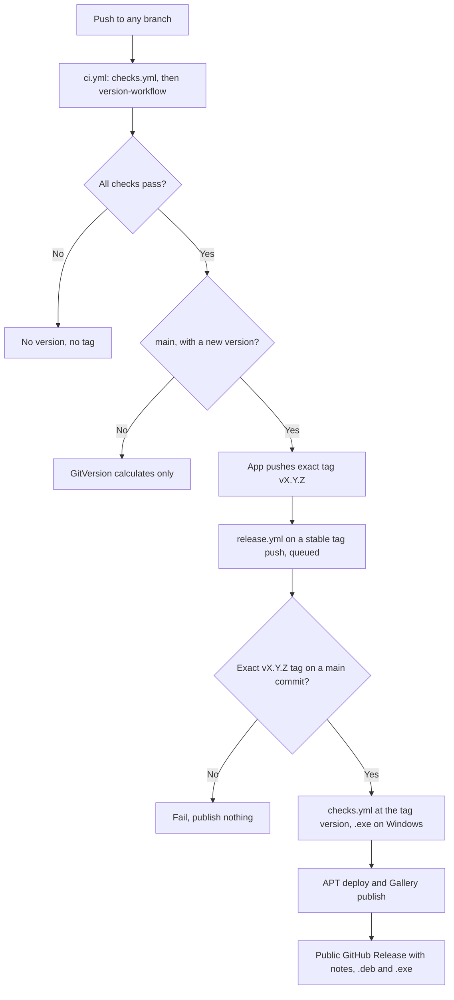

# Plan: PowerShell CI and release workflow

PowerShell has no shared CI component, and its two publishing actions predate the delivery conventions.
This adds `vhco-pro/pwsh-ci-action` and `vhco-pro/setup-pwsh-action`, makes
`publish-pwsh-module-action` and `package-pwsh-script-action` release-only, lets `vhco-pro/gh-release-action`
attach files to a Release, and moves `michielvha/PDS`, the PowerShell actions' only consumer, onto
the CI, version and tag-triggered release shape that the Go repositories already use.

## Context

### Owner summary

**Problem.** PDS publishes its PowerShell module from a job that also runs on pull requests. Each PR run
pushed a junk prerelease tag and reached the publish step, skipped only because an earlier step failed.
PDS runs no PowerShell lint or tests, and three workflows compute its version independently.

**Approach.** A new `pwsh-ci-action` checks formatting, lint, module loading and Pester tests on every
branch push. A new `setup-pwsh-action` installs the one pinned PowerShell all PowerShell actions use. Both
start in the `vhco-pro` organization, where the owner wants new shared components. `version-workflow`
tags `main` after the checks pass. Only an exact stable `v` tag on a `main` commit publishes, through its
push or a dispatch on that tag. The release deploys the APT repository, rebuilt from every Release, and
publishes the module to the Gallery, and only when both succeed creates the public GitHub Release with
git-cliff notes, the tested `.deb` and the `.exe`. The shared `gh-release-action` creates it and gains
one optional input for this, `files`, in `v0.2.0`; without it nothing changes. No partial Release is ever
public: a failed release is finished by rerunning its failed jobs, a cancelled Release job can leave a
hidden draft to delete, and a defect in the tag's own workflow is fixed forward with a new version. The two existing PowerShell
actions become release-only and gain the repository hygiene the conventions require. The owner set this
CI, version and tag shape as the target for every language.

**Defaults.** PDS publishes stable versions from `main` only; the publish action refuses prerelease tags
until a repository wants previews ([michielvha/publish-pwsh-module-action#7](https://github.com/michielvha/publish-pwsh-module-action/issues/7)).
The analyzer settings exclude one rule, `PSAvoidUsingWriteHost`; every other finding is fixed, and an
in-source suppression needs a written reason why fixing is wrong. Every public PDS function gets a
Pester test. The actions run on the pinned, checksum-verified PowerShell `setup-pwsh-action` installs,
not the runner's. Release notes are a real changelog, not the APT template's fixed text.

**Permissions and owner steps.** PDS needs the `michielvha-repo-write` App's variable and key so its tag
push starts the release. The `github-pages` environment must allow `v*.*.*` tags. The Gallery key and the
GPG signing key move to `release.yml`, where only the Gallery and APT jobs receive them; no workflow
uses `secrets: inherit`. PDS and the five action repositories this feature touches adopt the GitHub
Actions convention, checked by AC-21. The managed Renovate App must reach the new `vhco-pro` repositories, where no
Renovate configuration exists yet.

**Migration and rollback.** PDS first pins both current actions by SHA, so their release-only versions
cannot break it. Tags gain the `v` prefix from a baseline tag on the latest release tag. Until the new
path pushes its first `v` tag, rolling back means reverting the whole migration change; the `v` baseline
tag stays. From that push on, a problem is fixed forward with a new version.

**Proof.** Planned, not yet run: action behaviour tests over fixtures, a full PDS tag release and a rerun
of it, and a real run on a disposable Windows 11 VM for every function whose code changes beyond
whitespace, byte-order marks and identifier casing, except those that need a domain, a remote server, a
cloud account or a cluster, or never terminate, which keep to mocked tests. Observed
so far: the analyzer and formatter baselines below, and a real-VM run that found the `Enable-SshServer`
firewall defect a stubbed test had passed.

### A pull request runs the release

`michielvha/PDS` publishes its PowerShell module from one job that triggers on `pull_request` as well as
on pushes to `main` (`PDS/.github/workflows/publish-pwsh-module.yaml:15`). The job has no `if:`, and it
calls the action at a moving branch, `michielvha/publish-pwsh-module-action@main`
(`publish-pwsh-module.yaml:27`). The action, read at `753afb5` (its `main`), does every step for every
event:

- **It tags the repository.** `MKTHEPLUGG/gitversion-tag-action@v5` (`action.yml:42`) runs `git tag`
  and `git push origin <semVer>` (`gitversion-tag-action@v5:action.yml:46-47`). A PR run pushes a
  `PullRequest` prerelease tag.
- **It builds the manifest from that version.** `New-ModuleManifest -ModuleVersion <semVer>`
  (`action.yml:63`) accepts only a `System.Version`, so a PR's `0.24.0-PullRequest53.2` fails.
- **It publishes.** `Publish-Module -NuGetApiKey` (`action.yml:93`) runs next. On a PR it is skipped
  only because the manifest step failed first.

```text
$ gh run list -R michielvha/PDS --workflow publish-pwsh-module.yaml --limit 6
2026-11-17 push         main                            success
2026-11-17 pull_request fix/ssh-server-firewall-profile failure
2026-11-17 push         main                            success
2026-11-17 pull_request feat/ssh-server-optional-key    failure
2026-11-12 push         main                            success
2026-11-12 pull_request feat/pwsh-enable-ssh-server     failure
```

Each PR failure ends with `Cannot convert value "<version>-PullRequest<n>.<m>" to type "System.Version"`
([run 44117944699](https://github.com/michielvha/PDS/actions/runs/44117944699)) and leaves that tag
behind. None of the 20 such tags had a GitHub Release; with the owner's approval they were deleted on
2026-11-17 after their commit SHAs were recorded, and the one PR 54 added was deleted the same day.

`package-pwsh-script-action@v1` behaves the same for the `.exe` build: PDS calls it on `pull_request`
(`package-ps1-script.yaml:18`, `:32`) and it tags through `gitversion-tag-action@v5`
(`package-pwsh-script-action@v1:action.yaml:38`). It only uploads a workflow artifact, so nothing is
deployed.

### Three jobs decide one version

PDS ships three artifacts from one repository: the `.deb` package with its APT repository, the
PowerShell Gallery module and the packaged `.exe`. Each workflow runs GitVersion on its own. The APT
workflow computes the version with `dry-run: 'true'` (`build-apt-package.yml:44-47`) and creates the tag
through `gh release create` (`:173`). The module action pushes the same tag itself. One push to `main`
that touches both paths makes two writers race for one tag, which
[delivery](../../../conventions/delivery.md#git-and-versioning) forbids: one component decides the
version and one path publishes.

The two paths have drifted apart. The latest tag is `0.24.1` (`git describe --tags origin/main`, commit
`0770894`), published to the Gallery by the module action, while the latest GitHub Release is `0.23.0`
(`gh release list -R michielvha/PDS`). PDS tags without the `v` prefix (`PDS/gitversion.yml:5`) under a
repository-specific GitVersion file, and eleven old `v0.1.4xx` tags exist beside the current line.

The release notes come from `.github/templates/release-notes.md`, the same text for every release apart
from the version, whose line 23 builds the `.deb` download URL from the unprefixed version. The shared
release machinery renders real notes: `vhco-pro/gh-release-action` (`v0.1.1`) renders git-cliff notes for
the commits since the previous stable `vX.Y.Z` tag and creates the Release, keeping an existing one
unchanged. Its inputs are `tag`, `config-file`, `dry-run` and `token` (`action.yml`), so it cannot attach
files or create a draft. `vhco-pro/gh-release-workflow` wraps it with GitVersion for repositories whose
tag is the release (its README), so it does not fit a repository that publishes files from a tag. The APT repository deploys to GitHub Pages through the
`github-pages` environment, whose only deployment policy is the `main` branch
(`gh api repos/michielvha/PDS/environments/github-pages/deployment-branch-policies`). The deploy restores
an aptly cache under one fixed key (`build-apt-package.yml:218-223`). `gh cache list` shows that key
created at 2026-11-05T07:40:52Z, 26 seconds after the 0.20.0 Release, and restored ever since;
`actions/cache` saves nothing on an exact key hit, so every deploy starts from that state and adds only
its own package. The live index (`/PDS/apt/dists/stable/main/binary-all/Packages`) lists 0.23.0 and
0.20.0 and none of the other releases, including 0.21.0 and 0.19.0.

### No PowerShell checks exist

`PDS/AGENTS.md:31` records it: "PowerShell checks are not yet wired into CI." Measured on `PDS@b1e5857`
with PowerShell 7.5.13, PSScriptAnalyzer 1.25.0 and Pester 5, default rules:

```text
files: 81 (module: 78, scripts: 3; the commented-out test file excluded)
total findings: 773   Error: 0   Warning: 369   Information: 404
  404 PSAvoidTrailingWhitespace        283 PSAvoidUsingWriteHost
   43 PSUseShouldProcessForStateChangingFunctions
   14 PSUseSingularNouns                 7 PSUseBOMForUnicodeEncodedFile
    5 PSAvoidAssignmentToAutomaticVariable   4 PSAvoidUsingInvokeExpression
    4 PSAvoidUsingWMICmdlet              3 PSAvoidUsingEmptyCatchBlock
    2 PSAvoidUsingCmdletAliases          2 PSReviewUnusedParameter
    1 PSUseApprovedVerbs                 1 PSUseSupportsShouldProcess
pester: passed 0 failed 0 skipped 0
```

The 404 `PSAvoidTrailingWhitespace` findings are exactly the 404 `Information` records. With
`PSAvoidUsingWriteHost` excluded, 490 findings remain, of which 86 are warnings.

`Invoke-Formatter` applies only the formatting rules a settings file configures under `Rules`
(`PowerShell/PSScriptAnalyzer`, `Engine/Formatter.cs`). With the module's own `CodeFormatting` preset on
the same 81 files:

```text
files: 81  files that would change: 62  changed lines (both sides): 673
```

The one test file, `pwsh/module/Public/System/Update-Env.Tests.ps1`, is commented out. The module
loader collects every `*.ps1` under `Public/` (`PDS/pwsh/module/PDS.psm1:9`), test files included,
dot-sources each (`:17`) and reports a broken file with a non-terminating `Write-Error`, so a module
with a syntax error still imports.

### Stubbed tests miss real Windows behaviour

On 2026-11-17 `Enable-SshServer` passed a container smoke test whose Windows cmdlets were stubbed, then
failed on a real Windows 11 VM: Windows' own `OpenSSH-Server-In-TCP` rule covered only the Private
profile, the VM's network was Public, and the function accepted that rule instead of creating its own.
SSH stayed blocked while `sshd` listened on port 22. The fix shipped in PDS 0.24.1
([PDS PR 54](https://github.com/michielvha/PDS/pull/54)) after real runs on the VM. `PDS/AGENTS.md:16`
already says "Syntax checks or stubs alone do not prove installation or authentication works".

### The actions fall short of the conventions

| Gap | `publish-pwsh-module-action` | `package-pwsh-script-action` |
| --- | --- | --- |
| Nested actions pinned by SHA | No: `checkout@v5`, `gitversion-tag-action@v5` | No: `checkout@v4`, `gitversion-tag-action@v5`, `upload-artifact@v4` at `v1` |
| Exact semver release tags | No: only moving `v1`, `v2` | No: only moving `v1` |
| Consumer gets dependency updates | `@main` gets them unreviewed | `@v1` is stuck behind `main` (`checkout@v7`, `gitversion@v6`) |
| Tests, `AGENTS.md`, licence | None | None |
| Owns one intent | No: checkout, version, tag, build and publish | No: checkout, version, tag and build |

The [release rollout handover](../../../reports/2026-10-23-release-rollout-handover.md#open-items) lists
both as missing a licence. `go-ci-action` is the model for the fix: one intent, behaviour tests over a
fixture, a `test.yml` that runs the action on itself and a release through `gh-release-workflow`
(`go-ci-action/.github/workflows/release.yml`). The current publish action's inputs are `psd1Path`,
`psm1Path`, `companyName`, `apiKey`, `rootModule` and `description` (`action.yml:9-28`); the author is
hardcoded (`action.yml:63`).

Code search finds PDS as the only consumer of either action:

```text
$ gh search code --owner michielvha --owner vhco-pro publish-pwsh-module-action
michielvha/PDS .github/workflows/publish-pwsh-module.yaml
$ gh search code --owner michielvha --owner vhco-pro package-pwsh-script-action
michielvha/package-pwsh-script-action readme.md
michielvha/PDS .github/workflows/package-ps1-script.yaml
```

## Scope

In scope:

- A new public action, `vhco-pro/pwsh-ci-action`, owning blocking PowerShell checks.
- A new public action, `vhco-pro/setup-pwsh-action`, installing one pinned, checksum-verified PowerShell
  for the other actions.
- One optional input on `vhco-pro/gh-release-action`, `files`, released as a minor version; its
  existing behaviour is unchanged without it.
- `publish-pwsh-module-action` v3.0.0 and `package-pwsh-script-action` v2.0.0 as release-only actions,
  plus the repository hygiene each one lacks: SHA pins, Renovate with custom managers for tool pins,
  tests, `AGENTS.md`, Apache-2.0 licence and exact releases through `gh-release-workflow`.
- PDS on branch CI, `version-workflow` and one tag-triggered release that publishes all three of its
  artifacts from one exact `v` tag. PDS releases stable versions from `main` only.
- PDS made to pass the new checks: a committed settings file, every baseline finding resolved as the
  Design says, and a Pester test for every public function.
- PDS's APT deploy rebuilt from every GitHub Release's `.deb` on each run, replacing the stale cache.
- PDS's release notes rendered by `gh-release-action` instead of the fixed template, which is removed.
- `knowledge/shared-delivery.md` rows for the new and changed components, and a new page,
  `knowledge/tag-driven-pwsh-releases.md`.
- Owner steps, each done with the owner's approval during implementation: the `michielvha-repo-write`
  App's `RELEASE_APP_CLIENT_ID` variable and `RELEASE_APP_PRIVATE_KEY` secret on PDS, and a `v*.*.*` tag
  policy on PDS's `github-pages` environment, and the managed Renovate App's access to the new `vhco-pro`
  repositories, confirmed by their Dependency Dashboards.

Out of scope:

- A reusable `vhco-pro/pwsh-release-workflow`. PDS is the only repository that publishes a PowerShell
  module, so its `release.yml` composes the actions directly.
  [vhco-pro/docs#50](https://github.com/vhco-pro/docs/issues/50) tracks extracting it once a second
  module repository appears.
- Prerelease tags. The publish action refuses them;
  [michielvha/publish-pwsh-module-action#7](https://github.com/michielvha/publish-pwsh-module-action/issues/7)
  tracks adding support with its ordering and collision rules.
- Changing what the package build, ShellCheck and install tests check. They move into a shared checks
  workflow with a placeholder version; the APT deploy itself changes as the Design says.
- Windows PowerShell 5.1 checks. The checks run on PowerShell 7 first; a 5.1 pass is a later input of
  `pwsh-ci-action`, tracked by [vhco-pro/docs#51](https://github.com/vhco-pro/docs/issues/51).
- Deleting the existing `v1`/`v2` alias tags on the two actions. Releases stop adding aliases; the old
  ones stay so a forgotten pin does not break.
- `knowledge/tag-driven-go-releases.md`. It stays the Go page; the new page links to it.
- PDS's hand-written `changelog.md`, which `PDS/AGENTS.md` requires on every change. Whether the rendered
  release notes replace it is a later PDS decision.

## Design

The shape follows [tag-driven Go releases](../../../knowledge/tag-driven-go-releases.md), in its
separate-workflows arrangement: each action owns one intent, workflows only orchestrate, the App's tag
push starts the release workflow, and only an exact tag publishes.

The owner set this shape as the target for every language on 2026-11-17, not only Go and PowerShell:
a repository that publishes artifacts from a tag runs a language CI action on branch pushes,
`version-workflow` tags `main`, and a tag-triggered release publishes. Actions and reusable workflows,
whose tag is itself the release, keep releasing through `gh-release-workflow`, as this feature's three
actions do. `knowledge/tag-driven-pwsh-releases.md` and the release contract in
`knowledge/shared-delivery.md` state both, so later languages start from them.

| Intent | Go component | PowerShell component |
| --- | --- | --- |
| Install the toolchain | `actions/setup-go` | `setup-pwsh-action` (new) |
| Check source | `go-ci-action` | `pwsh-ci-action` (new) |
| Decide when to tag, then tag | `version-workflow` + `gitversion-tag-action` | the same, unchanged |
| Build and publish an exact tag | `goreleaser-action` v2 via `go-release-workflow` | `publish-pwsh-module-action` v3, `package-pwsh-script-action` v2 and `gh-release-action`, composed in the consumer's `release.yml` |



<details>
<summary>Legend</summary>

- **ci.yml** runs on branch pushes, as the Go callers do: a `pull_request` run has the merge ref, so
  GitVersion would compute a `PullRequest` version. A PR shows the push checks on its head commit.
- **New version**: a merge whose commits do not bump (`docs`, `style`, `test`, `ci`) computes an existing
  version, and the tag action skips it.
- **release.yml** runs the same `checks.yml` as `ci.yml` on the exact tag before publishing, so a tag
  pushed by hand cannot publish unchecked source. Runs share one repository-wide group with
  `cancel-in-progress: false` and `queue: max`, so up to 100 wait and none is cancelled; the default
  `queue: single` would cancel a waiting run. actionlint 1.7.12 does not know `queue` yet, so each
  repository ignores exactly that one message for `release.yml` in `.github/actionlint.yaml` until it
  does. Start order matters only for which stable Release GitHub
  marks latest, which the Recovery bullet covers.

</details>

### `pwsh-ci-action`

A composite action. The logic lives in one script, `ci.ps1`, that the action calls and a developer can
run locally with the same arguments. Hosted runs use the pinned PowerShell; a local run uses whatever
PowerShell is installed, and these public repositories rely on hosted CI for the verdict. It does not check out,
version, tag or publish.

The checks themselves are the official modules, Microsoft's PSScriptAnalyzer and Pester; the script only
installs them at pinned versions and calls them, as `go-ci-action` calls `gofmt` and `golangci-lint`.
No maintained official action wraps them:

- `microsoft/psscriptanalyzer-action` last released `v1.1` on 2022-09-13. It installs whatever
  PSScriptAnalyzer is newest, interpolates its inputs into the script, and exits non-zero only on
  `Error` records through `enableExit`; its purpose is a SARIF file for code scanning.
- `pester/action` has been archived since 2021, and the Pester organization publishes no other action.
- GitHub's runner images preinstall Pester 5.9.0 and an unpinned PSScriptAnalyzer
  (`actions/runner-images` toolsets), but
  [delivery](../../../conventions/delivery.md#pinning-and-updates) forbids silently accepting a
  preinstalled version, so the action installs its own pins.

Inputs: `path` (default `.`), `settings` (PSScriptAnalyzer settings relative to `path`, default
`PSScriptAnalyzerSettings.psd1`), `module-manifest` (optional `.psd1` or `.psm1` to load), `tests`
(Pester path relative to `path`, default `tests`) and `allow-no-tests` (default `false`).

Blocking checks, in order:

1. **Format.** `Invoke-Formatter` with the caller's settings over every `*.ps1`, `*.psm1` and `*.psd1`.
   It reports files whose formatted output differs and changes nothing, like `gofmt -l`. A settings file
   that configures no formatting rule under `Rules` fails the check, because the formatter would then
   change nothing and the check could never fail.
2. **Analyze.** `Invoke-ScriptAnalyzer -Recurse -Settings <settings>`. Any `Error` or `Warning` fails;
   `Information` is reported only. A missing settings file fails, so the rule set is always explicit.
3. **Load.** When `module-manifest` is set, import it in a fresh `pwsh` process whose command sets
   `$ErrorActionPreference = 'Stop'` before `Import-Module`, so a non-terminating load error such as
   the PDS loader's fails the check. Measured with PDS's loader and a broken function file:
   `Import-Module -ErrorAction Stop`, or a script block that sets the preference, still exits 0. A `.psd1` also goes through `Test-ModuleManifest`.
4. **Test.** `Invoke-Pester` 5 with a configuration object, failing on any failed test, and failing
   when it discovers no tests unless `allow-no-tests` is `true`.

PowerShell itself comes from `setup-pwsh-action`, as `go-ci-action` gets Go from `actions/setup-go`.
PSScriptAnalyzer and Pester install at exact versions from `nupkg` files whose
SHA-256 the action pins and checks before import, as
[delivery](../../../conventions/delivery.md#pinning-and-updates) requires; those pins sit in one file
that a custom manager on the `nuget` datasource with the Gallery's v2 feed matches. The checksums still have to be
refreshed in the same PR, so the README says how. The action supports Linux, macOS and Windows runners; the caller picks
the runner.

The repository copies `go-ci-action`'s layout: `tests/` with a passing fixture module and failing
fixtures (a formatting diff, a settings file with no formatting rule, a missing settings file, an
analyzer warning, a module whose loader dot-sources a broken file inside `try`/`catch` and reports it
with `Write-Error` as PDS's does, a failing test, a module with no tests), a fixture whose
only finding is `Information`, which must pass, a `test.yml` that runs the composite on
each fixture and then `ci.ps1` directly on the same fixture and compares the two verdicts, `release.yml` through `gh-release-workflow`, `AGENTS.md`,
`README.md`, `renovate.json5` and an Apache-2.0 `LICENSE`.

### `setup-pwsh-action`

A composite action, the PowerShell counterpart of `actions/setup-go`, so the toolchain is installed in
one place instead of copied into every action. It downloads the exact PowerShell release archive for
the runner's operating system and architecture, checks its SHA-256, and puts it first on `PATH`, so
every later `shell: pwsh` step in the job runs it rather than the runner's preinstalled `pwsh`. The
version and its checksums sit in one file in this action, matched by a Renovate custom manager on the
`github-releases` datasource for `PowerShell/PowerShell`; a caller chooses the version by pinning a
release of this action. It has an output, `version`, and no inputs. Renovate bumps only the version, so
the same PR refreshes the checksums from the PowerShell release's `hashes.sha256` asset, as the README
says.

`pwsh-ci-action`, `publish-pwsh-module-action` and `package-pwsh-script-action` each call it by full
SHA as their first step, so Renovate updates all three by the same action pin. No maintained
alternative exists: GitHub publishes no setup action for PowerShell, and the closest matches
(`PSModule/Install-PowerShell`, `milliewalky/setup-pwsh`, `mchave3/setup-pwsh`) have a handful of stars
each.

### `publish-pwsh-module-action` v3

A release-only major, like `goreleaser-action` v2. It no longer checks out, runs GitVersion, tags or
reads the commit message. Inputs: `module-path`, `tag` (the exact tag, such as `v0.25.0`), `api-key`,
`root-module`, `description`, `company-name`, a new `author` input that replaces the hardcoded value,
an optional `release-notes` string written into the manifest, and `repository` (default `PSGallery`).
It runs on the PowerShell `setup-pwsh-action` installs and publishes with that release's bundled PSResourceGet (`Find-PSResource`, `Publish-PSResource`), not the runner's PowerShellGet.

It turns the tag into `ModuleVersion`: `v0.25.0` becomes `0.25.0`. A prerelease tag, a tag without the
`v` prefix or a version that is not three-part SemVer fails before anything is written, naming the tag.

It writes the manifest, runs `Test-ModuleManifest`, then looks up that exact version in `repository`. A
published version is immutable, so if the version exists the step logs that it is already published and
succeeds without publishing; the lookup compares the version only. Otherwise it publishes. Its
`test.yml` registers a local folder as a PSResourceGet repository and runs the action against it end to
end, publishing once and then hitting the already-published path, so no test touches the Gallery.

### `package-pwsh-script-action` v2

Release-only as well, on the PowerShell `setup-pwsh-action` installs: inputs `script-path`, `name` and `tag`; it installs
PS2EXE at a pinned version and checksum, builds `<name>-<version>.exe` without the `v`, and returns the file path for the caller to
attach. It no longer tags or uploads a workflow artifact. The PS2EXE pin sits in a file that a Renovate
custom manager on the same `nuget` datasource matches, with the same checksum-refresh note. It runs only
on Windows runners, because PS2EXE compiles with the .NET Framework that ships with Windows.

### `gh-release-action` files

One optional input, so a repository that publishes files from a tag releases through the shared action
instead of its own `gh release create`, and gets its git-cliff notes:

- `files`: one path per line, relative to the workspace, with no glob expansion. The script checks that
  every path exists and fails naming the first missing one. With no published Release for the tag, the
  action creates the public Release with these files in one `gh release create` call without `--draft`,
  and never calls `gh release upload`. With files attached, gh uploads them to a hidden draft
  first and deletes that draft if an upload fails, so a Release never appears with some files missing.
  A published Release that holds exactly these file names is left as it is; any other set fails, and no
  file is replaced.

With `files` empty the action behaves as `v0.1.1` does, so `gh-release-workflow` is unaffected. The same
change brings its own workflows up to the GitHub Actions convention, including `timeout-minutes` and
`defaults.run.shell` in `test.yml` and `release.yml`, `actionlint` in its checks, and the computed
`DRY_RUN` expression in `release.yml` moved into a step that writes it as an output. A stable
Release still becomes GitHub's latest when it is created, as today. It ships as `v0.2.0` through its own
release workflow, with behaviour tests against its mock `gh` for creating with files, a failed upload, an
existing Release with the same set, an existing Release with a different set, and the empty default.

### Releasing the actions

`setup-pwsh-action` releases before the three PowerShell actions, which pin it. `gh-release-action`
`v0.2.0` releases before the PDS migration, whose `release.yml` pins it. The two existing actions have only alias tags, which GitVersion's strict format does not
read, so a first release would start from a fallback version. Before their release-only change merges, each gets an
exact baseline tag on the commit its alias names: `v2.0.0` on publish's `v2` (`78d4a6f`) and `v1.0.0` on
package's `v1` (`70c9121`), after checking that neither commit has a tag-triggered workflow. The
release-only change is a breaking commit, so `gh-release-workflow` computes `v3.0.0` and `v2.0.0`.

### PDS

PDS keeps its packaging and test steps and changes who decides the version and who publishes.

**Rollout order.** First, PDS pins `publish-pwsh-module-action` to `753afb5` and
`package-pwsh-script-action` to the commit of `v1`, each by full SHA, in a change of its own. Only then
does either action's release-only change merge to its `main`. Until the first post-baseline `v` tag is
pushed, rollback is reverting the whole migration change: workflows, `gitversion.yml`, the
release-notes template and the loader together. The `v` baseline tag stays; GitVersion reads both
prefixes. From that push on, a revert is not a rollback path: the APT or Gallery job may already have
published the version even if the run failed later, and the restored `gitversion.yml` reads only
unprefixed tags, so it would compute a version below the published one or republish it. A problem is
fixed forward with a new version.

- **`checks.yml`** is a reusable workflow holding every PDS check: ShellCheck, the package build and its
  tests, the install tests on each Ubuntu version and `pwsh-ci-action` on `windows-latest` with
  `module-manifest: pwsh/module/PDS.psm1` and `tests: pwsh/tests`. It takes a `version` input, default
  `0.0.0`, builds the `.deb` at that version, installs and tests that file, and uploads it as a workflow
  artifact. It has no GitVersion job, so only `version-workflow` computes a version, and it receives no
  secrets in either caller.
- **`ci.yml`** on `push` to any branch calls `checks.yml` with the default version, then
  `version-workflow` with `preview-label: ''` and only the App's variable and key, so only `main` is
  tagged.
- **Secrets.** No PDS workflow uses `secrets: inherit`. Only the APT job receives `GPG_PRIVATE_KEY` and
  `GPG_PASSPHRASE`, and only the Gallery job receives `API_KEY`.
- **Workflow rules.** The whole [GitHub Actions convention](../../../conventions/github-actions.md), added
  after this document's pinned revision, applies to PDS and to the five action repositories this feature
  creates or changes: `pwsh-ci-action`, `setup-pwsh-action`, `publish-pwsh-module-action`,
  `package-pwsh-script-action` and `gh-release-action`. Its checkable rules are AC-21: `permissions: {}`
  at the top with per-job grants, `timeout-minutes` on every job that runs steps (a job that calls a
  reusable workflow cannot set one and takes the called jobs' timeouts), `defaults.run.shell` set,
  `actionlint` in each repository's checks (with only the `queue` ignore the Legend describes), no `${{ }}`
  inside a `run:` block of a workflow or an action
  metadata file (`action.yml` or `action.yaml`), no `$GITHUB_ENV` write, and `persist-credentials: false` except in a job that pushes. Its
  judgement rules, such as moving a long `run:` block to a script, are checked in the implementation
  review. The PDS steps that move unchanged are rewritten only where they break it, including: the APT
  job's secrets inside `run:`, `${{ secrets.GPG_PRIVATE_KEY }}` (`build-apt-package.yml:212`) and
  `${{ secrets.GPG_PASSPHRASE }}` (`:254-288`), move to `env:`, as do the other `${{ }}` uses inside
  `run:`; the `VERSION` writes to `$GITHUB_ENV` (`:79`, `:156`, `:196`) become outputs; and the
  31-line repository rebuild block (`:228-258`) becomes a script.
- **`release.yml`** triggers on `push` of stable tags only (`v[0-9]+.[0-9]+.[0-9]+`) and on
  `workflow_dispatch`, run with `--ref v<version>`. It uses the concurrency group `release-<repository>`
  with `cancel-in-progress: false` and `queue: max`. Its first job fails unless `github.ref` is exactly
  `refs/tags/vMAJOR.MINOR.PATCH` and the tagged commit is an ancestor of `origin/main`
  (`git merge-base --is-ancestor`), because a dispatch ignores the tag filter: a dispatch on a prerelease
  tag, on an exact tag outside `main`, or from a branch publishes nothing. Then:
  1. `checks.yml` at the tag's version, which uploads the tested `.deb` as a workflow artifact.
  2. A Windows job builds the `.exe` with `package-pwsh-script-action` and uploads it as an artifact.
  3. The APT job (`contents: read`, `pages: write`, `id-token: write`, the two GPG secrets) builds the
     aptly repository from scratch with no cache, from the `.deb` of every published GitHub Release plus
     this run's `.deb` when the tag has no Release yet, and deploys it to Pages.
  4. The Gallery job (`contents: read`, `API_KEY`) publishes the module from the tag's checkout and skips
     a published version.
  5. After both succeed, the Release job (`contents: write`, no other secret) checks out full history
     and tags, downloads the `.deb` and `.exe` artifacts and calls `gh-release-action` with both, which
     creates the public Release with git-cliff notes.
  The three old workflows are removed.
- **Recovery.** Release files are never replaced, as
  [tag-driven Go releases](../../../knowledge/tag-driven-go-releases.md) requires. A failed job is rerun
  within GitHub's 30-day limit with `gh run rerun <run-id> --failed`; the jobs that succeeded are not
  repeated and their artifacts stay, so the Release gets the same files the APT job deployed. Once a rerun has created the Release, the run's
  APT job is rerun too (`gh run rerun <run-id> --job <apt-job-id>`), because another tag's run may have
  deployed an index without this version in between; it then uses the Release's `.deb`. Every
  publishing step is safe to repeat: the APT job uses a published Release's own `.deb` once one exists,
  the Gallery job skips a published version, and `gh-release-action` leaves a Release with the same file
  names unchanged. After 30 days, a dispatch on the tag rebuilds the files; when the tag has no Release
  yet, the APT repository then serves the rebuilt `.deb` for that version. Three cases need a person:
  - A cancelled Release job can leave a hidden draft, which is not public; delete it and rerun.
  - A defect in the tag's own `release.yml`, `checks.yml` or action pins is fixed on `main` with a
    version-bumping commit such as `fix:`, since a `ci:` commit computes no new version, and released as
    a new version. The abandoned tag stays and gets no Release: its `.deb` drops out of the APT index at
    the next rebuild, a Gallery version it published stays (unlisted by hand if wanted, and its release
    notes link to a Release that never exists), and the next Release's notes start at it, so the commits
    before it appear in no Release's notes.
  - A stable Release created after a higher one, such as a recovered older tag, becomes GitHub's latest;
    set it back with `gh release edit v<higher> --latest`.
- **Release notes.** `gh-release-action` renders them with its bundled git-cliff configuration, from the
  commits since the previous stable `v` tag; normally the first notes start at the `v` baseline.
  `.github/templates/release-notes.md` and the step that filled it are removed; install instructions stay
  in the README and on the APT repository's Pages index. The Gallery's release notes are a link to the
  GitHub Release.
- **Version.** Tags gain the `v` prefix. Before the migration merges, the commit of the latest release
  tag (`0.24.1` today) gets the same version with `v`, as
  [delivery](../../../conventions/delivery.md#git-and-versioning) describes, and `PDS/gitversion.yml`
  is dropped for the action's bundled configuration. GitVersion on the migration branch must then
  compute a version above that baseline. Artifact versions stay unprefixed (`pds_0.25.0_all.deb`,
  module `0.25.0`).
- **Settings.** `PSScriptAnalyzerSettings.psd1` at the repository root configures the `CodeFormatting`
  preset's rules under `Rules` (open and close brace placement, consistent indentation and whitespace,
  aligned assignments, correct casing) plus `PSAvoidTrailingWhitespace`, so the Format check enforces the
  404 whitespace findings, and excludes one rule, `PSAvoidUsingWriteHost`, with its reason in a comment.
  It has no `IncludeRules`: the preset's own `IncludeRules` lists only the six formatting
  rules, and copying it would switch every default rule off.
- **Why `Write-Host` stays.** The rule's documentation says `Write-Host` is "designed to produce
  display-only output in the host" and recommends `Write-Output` for objects and `Write-Verbose` for
  logging. PDS functions are interactive installers whose `Write-Host` calls print coloured progress, and
  none of the replacements keep that: `Write-Output` puts the text into the function's return value,
  `Write-Verbose` shows nothing without `-Verbose`, and `Write-Information` shows nothing by default and
  has no colour parameters. Since Windows PowerShell 5.0 `Write-Host` writes to the information stream,
  so a caller can still suppress it: `6>$null` works for every function, and
  `-InformationAction Ignore` for advanced functions. A `Write-Host` that
  emits data a caller needs is a defect and becomes `Write-Output` during the fix.
- **Every other finding is fixed.** All 490 remaining findings and the 673-line formatter diff are
  resolved in the code, including real `-WhatIf` support (`SupportsShouldProcess` and
  `$PSCmdlet.ShouldProcess`) for the 43 state-changing functions. An in-source
  `[Diagnostics.CodeAnalysis.SuppressMessageAttribute]` is allowed only where fixing would be wrong, with
  a `Justification` that says why; no settings file exclusion is added for it. A rename keeps the old
  public name as an exported alias, because `PDS/AGENTS.md` requires public names to stay. Where the singular name is already taken, the function gets another
  singular noun: `Get-RDSActiveSessions` builds and exports a report of active sessions, so it becomes
  `Get-RDSActiveSessionReport`, with `Get-RDSActiveSessions` as its alias, and the existing
  `Get-RDSActiveSession` is not renamed or merged.
- **Public functions.** A public function is a command the module exports: one per file under
  `pwsh/module/Public/`, named after the file. Four files break that on `PDS@0770894`, so none of their
  commands is exported today. `AD/Remove-StaleComputer.ps1` and `Kubernetes/Install-KubeCLI.ps1` are
  renamed to `Remove-StaleADComputer.ps1` and `Install-AzureKubeCLI.ps1`, the names their functions
  declare and `pwsh/scripts/main.ps1:88` already calls. `Set-LogProject` in `utils/Set-Log.ps1` has no
  caller elsewhere and stays an internal helper. `template.ps1` is a scaffold, not a command, and moves
  to `pwsh/templates/`.
- **Tests.** The Pester suite lives in `pwsh/tests/`, one file per public function, and runs on
  `windows-latest`. Tests mock every call that installs software or changes the system. The loader skips
  `*.Tests.ps1`, and the commented-out `Update-Env.Tests.ps1` is deleted in favour of a real test in
  `pwsh/tests/`. Because stubbed tests miss real Windows behaviour, a set of functions also runs for real
  on the disposable Windows 11 VM before merge, and the PR records each run. The set is mechanical:
  `Enable-SshServer`, plus every public function with at least one changed line whose change is more
  than whitespace, a byte-order mark or identifier casing. A `Write-Host` changed to `Write-Output`
  counts. A function in that set stays on its mocked Pester tests instead when it needs a domain, a remote
  server, a cloud account or a cluster, or never terminates. A remote server here is one the function
  manages or queries that a standalone, internet-connected Windows 11 VM lacks, such as a domain
  controller, an RDS host, a Kubernetes cluster or a cloud tenant; downloading software from the internet
  does not count, so installers such as `Install-Choco`, `Install-Scoop` and `Install-Winget` run on the
  VM. On `PDS@0770894` the rule covers, among others,
  `Remove-StaleADComputer`, `Start-RemoteADSyncCycle`, `New-AzSession`, `Start-TaintWatcher`,
  `Get-DisabledADUsers`, `Enable-RDSHosts`, `Get-RDSActiveSessions`, `Show-AksInfo` and
  `Start-ScrollLockToggle`. A script in the PR prints both lists, the VM set and the mocked-only
  functions, each mocked-only entry with its reason and the `file:line` of the dependency or the
  unbounded loop, so the VM table and every reason can be checked. A VM run passes when
  it completes without error.
- **Docs.** `AGENTS.md` lists the PowerShell command beside the existing checks, `pwsh/readme.md`
  describes the checks and the release path, and `changelog.md` records the change.

## Acceptance Criteria

- [x] AC-01: `vhco-pro/pwsh-ci-action` exists, public, Apache-2.0, with a released exact `v` tag
  published through `gh-release-workflow`, and every `uses:` reference to another repository's action or
  workflow pinned by full SHA with its release as a comment.
  Evidence: `gh api repos/vhco-pro/pwsh-ci-action/license` and `gh release view v0.1.0`, `vhco-pro/pwsh-ci-action@7b21017`, public, Apache-2.0, `v0.1.0` published by release run 44791496127 through `gh-release-workflow`; every `uses:` not starting with `./` carries a full SHA with its release comment (`actions/checkout` v7.0.1, `setup-pwsh-action` v0.1.0, `gh-release-workflow` v0.1.1) or an image digest with its tag (actionlint 1.7.12).
- [x] AC-02: Run against its fixtures, the action passes the clean module and the Information-only fixture
  and fails each failing fixture (formatting diff, settings with no formatting rule, missing settings,
  analyzer warning, a loader that reports a broken file with `Write-Error`, failing test, no tests) with
  a message naming the failed check, and changes no file.
  Evidence: `pwsh -File tests/test-fixtures.ps1`, `vhco-pro/pwsh-ci-action@7b21017`, locally (pwsh 7.5.13) and in `test.yml` on Linux and Windows (pinned pwsh 7.7.0): clean and Information-only pass, every failing fixture (formatting diff, wrong casing, mixed line endings, no formatting rule, missing settings, analyzer warning, `Write-Error` loader, failing test, no tests) fails naming its check, and a tree hash of each copy is unchanged after every run.
- [x] AC-03: `pwsh ./ci.ps1` run directly on a fixture gives the same verdict as the composite on that
  fixture.
  Evidence: `test.yml` `compare` jobs, `vhco-pro/pwsh-ci-action@7b21017`, PR #1 final run: for each of the 12 fixture cases the composite action and `ci.ps1` on the same fixture gave the same verdict, matching the case's expected exit.
- [x] AC-04: The action refuses to import PSScriptAnalyzer or Pester when the downloaded package's
  SHA-256 differs from the pinned value.
  Evidence: `wrong-checksum` case of `tests/test-fixtures.ps1`, `vhco-pro/pwsh-ci-action@7b21017`, locally and in `test.yml`: with zeroed SHA-256 pins `ci.ps1` exits 1 with "checksum mismatch" and the fresh module cache holds no extracted `.psd1`.
- [ ] AC-05: `publish-pwsh-module-action` `v3.0.0` and `package-pwsh-script-action` `v2.0.0` are released
  with those exact tags, take the version from a `tag` input, and contain no checkout, GitVersion or
  `git tag` step.
- [ ] AC-06: Given `v0.25.0`, the publish action writes `ModuleVersion = '0.25.0'`; given a prerelease
  tag, a tag without `v` or a version that is not three-part SemVer, it fails before writing a manifest.
- [ ] AC-07: Publishing a version that already exists on the Gallery ends as already published, and the
  run succeeds without publishing again.
- [ ] AC-08: Both existing actions, `pwsh-ci-action` and `setup-pwsh-action` have `AGENTS.md`, an Apache-2.0 `LICENSE`, a README listing
  inputs, outputs and an example pinned by SHA, Renovate with `helpers:pinGitHubActionDigests` and a
  custom manager matching every tool pin, a `test.yml` that runs the action on itself, every `uses:`
  reference to another repository pinned by full SHA with its release as a comment, releases published
  through `gh-release-workflow`, and a Dependency Dashboard from the managed Renovate App that lists every
  tool pin.
- [ ] AC-09: A PDS branch push that touches `pwsh/module/` runs `pwsh-ci-action`, creates no tag and
  publishes nothing; `API_KEY`, `GPG_PRIVATE_KEY` and `GPG_PASSPHRASE` appear in no workflow except
  `release.yml`, and there only in the Gallery and APT jobs; and no PDS workflow uses `secrets: inherit`.
- [ ] AC-10: Before the migration merges, `v<latest release tag>` exists on the latest release tag's
  commit. The first PDS merge to `main` carrying a version-bumping commit whose release completes creates
  exactly one tag,
  `v<version>`, above that baseline, and that tag's run publishes the module to the Gallery, attaches the
  `.deb` and `.exe` to one public GitHub Release whose notes git-cliff rendered from the commits since the
  previous stable `v` tag, and deploys an APT repository whose index lists the version of every GitHub Release that has
  a `.deb` asset.
- [ ] AC-11: A PDS PR carrying the `release:preview` label creates no tag and publishes nothing; only a
  push to `main` tags PDS.
- [ ] AC-12: PDS passes `pwsh-ci-action` with a committed settings file that configures the
  `CodeFormatting` rules and `PSAvoidTrailingWhitespace`, has no `IncludeRules` and excludes only
  `PSAvoidUsingWriteHost`, with its reason; `Invoke-ScriptAnalyzer` under it returns no unsuppressed
  record of any severity; every in-source suppression carries a non-empty `Justification`; every file
  under `pwsh/module/Public/` exports a command named after the file; and every public function has a
  test file in `pwsh/tests/` with at least one passing test that invokes it,
  including `Enable-SshServer` with and without a key.
- [ ] AC-13: `knowledge/shared-delivery.md` lists `pwsh-ci-action`, `setup-pwsh-action`, the two
  release-only actions and the `files` input of `gh-release-action`, and
  states that every repository publishing artifacts from a tag follows the CI, version and tag-triggered
  release shape while actions and reusable workflows release through `gh-release-workflow`, and
  `knowledge/tag-driven-pwsh-releases.md` describes the PowerShell flow and links the PDS workflows as
  the reference consumer.
- [ ] AC-14: Every public PDS function renamed to satisfy the analyzer still runs under its old name.
- [ ] AC-15: For an already released tag, rerunning any job, rerunning the whole run and dispatching
  `release.yml` on the tag each succeed and leave unchanged the Release and its asset checksums, the set
  of packages and versions in the APT index, and the Gallery versions.
- [ ] AC-16: Every function in the VM set the Design defines has completed without error on the disposable
  Windows 11 VM; every function the rule keeps on mocked tests is listed with its reason; and the PR
  records each run and its result.
- [ ] AC-17: `vhco-pro/setup-pwsh-action` exists, public, Apache-2.0 and released, and refuses an archive
  whose SHA-256 differs from its pin. Each of the three actions calls it by full SHA, and their
  `shell: pwsh` steps report its pinned version in `$PSVersionTable.PSVersion` on a runner whose
  preinstalled `pwsh` differs.
- [ ] AC-18: Pushing a prerelease tag such as `v0.0.1-test.1` starts no release run; a `release.yml`
  dispatch on that tag, on an exact tag outside `main` or from a branch fails at the first job; none of
  them publishes anything.
- [ ] AC-19: `release.yml` runs the same `checks.yml` as `ci.yml`, no publishing job starts before it
  passes, and the `.deb` on the Release is the file `checks.yml` built and tested at the tag version.
- [ ] AC-20: `vhco-pro/gh-release-action` `v0.2.0` is released. With `files` it creates the public Release
  with those files when none is published, leaves no Release behind when an upload fails, leaves a
  published Release holding exactly those names unchanged, and fails on any other set without replacing
  a file. A missing path fails naming the path. With `files` empty it behaves as `v0.1.1` does.
- [ ] AC-21: PDS and the five action repositories follow the GitHub Actions convention's checkable rules:
  `actionlint` passes in each repository's checks, ignoring nothing but the `queue` key in
  `release.yml`; every workflow sets `permissions: {}` at the top,
  `timeout-minutes` on every job that runs steps and `defaults.run.shell`; no `run:` block in a workflow
  or an action metadata file (`action.yml` or `action.yaml`) contains `${{`; nothing writes to `$GITHUB_ENV`; and every checkout sets
  `persist-credentials: false` except in a job that pushes.

## Test Plan

| Criterion | Proof |
| --- | --- |
| AC-01 | `gh repo view` and `gh release view` on the new repository; every `uses:` line not starting with `./` carries a 40-character SHA and a release comment |
| AC-02 | `test.yml` on GitHub and the behaviour tests, including the `Write-Error` loader fixture: for each failing fixture the exit code is non-zero and the output names the failed check; the clean and Information-only fixtures exit zero; `git status --porcelain` on the fixture is empty after every run |
| AC-03 | `test.yml` runs the composite and then `ci.ps1` on each fixture and fails when the two exit codes differ |
| AC-04 | A behaviour test that pins a wrong checksum and expects a failure before import |
| AC-05 | `gh release view v3.0.0` and `gh release view v2.0.0`; read each action's metadata file (`action.yml` or `action.yaml`) at the released SHA; their tests call them with a `tag` input |
| AC-06 | Unit tests of the tag-to-version function in the publish action's suite, one per accepted and rejected form |
| AC-07 | The publish action's `test.yml` against a local folder repository: the first run publishes, the second reports already published and succeeds; and the AC-15 Gallery job rerun |
| AC-08 | For each of the four repositories at its released SHA: `gh repo view --json licenseInfo` shows Apache-2.0; read the README and `renovate.json5` and match each tool pin against a custom manager; every `uses:` line not starting with `./` carries a 40-character SHA and a release comment; `gh release view` shows a release from `gh-release-workflow`; each repository's Dependency Dashboard issue lists every custom-manager dependency |
| AC-09 | Push a PDS branch touching `pwsh/module/`; `git ls-remote --tags` and the Gallery feed are unchanged; `grep -l` for the three secret names in `.github/workflows/` lists only `release.yml`, where they sit only in the Gallery and APT jobs; `grep -r 'secrets: inherit' .github/workflows/` finds nothing |
| AC-10 | `git ls-remote --tags` shows the `v` baseline before the merge; after the first bumping merge, one new tag above it, one public GitHub Release with both files and notes listing the merged commits, the Gallery feed shows the version, the Pages deployment from the tag run succeeded, and the APT `Packages` index lists exactly the versions of the non-draft Releases with a `.deb` asset returned by `gh api --paginate repos/michielvha/PDS/releases` |
| AC-11 | Label a PDS PR and push to it; `git ls-remote --tags`, the GitHub Releases list and the Gallery feed are unchanged |
| AC-12 | `pwsh-ci-action` result on the PDS head; the settings file has no `IncludeRules`, and a scratch function with a default-rule warning fails `Invoke-ScriptAnalyzer` under it; `Invoke-ScriptAnalyzer` over the module under the settings returns no record; `-SuppressedOnly` returns only records with a non-empty `Justification`; Pester's per-file results show at least one passing test in each public function's file, and each file invokes the function it is named for; after `Import-Module`, `Get-Command -Module PDS` lists a command for every file under `pwsh/module/Public/` |
| AC-13 | Read both pages in the merged docs commit for both statements: the shape for tag-published artifacts, and `gh-release-workflow` for actions and reusable workflows |
| AC-14 | A Pester test per renamed function that invokes the old alias, with installs mocked, and asserts the new function ran, including `Get-RDSActiveSessions` reaching `Get-RDSActiveSessionReport` while `Get-RDSActiveSession` keeps its own parameters |
| AC-15 | For the first released tag: `gh run rerun <run-id> --job` for each job, `gh run rerun <run-id>`, and `gh workflow run release.yml --ref v<version>`; compare the Release assets and their checksums, the packages and versions in the APT `Packages` index and the Gallery version list before and after |
| AC-16 | Run the PR's set script at the merge commit and compare its two lists with the PR body: every function in the VM set has a row whose result is a completed run without error, and every mocked-only function is listed with its reason; open each cited `file:line` and confirm it is a domain, remote server, cloud or cluster dependency or an unbounded loop |
| AC-17 | `setup-pwsh-action`'s behaviour test with a wrong checksum fails before `PATH` changes; each action's `test.yml` asserts `$PSVersionTable.PSVersion` equals the pin on a runner whose preinstalled `pwsh` differs; read each action's metadata for the SHA-pinned call |
| AC-18 | Push a throwaway tag `v0.0.1-test.1` and see no release run start; dispatch `release.yml` on it, on a throwaway `v0.0.1` on a commit outside `main`, and from a branch, and see each fail at the first job; the Releases list, the APT index and the Gallery feed are unchanged; delete both tags afterwards |
| AC-19 | Read `ci.yml` and `release.yml`: both call `checks.yml`, and every publishing job in `release.yml` needs it; the SHA-256 of the `.deb` artifact from the tag run's `checks.yml` equals the Release asset's |
| AC-20 | `gh release view v0.2.0`; the action's behaviour tests against its mock `gh` cover creating with files, an existing Release with the same set, one with a different set, a missing path and the empty default, and assert from the mock's call log that a create makes exactly one `gh release create <tag> <files...>` call without `--draft` and no `gh release upload` call, the condition under which gh removes its hidden draft on a failed upload |
| AC-21 | `actionlint` results in each repository's checks at the merge commit, and `.github/actionlint.yaml` ignores only the unknown `queue` key for `release.yml`; read every workflow for `permissions: {}`, `timeout-minutes` on each job that has `steps:` and `defaults.run.shell`; a search of `run:` blocks in workflows and action metadata files (`action.yml` or `action.yaml`) finds no `${{`; `grep -r GITHUB_ENV` finds no write; every `actions/checkout` sets `persist-credentials: false` unless its job pushes |

## Tasks

Paths are `<repository>:<path>`. Creating a repository, an owner step, a tag push and a merge each wait
for the owner's go when they come up.

- [x] T1 `michielvha/PDS:.github/workflows/publish-pwsh-module.yaml` `michielvha/PDS:.github/workflows/package-ps1-script.yaml` - both actions pinned by full SHA (`753afb5`, the commit of package's `v1`); `grep -E '@(main|v1)$'` over `.github/workflows/` finds nothing (Design, rollout order)
  Evidence: `grep -n -E '@(main|v1)\r?$'` over the two workflows, `michielvha/PDS@4e6f8d7` (branch `feat/pwsh-release-workflow`), found both references before the change (exit 0) and nothing after (exit 1); `actionlint` 1.7.12 on both files exits 0; CRLF endings kept; not pushed.
- [x] T2 `vhco-pro/setup-pwsh-action:tests/` - behaviour tests for a wrong checksum failing before `PATH` changes and for `pwsh` reporting the pinned version; they fail because the action does not exist (AC-17)
  Evidence: `bash tests/test-install.sh`, `vhco-pro/setup-pwsh-action@9f92d47`, both cases fail because `scripts/install.sh` does not exist (exit 1, "No such file or directory"); runs on Linux x64 only here.
- [x] T3 `vhco-pro/setup-pwsh-action:action.yml` `vhco-pro/setup-pwsh-action:scripts/` `vhco-pro/setup-pwsh-action:pins` - download, checksum, `PATH` and the `version` output; T2 passes (AC-17)
  Evidence: `bash tests/test-install.sh`, `vhco-pro/setup-pwsh-action@cb228c3`, both cases pass on Linux x64 (wrong checksum exits non-zero naming the checksum with `GITHUB_PATH` empty; the pinned install reports 7.7.0 and writes `version=7.7.0`); ShellCheck stable over both scripts exits 0; macOS and Windows paths are untested until `test.yml` runs on GitHub (T4).
- [x] T4 `vhco-pro/setup-pwsh-action:.github/` `vhco-pro/setup-pwsh-action:AGENTS.md` `vhco-pro/setup-pwsh-action:README.md` `vhco-pro/setup-pwsh-action:LICENSE` `vhco-pro/setup-pwsh-action:renovate.json5` - `test.yml`, `release.yml` through `gh-release-workflow`, actionlint, Renovate custom manager and checksum note; actionlint passes and `v0.1.0` is released (AC-08, AC-17, AC-21)
  Evidence: PR vhco-pro/setup-pwsh-action#1 checks at `546ea41`, all pass: lint (actionlint 1.7.12, ShellCheck 0.11.0), behaviour tests on Linux and macOS, and the action on Linux x64 and arm64, macOS and Windows, where each runner's preinstalled pwsh 7.6.10 was replaced and `pwsh` steps reported 7.6.10 -> 7.7.0 from the tool cache; merged as `a90bb07`, release run 44790686977 succeeded and published `v0.1.0`. The first Windows run failed (Git Bash `sha256sum` escapes backslash paths), fixed in `546ea41` by hashing from standard input. Renovate config not validated until T19.
- [x] T5 `vhco-pro/pwsh-ci-action:tests/` - fixtures (clean, Information-only, formatting diff, no formatting rule, missing settings, analyzer warning, `Write-Error` loader, failing test, no tests) and a wrong-checksum case; the tests fail because `ci.ps1` does not exist (AC-02, AC-04)
  Evidence: `pwsh -File tests/test-fixtures.ps1` in `mcr.microsoft.com/dotnet/sdk:9.0` (pwsh 7.5), `vhco-pro/pwsh-ci-action@bff0562`, all ten fixture cases fail with exit 64 because `ci.ps1` does not exist, and the wrong-checksum case stops because `modules.pins` does not exist yet.
- [x] T6 `vhco-pro/pwsh-ci-action:ci.ps1` `vhco-pro/pwsh-ci-action:action.yml` `vhco-pro/pwsh-ci-action:pins` - the four checks, pinned module installs and the `setup-pwsh-action` call; T5 passes (AC-02, AC-04)
  Evidence: `pwsh -File tests/test-fixtures.ps1` in `mcr.microsoft.com/dotnet/sdk:9.0` (pwsh 7.5.13), `vhco-pro/pwsh-ci-action@c4287e8`, all 12 cases pass: clean and Information-only pass (the latter with 1 information finding), each failing fixture fails naming its check, no file changes, and a wrong module checksum is refused before extraction. A wrong-casing case was added after PSScriptAnalyzer's UseCorrectCasing threw intermittently under `Invoke-ScriptAnalyzer` with Pester loaded (PowerShell/PSScriptAnalyzer#1708; 2 of 6 self-checks failed); analyze now leaves casing to the format check, and 10 of 10 self-checks pass. The composite `action.yml` path is first exercised by `test.yml` in T7. Local runs set `DOTNET_SYSTEM_NET_DISABLEIPV6=1` because this host's IPv6 does not route.
- [x] T7 `vhco-pro/pwsh-ci-action:.github/` `vhco-pro/pwsh-ci-action:AGENTS.md` `vhco-pro/pwsh-ci-action:README.md` `vhco-pro/pwsh-ci-action:LICENSE` `vhco-pro/pwsh-ci-action:renovate.json5` - `test.yml` comparing the composite with `ci.ps1` per fixture, `release.yml`, actionlint and Renovate; `test.yml` passes and `v0.1.0` is released (AC-01, AC-03, AC-08, AC-21)
  Evidence: PR vhco-pro/pwsh-ci-action#1 checks at its final head, 20 of 20 pass: lint, `test-fixtures.ps1` on Linux and Windows (13 cases), the self-check on Linux and Windows, and the composite and `ci.ps1` agreeing on every fixture case; merged as `7b21017`, release run 44791496127 succeeded and published `v0.1.0`. CI exposed two defects, both fixed with tests: a non-zero `$LASTEXITCODE` left by an expected child failure failed `pwsh` steps (`2c837a2`), and `Invoke-Formatter` throwing on mixed line endings crashed `ci.ps1` (a `mixed-line-endings` case now covers it).
  Note: on 2026-11-20 the owner directed using the latest tool versions; Pester 6.2.0 replaces the Design's "Pester 5" (`pwsh-ci-action` passes every case on it), and that Design wording needs a spec revision before completion.
- [x] T8 `vhco-pro/gh-release-action:tests/` - `files` cases (create, same set, different set, missing path, empty default) and the call-log assertion; the new cases fail (AC-20)
  Evidence: `bash tests/test-release.sh`, `vhco-pro/gh-release-action@048e862`, exits 1 at the first publish case because `publish-release.sh` still looks the release up with `--jq .html_url` and has no `files` support; the notes cases before it still pass.
- [x] T9 `vhco-pro/gh-release-action:action.yml` `vhco-pro/gh-release-action:scripts/publish-release.sh` - the `files` input; T8 passes (AC-20)
  Evidence: `bash tests/test-release.sh`, `vhco-pro/gh-release-action@6a77589`, exits 0 with every case passing: create with files makes exactly one `gh release create v3.0.0 <deb> <exe>` call with no `--draft` and no `gh release upload`, the same set is left unchanged, a different set fails naming both sets, a missing path fails naming it, and the existing notes, prerelease and lookup-failure cases still pass; ShellCheck 0.11.0 exits 0.
- [x] T10 `vhco-pro/gh-release-action:.github/workflows/` - timeouts, default shell, actionlint and `DRY_RUN` as a step output; actionlint passes and `v0.2.0` is released (AC-20, AC-21)
  Evidence: PR vhco-pro/gh-release-action#4, all checks pass (the release script tests including the new `files` cases, actionlint 1.7.12 and ShellCheck 0.11.0 from pinned images); the dry run computed 0.2.0; merged as `7d87a95` and release run 44814016667 published `v0.2.0`.
- [x] T11 `michielvha/publish-pwsh-module-action:refs/tags/v2.0.0` - exact baseline tag on `78d4a6f` after checking it has no tag-triggered workflow; `git ls-remote --tags` shows it (AC-05)
  Evidence: `git ls-tree -r --name-only 78d4a6f` lists no `.github/workflows/` file, so the tag starts no run; annotated tag `v2.0.0` pushed on `78d4a6f`, shown by `git ls-remote --tags`; PR #8's dry run then computed 3.0.0 where it had computed 1.0.0 before the tag.
- [x] T12 `michielvha/publish-pwsh-module-action:tests/` - tag-to-version unit tests and a local folder repository end-to-end case; they fail against the current action (AC-06, AC-07)
  Evidence: `Invoke-Pester -Path ./tests` (Pester 6.2.0, pwsh 7.5.13), `michielvha/publish-pwsh-module-action@deb6b48`, 0 passed and 10 failed because `scripts/ReleaseTag.ps1` and `scripts/publish.ps1` do not exist yet.
- [x] T13 `michielvha/publish-pwsh-module-action:action.yml` `michielvha/publish-pwsh-module-action:scripts/` - release-only v3 on `setup-pwsh-action` and PSResourceGet, a breaking commit; T12 passes (AC-05, AC-06, AC-07, AC-17)
  Evidence: `Invoke-Pester -Path ./tests` (Pester 6.2.0, pwsh 7.5.13), `michielvha/publish-pwsh-module-action@f4312ae`, 10 passed and 0 failed: `v0.25.0` gives `0.25.0`, six other tag forms are refused naming the tag, the fixture module publishes to a local folder repository with the expected manifest fields, a second publish reports already published and adds no package, and a prerelease tag fails before a manifest is written. The action itself runs on GitHub first in T14.
- [x] T14 `michielvha/publish-pwsh-module-action:.github/` `michielvha/publish-pwsh-module-action:AGENTS.md` `michielvha/publish-pwsh-module-action:readme.md` `michielvha/publish-pwsh-module-action:LICENSE` `michielvha/publish-pwsh-module-action:renovate.json5` - hygiene and the release workflow; actionlint passes and `v3.0.0` is released (AC-05, AC-08, AC-21)
  Evidence: PR michielvha/publish-pwsh-module-action#8, all checks pass: lint, `vhco-pro/pwsh-ci-action` v0.1.0 on the repository (10 Pester tests), and the end-to-end job, where the action published Example 0.0.1 to a local folder repository, the second run reported "already published; nothing to publish", and the repository held the version once; merged as `1bf4e8d`, release run 44814472905 published `v3.0.0`. The licence names VH & Co BV.
- [x] T15 `michielvha/package-pwsh-script-action:refs/tags/v1.0.0` - exact baseline tag on `70c9121` after checking it has no tag-triggered workflow; `git ls-remote --tags` shows it (AC-05)
  Evidence: `git ls-tree -r --name-only 70c9121` lists no `.github/workflows/` file, so the tag starts no run; annotated tag `v1.0.0` pushed on `70c9121`, shown by `git ls-remote --tags`.
- [ ] T16 `michielvha/package-pwsh-script-action:tests/` - a Windows test building `<name>-<version>.exe` from a `tag` input and a wrong PS2EXE checksum case; they fail against the current action (AC-05)
- [ ] T17 `michielvha/package-pwsh-script-action:action.yaml` `michielvha/package-pwsh-script-action:scripts/` - release-only v2 on `setup-pwsh-action`, a breaking commit; T16 passes (AC-05, AC-17)
- [ ] T18 `michielvha/package-pwsh-script-action:.github/` `michielvha/package-pwsh-script-action:AGENTS.md` `michielvha/package-pwsh-script-action:readme.md` `michielvha/package-pwsh-script-action:LICENSE` `michielvha/package-pwsh-script-action:renovate.json5` - hygiene and the release workflow; actionlint passes and `v2.0.0` is released (AC-05, AC-08, AC-21)
- [ ] T19 `vhco-pro/setup-pwsh-action:Dependency Dashboard` `vhco-pro/pwsh-ci-action:Dependency Dashboard` - owner grants the Renovate App access; each Dependency Dashboard lists every tool pin (AC-08)
- [ ] T20 `michielvha/PDS:PSScriptAnalyzerSettings.psd1` `michielvha/PDS:pwsh/module/PDS.psm1` `michielvha/PDS:pwsh/module/Public/` `michielvha/PDS:pwsh/templates/` - settings file, the two file renames, the template move and the loader skipping `*.Tests.ps1`; `Get-Command -Module PDS` lists a command per file under `Public/` (AC-12)
- [ ] T21 `michielvha/PDS:pwsh/tests/` - a Pester file per public function with system calls mocked, and old-alias tests; the alias tests fail until the renames land (AC-12, AC-14)
- [ ] T22 `michielvha/PDS:pwsh/` - formatter, trailing whitespace and byte-order mark fixes; `Invoke-Formatter` under the settings changes no file (AC-12)
- [ ] T23 `michielvha/PDS:pwsh/module/Public/` - `SupportsShouldProcess` and `$PSCmdlet.ShouldProcess` in the state-changing functions; their `ShouldProcess` findings are gone and T21 still passes (AC-12)
- [ ] T24 `michielvha/PDS:pwsh/module/Public/` - the remaining analyzer fixes and the renames with aliases, including `Get-RDSActiveSessionReport`; `Invoke-ScriptAnalyzer` under the settings returns no record and T21 passes (AC-12, AC-14)
- [ ] T25 `michielvha/PDS:scripts/vm-set.ps1` - prints the VM set and the mocked-only list with `file:line` reasons; every VM-set function completes on the Windows VM and the PR records each run (AC-16)
- [ ] T26 `michielvha/PDS:.github/workflows/checks.yml` `michielvha/PDS:.github/actionlint.yaml` - reusable checks with a `version` input, no GitVersion job and no secrets; actionlint passes with only the `queue` ignore (AC-19, AC-21)
- [ ] T27 `michielvha/PDS:.github/workflows/ci.yml` - branch-push CI calling `checks.yml` then `version-workflow` with `preview-label: ''`; a branch push runs `pwsh-ci-action` and creates no tag (AC-09, AC-11)
- [ ] T28 `michielvha/PDS:.github/workflows/release.yml` `michielvha/PDS:scripts/build-apt-repo.sh` - stable-tag trigger, dispatch, the guard, queued concurrency, the APT, Gallery and Release jobs with their permissions and secrets in `env:`; actionlint passes (AC-15, AC-18, AC-19, AC-21)
- [ ] T29 `michielvha/PDS:gitversion.yml` `michielvha/PDS:.github/templates/release-notes.md` `michielvha/PDS:.github/workflows/` `michielvha/PDS:AGENTS.md` `michielvha/PDS:pwsh/readme.md` `michielvha/PDS:changelog.md` - remove the custom GitVersion file, the template and the three old workflows, and update the docs; the AC-09 and AC-21 greps pass (AC-09, AC-21)
- [ ] T30 `michielvha/PDS:settings` - owner adds `RELEASE_APP_CLIENT_ID`, `RELEASE_APP_PRIVATE_KEY` and a `v*.*.*` tag policy on `github-pages`; `gh variable list`, `gh secret list` and the environment's policies show them (AC-10)
- [ ] T31 `michielvha/PDS:refs/tags/v0.24.1` - the `v` baseline on the latest release tag's commit before the migration merges; GitVersion on the migration branch computes a version above it (AC-10)
- [ ] T32 `michielvha/PDS:refs/tags` - throwaway-tag and labelled-PR checks; a prerelease tag starts no run, the three dispatches fail at the first job, a labelled PR tags nothing, then the throwaway tags are deleted (AC-11, AC-18)
- [ ] T33 `michielvha/PDS:releases` - after the merge, the first bumping release and its reruns; one tag, one public Release with notes, `.deb` and `.exe`, the Gallery version, an APT index matching the Releases, and reruns changing nothing (AC-10, AC-15, AC-19)
- [ ] T34 `vhco-pro/docs:knowledge/shared-delivery.md` `vhco-pro/docs:knowledge/tag-driven-pwsh-releases.md` - component rows and the PowerShell flow page with both statements; `node scripts/check-docs.mjs` passes (AC-13)

## Open Questions

None.

## Review Log

| Date | Review | Kind | Commit | Model | Isolation | Outcome |
| --- | --- | --- | --- | --- | --- | --- |
| 2026-11-17 | R-1 | spec | `bae0bb0` | claude-opus-5-5 | procedural | Blocking: 1 blocking, 16 should-fix and 4 nits |
| 2026-11-17 | R-2 | spec | `099d660` | claude-opus-5-5 | procedural | Blocking: 1 blocking, 14 should-fix and 3 nits |
| 2026-11-17 | R-3 | spec | `6cdeb70` | claude-opus-5-5 | procedural | Blocking: 1 blocking, 13 should-fix and 2 nits |
| 2026-11-17 | R-4 | spec | `9a49899` | claude-opus-5-5 | procedural | Not clean: 6 should-fix and 5 nits |
| 2026-11-17 | R-5 | spec | `aa5e9aa` | claude-opus-5-5 | procedural | Not clean: 9 should-fix and 4 nits |
| 2026-11-17 | R-6 | spec | `43ba4e1` | claude-opus-5-5 | procedural | Not clean: 7 should-fix and 2 nits |
| 2026-11-17 | R-7 | spec | `0834a2c` | claude-opus-5-5 | procedural | Blocking: 2 blocking, 2 should-fix and 1 nit |
| 2026-11-17 | R-8 | spec | `1bb6957` | claude-opus-5-5 | procedural | Not clean: 3 should-fix and 1 nit |
| 2026-11-17 | R-9 | spec | `bea37e5` | claude-opus-5-5 | procedural | Not clean: 2 should-fix and 1 nit |
| 2026-11-17 | R-10 | spec | `36ebfd3` | claude-opus-5-5 | procedural | Clean: 4 nits, no blocking or should-fix findings |
| 2026-11-20 | R-10 | spec | `36ebfd3` | n/a | n/a | accepted by owner |

### R-1

FINDING: F-01
KIND: factual
SEVERITY: blocking
WHERE: Test Plan, row AC-01; Acceptance Criteria, AC-01; Design, `pwsh-ci-action` (repository layout copied from `go-ci-action`)
EVIDENCE: The AC-01 proof says to "grep the workflow and action files for `uses:` lines without a 40-character SHA". The layout the Design copies from `go-ci-action` has local references with no SHA: `git -C /home/m/code/go-ci-action show origin/main:.github/workflows/test.yml` has `uses: ./` and `release.yml:25` has `uses: ./.github/workflows/test.yml`. The grep as written matches those lines, so the proof fails a correct implementation. conventions/delivery.md (Pinning and updates) pins external actions and reusable workflows only.
PROPOSAL: Limit the AC-01 proof (and criterion wording) to external `uses:` references, for example lines not starting with `./`, each requiring a 40-character SHA and a release comment.

FINDING: F-02
KIND: factual
SEVERITY: should-fix
WHERE: Context, Owner summary (absent; Context opens with "### A pull request runs the release")
EVIDENCE: conventions/feature-documents.md at 1ccf8f3, "Owner summary in Context": "New documents and documents undergoing a normative revision start Context with `### Owner summary`" and it must be refreshed "before asking for acceptance". This document was created in 3659198 on 2026-11-17 and waits on spec review for acceptance.
PROPOSAL: Add a `### Owner summary` at the top of Context covering problem, scope, approach, defaults (PDS stable only, one `Write-Host` exclusion), permissions (App key, Gallery key, GPG key, Pages), migration (v0.24.0 baseline, old workflows removed), and planned versus observed proof.

FINDING: F-03
KIND: factual
SEVERITY: should-fix
WHERE: Design, `pwsh-ci-action` check 1 (Format); Design, PDS "Checks pass"; Acceptance Criteria, AC-02 (formatting diff fixture) and AC-12; Context, "No PowerShell checks exist" baseline
EVIDENCE: PSScriptAnalyzer `Engine/Formatter.cs` (`gh api repos/PowerShell/PSScriptAnalyzer/contents/Engine/Formatter.cs`): `Format` loops over formatting rules and does `if (!settings.RuleArguments.ContainsKey(rule)) continue;`, so `Invoke-Formatter` applies only rules configured under the settings file's `Rules` key. AC-12 and the Design say the PDS settings file "excludes only `PSAvoidUsingWriteHost`", which configures no formatting rule. That makes the Format check a no-op on PDS. The Context baseline measures analyzer findings only, not formatter diffs, so if the settings enable formatting rules, the PDS work is unmeasured.
PROPOSAL: State which formatting rules (for example the `CodeFormatting` preset values) the PDS settings file configures under `Rules`, measure the formatter diff on PDS for the baseline, and have AC-12 require that configuration. Also say that the action fails or warns when the settings configure no formatting rule.

FINDING: F-04
KIND: judgement
SEVERITY: should-fix
WHERE: Scope ("the baseline findings fixed or excluded with a reason"); Design, PDS "Checks pass" ("The other 486 findings are fixed") and "Other findings are mostly mechanical"; Acceptance Criteria, AC-12; Context baseline table
EVIDENCE: Scope allows findings to be "fixed or excluded with a reason". Design and AC-12 allow exactly one settings exclusion and say every other finding is fixed. Neither says whether in-source `[Diagnostics.CodeAnalysis.SuppressMessageAttribute]` suppressions are allowed, for example for the 43 `PSUseShouldProcessForStateChangingFunctions` findings, so one implementer adds ShouldProcess to 43 installers and another suppresses them. The count is also wrong: the Context table sums to 773 and 773 - 283 = 490, not 486. Only the 86 non-`Write-Host` warnings (369 - 283) block under the Analyze rule "Information is reported only", because the 404 `PSAvoidTrailingWhitespace` findings are exactly the 404 Information records.
PROPOSAL: State whether per-function suppressions with a reason are allowed and for which rules, make Scope, Design and AC-12 say the same thing, and correct the count to 490 (86 blocking).

FINDING: F-05
KIND: judgement
SEVERITY: should-fix
WHERE: Acceptance Criteria, AC-12; Test Plan, row AC-12; Design, PDS "Checks pass" and "Other findings are mostly mechanical"
EVIDENCE: AC-12 requires "at least one Pester test per public function changed in this feature, including `Enable-SshServer` with and without a key". The planned fixes (trailing whitespace in 404 places, BOMs, ShouldProcess, WMI to CIM, `Invoke-Expression`) touch most of the 78 module files, so "changed in this feature" could mean nearly every function or only the behaviourally changed ones. `Enable-SshServer` was changed by PDS PR 53 (`9385732`), not by this feature. PDS `AGENTS.md:16` says "Syntax checks or stubs alone do not prove installation or authentication works", and no row says whether these tests run the installer on the hosted Windows runner or mock it. The AC-12 proof ("`pwsh-ci-action` result on the PDS head, and the settings file review") does not check the per-function coverage.
PROPOSAL: Name the functions that need tests, or define "changed" as a behavioural change rather than a whitespace or encoding edit, and say whether `Enable-SshServer` tests run for real on `windows-latest` or mock the system calls. Make the AC-12 proof list the functions and their tests.

FINDING: F-06
KIND: factual
SEVERITY: should-fix
WHERE: Design, `pwsh-ci-action` Inputs (`tests` default); Design, PDS `ci.yml` bullet and "Checks pass"; Context, "No PowerShell checks exist"
EVIDENCE: The `tests` input defaults to `tests` relative to `path` `.`, but PDS already has a root `tests/` holding Python and Dockerfile tests (`git -C /home/m/code/PDS ls-tree origin/main tests/`). The only Pester file is `pwsh/module/Public/System/Update-Env.Tests.ps1`. `PDS.psm1:9` collects every `*.ps1` under `Public` recursively, `:17` dot-sources each one at import, and `:26-29` exports a function per file BaseName. A suite placed beside the functions, as the existing file is, runs its `Describe` blocks at module import and is missed by the default `tests` path. The Context names this loader behaviour, but the Design never decides where the suite lives or whether the loader skips `*.Tests.ps1`.
PROPOSAL: Name the Pester suite location and the `tests` input PDS passes, and state whether the loader excludes `*.Tests.ps1` and what happens to the commented-out `Update-Env.Tests.ps1`.

FINDING: F-07
KIND: factual
SEVERITY: should-fix
WHERE: Design, mermaid ("App pushes exact tag vX.Y.Z") and PDS `ci.yml` bullet ("No job here holds a publishing secret"); Scope (PDS on `version-workflow`); Acceptance Criteria, AC-09; Test Plan, row AC-09
EVIDENCE: `gh secret list -R michielvha/PDS` shows API_KEY, DOCKER_*, GPG_PASSPHRASE and GPG_PRIVATE_KEY, and `gh variable list` is empty, so PDS has no `RELEASE_APP_CLIENT_ID` or `RELEASE_APP_PRIVATE_KEY`. The separate-workflows arrangement needs them (`go-release-workflow/examples/separate-workflows/ci.yml`: "Needs: RELEASE_APP_CLIENT_ID (variable), RELEASE_APP_PRIVATE_KEY (secret)"). Without them, `version.yml` pushes with `GITHUB_TOKEN`, which starts no tag workflow (knowledge/tag-driven-go-releases.md, Same workflow or separate workflows). The document never lists this owner setup step and never records the arrangement choice. The version-workflow example passes `release-app-private-key` to the version job on every branch push, which the knowledge page calls an owner-wide credential. AC-09 ("receives no publishing secret") does not say whether that key counts, and "the run's jobs show no secret use" is not an observable check.
PROPOSAL: Add the App variable and secret setup to Scope as an owner action and record the separate-workflows choice. Name the secrets AC-09 covers (API_KEY, GPG_PRIVATE_KEY, GPG_PASSPHRASE), and prove AC-09 by showing those names appear only in `release.yml`.

FINDING: F-08
KIND: factual
SEVERITY: should-fix
WHERE: Design, PDS `release.yml` bullet ("then the APT repository deploy"); Scope, out of scope ("Only their trigger, version source and release owner move"); Acceptance Criteria, AC-10; Test Plan, row AC-10
EVIDENCE: `gh api repos/michielvha/PDS/environments` shows `github-pages` with a `branch_policy` protection rule and custom branch policies, and `.../environments/github-pages/deployment-branch-policies` lists only `main` (type branch). Pages uses `build_type: workflow`. The actions/deploy-pages README says the OIDC token carries the run's ref and "the pages deployment API ... verif[ies] if that workflow is allowed to deploy to pages", and that environment protection rules take precedence. Moving `deploy-apt-repo` (build-apt-package.yml:179-325) to a `v*.*.*` tag run is likely to be refused, so AC-10's APT update cannot happen. The document does not plan the policy change.
PROPOSAL: Add a `v*.*.*` tag policy to the `github-pages` environment as a named owner step in Scope (or move the Pages deploy elsewhere), and make the AC-10 proof include a successful Pages deployment from the tag run.

FINDING: F-09
KIND: judgement
SEVERITY: should-fix
WHERE: Design, PDS `release.yml` bullet; Design, `publish-pwsh-module-action` v3 ("An existing identical version ends the step as already published, so a retried tag is safe"); Acceptance Criteria, AC-07 and AC-10; Test Plan, rows AC-07 and AC-10
EVIDENCE: `release.yml` runs `gh release create`, then the APT deploy, then the Gallery publish. Today's step (build-apt-package.yml:173) is a plain `gh release create`, which fails when the release already exists. The AC-07 PDS proof ("rerun the release job for an already published tag") therefore stops at the release step before the Gallery idempotency is reached. A Gallery failure after the public Release leaves a Release with no module, and the document defines no recovery. There is no concurrency rule for `release.yml`, so two quick merges give two tag runs that both restore the same aptly cache and deploy Pages. `gh cache list` shows one fixed key `aptly-repo-Linux-michielvha/PDS`, and the live `Packages` index lists only 0.20.0 and 0.23.0, missing 0.21.0, so overlapping deploys can drop versions. go-release-workflow serializes per exact tag only. conventions/delivery.md (Workflows and permissions) says "Serialize publication where competing runs could conflict ... preserve exact tags on retries".
PROPOSAL: Define the release step as idempotent for the exact tag (create when absent, verify or upload missing assets when present, or draft until all publishes succeed), and give `release.yml` a repository-wide concurrency group without cancellation. Make the AC-07 and AC-10 proofs include a full rerun of the tag workflow.

FINDING: F-10
KIND: factual
SEVERITY: should-fix
WHERE: Design, PDS `release.yml` bullet (one `gh release create`) and "Version" bullet; Design, `publish-pwsh-module-action` v3 ("Release notes come from the GitHub Release for the tag"); Scope, out of scope
EVIDENCE: The design does not say what the PDS GitHub Release notes contain, and the publish action copies them to the Gallery. The current notes come from `.github/templates/release-notes.md`, whose line 23 builds `wget https://github.com/{{REPOSITORY}}/releases/download/{{VERSION}}/{{PACKAGE_NAME}}_{{VERSION}}_all.deb` from the unprefixed version. After the tags gain `v`, that URL points at a missing release. conventions/delivery.md (Git and versioning): "Update anything that builds a download URL from the version". knowledge/shared-delivery.md (Release contract) says shared releases render Conventional Commit notes with `git-cliff`.
PROPOSAL: Name the notes source for the PDS Release (the template with a `v{{VERSION}}` tag URL, or rendered notes), and add the template fix to the PDS changes.

FINDING: F-11
KIND: factual
SEVERITY: should-fix
WHERE: Design, PDS "Version" bullet; Acceptance Criteria, AC-10; Test Plan, row AC-10
EVIDENCE: AC-10 says "A PDS merge to `main` creates exactly one new tag". The bundled config (`gitversion-tag-action@v7.0.4:gitversion.yml:13-21`) sets main `increment: None` with commit-message incrementing, and `docs`, `style`, `test` and `ci` do not bump (conventions/delivery.md). A no-bump merge computes the existing version, and `scripts/tag.sh:23-26` skips with `tag-exists`, so the universal wording contradicts the design. The Design's preconditions ("tag the `0.24.0` commit as `v0.24.0`", "must compute a version above `0.24.0`") have no criterion or proof. AC-10 would pass on a reset version, because the Gallery accepts a lower new version. "The `0.24.0` commit" is hardcoded although `main` may move first (0.24.0 is at 68b1601, the Gallery's latest; the latest GitHub Release is 0.23.0).
PROPOSAL: Reword AC-10 to a merge carrying a bumping commit. Add a criterion and proof that `v<latest release>` exists on the latest release commit before the migration merge and that the first tag is above it. Phrase the baseline as "the latest released version" rather than 0.24.0.

FINDING: F-12
KIND: factual
SEVERITY: should-fix
WHERE: Scope ("`publish-pwsh-module-action` v3 and `package-pwsh-script-action` v2 ... exact releases through `gh-release-workflow`"); Design, intent table, `publish-pwsh-module-action` v3 and `package-pwsh-script-action` v2; Acceptance Criteria, AC-05; Test Plan, row AC-05
EVIDENCE: `git tag -l` shows only `v1` and `v2` in publish-pwsh-module-action and only `v1` in package-pwsh-script-action, with no exact SemVer tag. gh-release-workflow computes the version with `gitversion-tag-action@v7.0.4` and the bundled config, and GitVersion's default Strict format does not parse `v1` or `v2`. The first release therefore comes from the fallback base (0.x or 1.0.0), not v3.0.0 or v2.0.0. The Go precedent had an exact `v1.0.0` before `v2.0.0` (`gh api repos/michielvha/goreleaser-action/tags`).
PROPOSAL: Specify the baseline exact tags first (for example `v2.0.0` on the `v2` commit and `v1.0.0` on the `v1` commit, each checked for tag triggers) and a breaking-change commit, so gh-release-workflow computes v3.0.0 and v2.0.0. Make AC-05 name those versions.

FINDING: F-13
KIND: judgement
SEVERITY: should-fix
WHERE: Design, `publish-pwsh-module-action` v3; Design, PDS bullets; Scope, out of scope (alias tags "stay so a forgotten pin does not break")
EVIDENCE: PDS calls `michielvha/publish-pwsh-module-action@main` (`publish-pwsh-module.yaml:27`) on every module push to `main`. When v3 reaches the action's `main` before PDS migrates, the next PDS module push runs the release-only v3 with the old inputs (`psd1Path`, `psm1Path`, `apiKey`), and v3 has no checkout. Keeping alias tags does not protect a branch ref. knowledge/tag-driven-go-releases.md records the precedent: "Before the release-only change reached its default branch, all ten inventoried consumers of its floating main ref were frozen to their original commits".
PROPOSAL: State the rollout order: freeze PDS to `753afb5` by SHA (or migrate PDS) before v3 merges to the action's `main`, and say how PDS rolls back if the new release path fails.

FINDING: F-14
KIND: judgement
SEVERITY: should-fix
WHERE: Design, `publish-pwsh-module-action` v3 (prerelease mapping and "existing identical version"); Design, Legend (Gallery prerelease); Acceptance Criteria, AC-06 and AC-07; Scope, out of scope (prerelease publication)
EVIDENCE: The Gallery page in Sources says "If the Prerelease string is specified for two modules, the sort order is based on the string portion following the hyphen", which is a string comparison. Stripping the dot makes `feat-ssh.10` become `featssh10`, which sorts below `featssh9`, so `Install-Module -AllowPrerelease` installs an older preview after the ninth. Distinct tags such as `v0.25.0-feat-ssh.1` and `v0.25.0-featssh.1` map to the same `0.25.0`/`featssh1`, and the "already published" path then skips the second tag silently. "Identical" is not defined: the design does not say whether it is version-only or content-compared.
PROPOSAL: Define the mapping to keep the order (for example a zero-padded counter) and fail on a collision with an existing prerelease that came from a different tag. Define "identical" in the already-published check and cover both cases in AC-06 and AC-07.

FINDING: F-15
KIND: factual
SEVERITY: should-fix
WHERE: Design, `package-pwsh-script-action` v2 ("installs PS2EXE at a pinned version and checksum"); Acceptance Criteria, AC-08
EVIDENCE: conventions/delivery.md (Pinning and updates): "A version and checksum hardcoded in a script are invisible to Dependabot and Renovate ... use a Renovate custom manager that matches the pin ... Adding a dependency includes confirming the updater will propose its next version." The Design gives `pwsh-ci-action` a Renovate custom manager for its module pins, but gives the PS2EXE pin no updater path. AC-08 only requires `helpers:pinGitHubActionDigests`.
PROPOSAL: Give the PS2EXE pin the same Renovate custom manager and checksum-refresh note as `pwsh-ci-action`, and have AC-08 require each action's tool pins to be matched by a custom manager.

FINDING: F-16
KIND: factual
SEVERITY: should-fix
WHERE: Test Plan, rows AC-03, AC-05, AC-08 and AC-14
EVIDENCE: AC-03: "A behaviour test that runs `ci.ps1` directly on each fixture and compares the exit code with the composite run". A composite action runs only inside Actions, so a single behaviour test cannot run both unless the comparison happens in `test.yml`, and the row does not say so. AC-05 says to read "both `action.yml` files", but the package action's file is `action.yaml` (`git ls-files` in package-pwsh-script-action). AC-08: a "File listing" cannot show that a README lists inputs, outputs and a SHA-pinned example, or that Renovate uses `helpers:pinGitHubActionDigests`. AC-14: calling each old name "through `Get-Command`" resolves the name but does not run it, while the criterion says it "still runs under its old name".
PROPOSAL: Make AC-03 compare the two runs inside `test.yml` per fixture. Read both action metadata files whatever their extension. Make AC-08 inspect the README and Renovate contents. Make AC-14 invoke each old alias, with mocks where it installs software, and check that it reaches the new function.

FINDING: F-17
KIND: factual
SEVERITY: should-fix
WHERE: Design, intro ("The knowledge page this feature adds states that, so later languages start from it"); Scope (knowledge page); Acceptance Criteria, AC-13; Test Plan, row AC-13; frontmatter `covers`
EVIDENCE: The Design promises the new page states the owner's every-language target, but AC-13 only requires a page that "describes the PowerShell flow and links the PDS workflows", so the proof "Read both pages" passes without it. The new page's path is never named and is absent from `covers` (only `knowledge/shared-delivery.md` and `knowledge/tag-driven-go-releases.md`). Scope does not say whether `knowledge/tag-driven-go-releases.md` changes.
PROPOSAL: Name the new knowledge page path, add it to `covers`, say whether `tag-driven-go-releases.md` changes, and make AC-13 require the cross-language statement.

FINDING: F-18
KIND: factual
SEVERITY: nit
WHERE: Acceptance Criteria (AC-14 listed before AC-13); Test Plan (same order)
EVIDENCE: The criteria list runs AC-12, AC-14, AC-13, and the Test Plan rows follow the same order.
PROPOSAL: List AC-13 before AC-14 in both places.

FINDING: F-19
KIND: factual
SEVERITY: nit
WHERE: Scope, out of scope ("PDS is the only repository that uses PowerShell")
EVIDENCE: `gh repo list michielvha --json name,primaryLanguage` lists `PWSH` (private) and `func-app` (public, with `.github/workflows/deploy.yml`) as PowerShell repositories. The supported claim is that PDS is the only module-publishing consumer, which the code search in Context shows.
PROPOSAL: Say "PDS is the only repository that publishes a PowerShell module".

FINDING: F-20
KIND: factual
SEVERITY: nit
WHERE: Design, `publish-pwsh-module-action` v3 ("the manifest fields the current action takes (`root-module`, `description`, `company-name`, `author`)")
EVIDENCE: The current action's inputs are `psd1Path`, `psm1Path`, `companyName`, `apiKey`, `rootModule` and `description` (`action.yml:9-28` at 753afb5). Author is hardcoded as `-Author "itmvha"` (`action.yml:63`), not an input.
PROPOSAL: Say `author` is a new input that replaces the hardcoded value.

FINDING: F-21
KIND: factual
SEVERITY: nit
WHERE: Context, "A pull request runs the release" (run list) and "The actions fall short of the conventions" (code search output)
EVIDENCE: `gh run list -R michielvha/PDS` shows a `push main success` run of Publish PowerShell Module at 2026-11-17T15:46:31Z, which published 0.24.0 at 68b1601. It came before the document's commit (3659198, 16:16 UTC) but is missing from the quoted `--limit 4` output. The second code search also returns `michielvha/package-pwsh-script-action readme.md`, which the quoted output leaves out.
PROPOSAL: Refresh both command outputs so they match what the commands return.

### R-2

FINDING: F-01
KIND: factual
SEVERITY: blocking
WHERE: Design, Legend ("Runs queue in one repository-wide group and never cancel each other"); Design, mermaid ("release.yml on tag push, one at a time"); Design, PDS `release.yml` bullet (concurrency group `release-<repository>` with `cancel-in-progress: false`); Design, PDS "Reruns" bullet
EVIDENCE: GitHub's concurrency docs (github/docs `data/reusables/actions/actions-group-concurrency.md`, which applies to github.com through `data/features/actions-nga.yml`: `fpt: '*'`) say that by default (`queue: single`) "any existing `pending` job or workflow in the same concurrency group will be canceled and the new queued job or workflow will take its place". Only `queue: max` keeps up to 100 runs pending. With only `cancel-in-progress: false`, three tags in quick succession leave the middle tag's run cancelled while it waits. That tag then has no Release, no APT entry and no Gallery version, and nothing in the design notices. So the Legend states something false, and fixing it changes what gets built. This text was added in 099d660 when applying R-1 F-09.
PROPOSAL: Specify `queue: max` with `cancel-in-progress: false` for the `release.yml` group in the bullet, the Legend and the mermaid label. Alternatively, state that a cancelled pending tag run is recovered by dispatch, and say how it is detected.

FINDING: F-02
KIND: factual
SEVERITY: should-fix
WHERE: Context, "Three jobs decide one version" (the `Packages` index and aptly cache sentence); Scope, out of scope ("Changing what the APT build and test steps do ... the deploy gains the concurrency and rerun rules below"); Design, PDS "Reruns" bullet ("The APT deploy adds a version the repository does not hold yet"); Acceptance Criteria, AC-10 and AC-15; Test Plan, rows AC-10 and AC-15
EVIDENCE: `gh cache list -R michielvha/PDS` shows the only key, `aptly-repo-Linux-michielvha/PDS`, created 2026-11-05T07:40:52Z. That is 26 seconds after the 0.20.0 Release (07:40:26Z, `gh release list`), and the key was last used 2026-11-13T00:46:49Z by the 0.23.0 run. `build-apt-package.yml:218-223` restores that fixed key. actions/cache saves no new entry on an exact key hit, so every run starts from the 0.20.0 state and adds only its own package. The 0.21.0 run (2026-11-12 07:01) and the 0.23.0 run (2026-11-13 00:46) were 18 hours apart, not concurrent. The live index (`curl .../PDS/apt/dists/stable/main/binary-all/Packages`) lists exactly 0.23.0 and 0.20.0. The missing 0.21.0 therefore comes from the immutable cache, not from a missing concurrency guard, and the concurrency group added in 099d660 (R-1 F-09) does not fix it. Once every tag deploys APT, each release drops the previous one from the index. The AC-10 proof ("the APT `Packages` index lists it") and the AC-15 proof (index unchanged on rerun) both pass in that state.
PROPOSAL: Make the deploy build the aptly repository from every GitHub Release's `.deb`, or save its state under a key that changes per version, and move that change into scope. Have the AC-10 proof check that the index lists every released version, not only the new one.

FINDING: F-03
KIND: factual
SEVERITY: should-fix
WHERE: Design, PDS `release.yml` bullet (trigger: `push` of `v*.*.*` tags only); Design, PDS "Reruns" bullet ("recovered by a fresh dispatch of `release.yml` for that tag"); Context, Owner summary ("The tag push alone publishes"); Acceptance Criteria, AC-15; Test Plan, row AC-15 ("Dispatch `release.yml` again")
EVIDENCE: The trigger list has no `workflow_dispatch`, and the Go model it copies (`go-release-workflow/examples/separate-workflows/release.yml`) has only `push: tags: ['v*.*.*']`. `gh workflow run` refuses a workflow without a `workflow_dispatch` trigger, so the AC-15 proof cannot run against a release.yml built to the trigger list. The design also does not say how a dispatch names the tag. A `--ref <tag>` run and a main-ref run with a tag input give different `github.ref` values to the concurrency group and to the `github-pages` tag policy. The Reruns bullet and AC-15 were added in 099d660.
PROPOSAL: Add `workflow_dispatch` to `release.yml`, run it with `--ref v<version>`, and have the workflow refuse a ref that is not an exact tag. State this in the trigger bullet and in the AC-15 proof.

FINDING: F-04
KIND: factual
SEVERITY: should-fix
WHERE: Design, PDS `release.yml` bullet (trigger `v*.*.*` and step order ending with the Gallery publish); Design, Legend (a tag pushed by hand is released); Design, `publish-pwsh-module-action` v3 (prerelease tag fails); Scope ("PDS releases stable versions from `main` only"); Scope, out of scope (prerelease tags); Context, Owner summary, Defaults
EVIDENCE: The tag filter `v*.*.*` matches `v0.25.0-rc.1`, because `*` matches any characters except `/`. Prereleases are refused only by the publish action, which runs last, after the GitHub Release is created and the APT repository is deployed. A prerelease tag pushed by hand therefore publishes a Release and an APT package before failing. Debian reads `0.25.0-rc.1` as upstream `0.25.0` with revision `rc.1`, which sorts above `0.25.0`. APT clients would install the rc, and the stable `0.25.0` would look older. The stable-only default does not hold for the flow as designed.
PROPOSAL: Make the first step of `release.yml` accept only `vMAJOR.MINOR.PATCH` and fail before any build or publish step, or narrow the trigger to exclude `-`. Add a criterion and a proof: a prerelease tag publishes nothing.

FINDING: F-05
KIND: factual
SEVERITY: should-fix
WHERE: Design, Legend ("release.yml runs the checks again on the exact tag before publishing, so a tag pushed by hand cannot publish unchecked source"); Design, mermaid ("pwsh-ci-action on the tagged commit"); Design, PDS `ci.yml` bullet and `release.yml` bullet
EVIDENCE: `ci.yml` runs ShellCheck and the package build and install tests. `release.yml` lists only `pwsh-ci-action` and then "the `.deb` and `.exe` builds". In `build-apt-package.yml`, ShellCheck is a separate `lint` job (:48-62), the package tests are steps of `build` (:98-103) and the install tests are a separate `test-install` job (:118-140). Whether the tag run repeats `lint` and `test-install` is undefined. knowledge/tag-driven-go-releases.md, "Check first or tag first": "the checks inside the release workflow protect the artifact ... including for a tag pushed by hand".
PROPOSAL: State that `release.yml` runs every `ci.yml` check (ShellCheck, package tests, install tests and `pwsh-ci-action`) on the tag before any publish step, for example through one reusable checks workflow that both call.

FINDING: F-06
KIND: factual
SEVERITY: should-fix
WHERE: Design, PDS `ci.yml` bullet ("the package build and install tests moved unchanged from `build-apt-package.yml`"); Design, PDS "Version" bullet (`PDS/gitversion.yml` dropped); Scope, out of scope ("Their trigger, version source and release owner move"); Context, "Three jobs decide one version"
EVIDENCE: The `build` job `needs: [version, lint]` (:66) and takes `needs.version.outputs.semVer` (:78, :88-92, :107). The `version` job runs `gitversion-tag-action` with `configFilePath: gitversion.yml` (:44-47). Once the migration drops that file, `gitversion-tag-action@v7.0.4:scripts/select-config.sh` exits 1 with "GitVersion config not found", so the moved jobs fail on every push and `version-workflow` never runs. `version-workflow` runs after the checks, so its output cannot feed them. Keeping a dry-run GitVersion job would bring back a second version computation, the problem Context describes.
PROPOSAL: Name the version the CI package build uses, such as a fixed placeholder, and remove the separate GitVersion job from what moves into `ci.yml`.

FINDING: F-07
KIND: judgement
SEVERITY: should-fix
WHERE: Design, PDS "Reruns" bullet ("uploads only the assets it lacks", "adds a version the repository does not hold yet"); Acceptance Criteria, AC-15; Test Plan, row AC-15
EVIDENCE: Every `release.yml` run rebuilds the `.deb` and `.exe`. Suppose the Release was created and the APT deploy then failed. The recovery run keeps the Release's first `.deb` but adds a freshly built one to APT, so one version maps to two files unless the build is reproducible, which the document does not claim. knowledge/tag-driven-go-releases.md, "Failure and retry", which the Design says it follows: "A public release exists: Do not overwrite its assets; collisions must fail". The design skips existing assets instead, and no Open Question records that difference. The Reruns bullet was added in 099d660.
PROPOSAL: On a rerun, publish to APT the `.deb` already attached to the Release, or compare checksums and fail on a mismatch. Raise "skip existing assets" versus "fail on collision" as an Open Question.

FINDING: F-08
KIND: factual
SEVERITY: should-fix
WHERE: Design, PDS "Rollout order" ("rollback is restoring the three old workflows at those pins"); Context, Owner summary, "Migration and rollback"
EVIDENCE: All three old workflows read `gitversion.yml`: `build-apt-package.yml:46`, `package-ps1-script.yaml:36` (`config-file: 'gitversion.yml'`) and `publish-pwsh-module-action@753afb5:action.yml:44`. The migration deletes `PDS/gitversion.yml` and changes the release-notes template URL to `v{{VERSION}}`. Restoring only the workflows therefore fails at GitVersion, and if it ran, its Releases would link a `v` path that the unprefixed tags do not have.
PROPOSAL: Define rollback as reverting the whole migration change (workflows, `gitversion.yml`, template and loader), and state that the `v` baseline tag stays.

FINDING: F-09
KIND: factual
SEVERITY: should-fix
WHERE: Design, PDS "Settings" bullet ("configures the `CodeFormatting` preset's rules under `Rules`"); Design, `pwsh-ci-action` check 2 ("A missing settings file fails, so the rule set is always explicit"); Acceptance Criteria, AC-12; Test Plan, row AC-12 ("read the settings file")
EVIDENCE: `PowerShell/PSScriptAnalyzer` `Engine/Settings/CodeFormatting.psd1` begins with `IncludeRules` listing only the six formatting rules. A settings file built from the preset that keeps `IncludeRules` makes `Invoke-ScriptAnalyzer` run only those six rules. The 86 non-`Write-Host` warnings in the baseline (43 `PSUseShouldProcessForStateChangingFunctions`, 14 `PSUseSingularNouns` and others) would then never be checked, and Analyze passes. Neither AC-12 nor its proof rules this out.
PROPOSAL: State that the PDS settings file has no `IncludeRules`, so the default rules run plus the formatting rules under `Rules`. Make the AC-12 proof check this, for example by showing that a default-rule warning fails under the committed settings.

FINDING: F-10
KIND: factual
SEVERITY: should-fix
WHERE: Acceptance Criteria, AC-12 ("every in-source suppression carries a `Justification`"); Test Plan, row AC-12 ("`grep` for `SuppressMessageAttribute` without `Justification` finds none"); Design, PDS "Every other finding is fixed" bullet
EVIDENCE: PowerShell resolves an attribute name with or without the `Attribute` suffix, so `[Diagnostics.CodeAnalysis.SuppressMessage('Rule', '')]` is a valid suppression that a grep for `SuppressMessageAttribute` misses. A line grep also misses an attribute split across lines, and it accepts `Justification = ''`. A wrong implementation passes the proof.
PROPOSAL: Prove AC-12 with `Invoke-ScriptAnalyzer -SuppressedOnly` over the module and the committed settings, requiring a non-empty `Justification` on every returned record.

FINDING: F-11
KIND: factual
SEVERITY: should-fix
WHERE: Acceptance Criteria, AC-16; Test Plan, row AC-16; Design, PDS "Tests" bullet ("the `ShouldProcess`, CIM, `Invoke-Expression` and rename fixes"); Context, Owner summary, Proof
EVIDENCE: The Design's list leaves out other required fixes that change code paths: 5 `PSAvoidAssignmentToAutomaticVariable`, 3 `PSAvoidUsingEmptyCatchBlock`, 2 `PSReviewUnusedParameter` and 2 `PSAvoidUsingCmdletAliases` (Context baseline). Renaming a shadowed `$input` or `$args`, or adding catch handling, can change behaviour. AC-16 says "each function whose behaviour this feature changes" with no list. Its proof is a table in the PR that cannot show it is complete, so two implementers would run different VM sets.
PROPOSAL: Define the set mechanically, for example every public function whose diff changes more than formatting, encoding or `Write-Host`. Have the proof compare the VM table against that list.

FINDING: F-12
KIND: judgement
SEVERITY: should-fix
WHERE: Design, `pwsh-ci-action` (pinned module installs; "The action runs on `pwsh` on Linux, macOS and Windows runners"; "a local pass predicts the hosted one"); Design, `publish-pwsh-module-action` v3 ("It runs on `pwsh`"); Context, "No PowerShell checks exist" (measured with PowerShell 7.5.13)
EVIDENCE: conventions/delivery.md, Pinning and updates: "Do not silently accept a different preinstalled version." The Design applies that rule to reject the runners' Pester and PSScriptAnalyzer, but it runs on whatever `pwsh` the runner image ships, and v3 publishes with the preinstalled PowerShellGet `Publish-Module`. The model, `go-ci-action`, pins its toolchain (`action.yml:25-27`, `actions/setup-go` with `go-version-file`). The parser and runtime version can change analyzer and formatter verdicts between a local and a hosted run.
PROPOSAL: Decide whether the actions accept the runner's `pwsh` (printing and enforcing a minimum version) or install a pinned one, and the same for the publishing cmdlets. Raise the choice as an Open Question.

FINDING: F-13
KIND: factual
SEVERITY: should-fix
WHERE: Design, `publish-pwsh-module-action` v3 (input list); Acceptance Criteria, AC-08 ("a `test.yml` that runs the action on itself"); Acceptance Criteria, AC-07; Test Plan, row AC-07 ("against a stub Gallery lookup")
EVIDENCE: The v3 inputs are `module-path`, `tag`, `api-key`, `root-module`, `description`, `company-name`, `author` and `release-notes`. None selects a repository or a non-publishing mode. Running the action on itself in `test.yml` would either publish to the PowerShell Gallery or fail for want of a key. A "stub Gallery lookup" needs a seam the Design does not define, so implementers would invent different ones.
PROPOSAL: Add a `repository` or `dry-run` input, or name the script seam the tests use, and say how `test.yml` runs the action end to end without publishing.

FINDING: F-14
KIND: factual
SEVERITY: should-fix
WHERE: Scope ("plus the repository hygiene each one lacks: SHA pins, Renovate ..., tests, `AGENTS.md`, Apache-2.0 licence and exact releases through `gh-release-workflow`"); Acceptance Criteria, AC-05 and AC-08; Test Plan, rows AC-05 and AC-08; Context, "The actions fall short of the conventions" table
EVIDENCE: AC-01 requires Apache-2.0, full-SHA `uses:` pins and a release through `gh-release-workflow`, but only for `pwsh-ci-action`. AC-05 and AC-08 require none of these for the two existing actions. Today `gh repo view` reports no licence for either, and `reports/2026-10-23-release-rollout-handover.md:161-164` lists both as missing one. A finished implementation could leave both unlicensed and pass every proof.
PROPOSAL: Extend AC-08 to require an Apache-2.0 `LICENSE`, full-SHA external `uses:` with release comments, and a release through `gh-release-workflow` for both actions, proved as AC-01 is.

FINDING: F-15
KIND: factual
SEVERITY: should-fix
WHERE: Test Plan, row AC-02; Acceptance Criteria, AC-02
EVIDENCE: The row reads "The action's behaviour tests over `tests/fixtures`, and `test.yml` running the composite on GitHub". It names no check that the failure message names the failed check, or that the run "changes no file". A Format step that rewrites files would pass. conventions/feature-documents.md, Test plan: "Proof names a real check: a test, a scenario with a pass condition".
PROPOSAL: State the pass conditions: for each failing fixture the exit code is non-zero and the output names the check, and `git status --porcelain` on the fixture is empty after every run.

FINDING: F-16
KIND: factual
SEVERITY: nit
WHERE: Context, Owner summary, Approach ("both files plus the `.exe` to one GitHub Release") and "Migration and rollback" ("PDS first pins the current publish action by SHA")
EVIDENCE: AC-10 attaches the `.deb` and the `.exe`, two files, to the Release. "Both files plus the `.exe`" reads as three. The Design's rollout order pins both actions, not only the publish action.
PROPOSAL: Say "the `.deb` and the `.exe` to one GitHub Release", and say that PDS pins both actions by SHA.

FINDING: F-17
KIND: factual
SEVERITY: nit
WHERE: Acceptance Criteria, AC-10 ("`v<latest release>` exists on the latest release commit"); Design, PDS "Version" bullet ("the commit of the latest release tag (`0.24.1` today)")
EVIDENCE: Context separates the latest tag, `0.24.1`, from the latest GitHub Release, `0.23.0` (`gh release list`). "Latest release" in AC-10 can be read as either, while the Design means the latest release tag.
PROPOSAL: Say "the latest release tag" in AC-10.

FINDING: F-18
KIND: factual
SEVERITY: nit
WHERE: Context, "No PowerShell checks exist" ("files: 81 (module: 78, scripts: 3)") and the formatter output ("files: 81")
EVIDENCE: `git ls-tree -r --name-only b1e5857 | grep -iE '\.(ps1|psm1|psd1)$'` lists 82 files: 79 under `pwsh/module` (77 functions, `Update-Env.Tests.ps1` and `PDS.psm1`) and 3 under `pwsh/scripts`. I could not rerun the analyzer, because no PowerShell is available here.
PROPOSAL: Correct the file count or say which file the measurement excluded.

### R-3

FINDING: F-01
KIND: factual
SEVERITY: blocking
WHERE: Acceptance Criteria, AC-10 ("deploys an APT repository whose index lists every released version"); Test Plan, row AC-10 ("the APT `Packages` index lists every version in `gh release list`"); Design, PDS `release.yml` bullet ("the APT job downloads every GitHub Release's `.deb`"); Scope ("PDS's APT deploy rebuilt from every GitHub Release's `.deb`"); Context, Owner summary, Approach ("the APT repository rebuilt from every Release")
EVIDENCE: `gh release list -R michielvha/PDS --limit 100` returns 42 Releases. `gh release view v0.1.424 --json assets` shows no asset, so a correct APT job that builds from Release `.deb` files cannot list 0.1.424. Versions 0.24.0 and 0.24.1 are tagged (`git tag -l`) and published to the Gallery (`/api/v2/Packages(Id='PDS',Version='0.24.1')` returns 200), and the document itself calls 0.24.1 "the latest release tag", but neither has a GitHub Release or a `.deb`. So under either reading of "released version" the criterion cannot be met by the design it tests. The proof passes only by accident: bare `gh release list` returns 30 entries and stops before v0.1.424; any run with `--limit` of 42 or more fails a correct implementation. This wording came in 6cdeb70, applying R-2 F-02.
PROPOSAL: Reword AC-10 to "lists the version of every GitHub Release that has a `.deb` asset", and have the proof list all Releases with an explicit high `--limit`, keep those with a `.deb` asset, and compare that set with the index.

FINDING: F-02
KIND: factual
SEVERITY: should-fix
WHERE: Acceptance Criteria, AC-09; Test Plan, row AC-09 ("`grep -l` for the three secret names in `.github/workflows/` lists only `release.yml`"); Design, PDS `ci.yml` bullet ("appear in no job here"); Design, PDS `release.yml` bullet (calls `checks.yml` on the tag); Context, Owner summary, Permissions ("The Gallery key and the GPG signing key move to `release.yml` only")
EVIDENCE: `secrets: inherit` passes every repository secret to a called workflow without naming any of them. If `ci.yml` calls `checks.yml` or `version-workflow` with `secrets: inherit`, or `release.yml` calls `checks.yml` that way, then `API_KEY`, `GPG_PRIVATE_KEY` and `GPG_PASSPHRASE` reach branch-push or check jobs while the grep still lists only `release.yml`. conventions/delivery.md (Workflows and permissions): "Check jobs receive no tagging or signing keys." The Design never says that the `checks.yml` call inside `release.yml` receives no secrets.
PROPOSAL: State that only the APT and Gallery jobs receive those secrets, that `checks.yml` gets none in either caller, and that no PDS workflow uses `secrets: inherit`. Extend the AC-09 proof to fail on any `secrets: inherit`.

FINDING: F-03
KIND: factual
SEVERITY: should-fix
WHERE: Design, PDS "Every other finding is fixed" bullet ("All 490 remaining findings ... are resolved in the code"); Design, PDS "Settings" bullet (the `Rules` it configures); Design, `pwsh-ci-action` check 2 ("`Information` is reported only"); Scope ("every baseline finding resolved as the Design says"); Context, Owner summary, Defaults ("every other finding is fixed"); Acceptance Criteria, AC-12; Test Plan, row AC-12; Context, "No PowerShell checks exist" (404 `Information` records)
EVIDENCE: Context says all 404 `PSAvoidTrailingWhitespace` findings are the 404 `Information` records, and Analyze fails only on `Error` or `Warning`. `PSAvoidTrailingWhitespace` is a formatter rule (`Engine/Formatter.cs` lists it in its rule order), but `Format` skips every rule the settings do not configure (`if (!settings.RuleArguments.ContainsKey(rule)) continue;`). The Settings bullet configures only the `CodeFormatting` preset's six rules (`Engine/Settings/CodeFormatting.psd1`), which do not include it. Neither check fails on trailing whitespace, so AC-12 ("PDS passes `pwsh-ci-action`") passes with all 404 findings left, while the Design says they are fixed.
PROPOSAL: Either configure `PSAvoidTrailingWhitespace` under `Rules` in the PDS settings so the Format check enforces it, or make the AC-12 proof require `Invoke-ScriptAnalyzer` under the committed settings to return no unsuppressed record of any severity. Otherwise, say that `Information` findings may remain.

FINDING: F-04
KIND: factual
SEVERITY: should-fix
WHERE: Design, PDS `release.yml` bullet ("Only then do two jobs publish from that Release"); Design, PDS "Recovery" bullet ("it uses the files already on the Release and rebuilds nothing"); Design, mermaid ("then APT deploy and Gallery publish from it"); Design, `publish-pwsh-module-action` v3 (inputs `module-path`, `tag`; "It writes the manifest"); Acceptance Criteria, AC-10 (Release holds the `.deb` and `.exe`); Context, Owner summary, Approach
EVIDENCE: The Release holds only the `.deb` and the `.exe` (AC-10, Owner summary). The publish action v3 takes `module-path`, writes the manifest from the tag and packages the module itself, so the Gallery job has to build from the tag's checkout, not from Release files. A rerun of that job repackages the module. One implementer would add a module package to the Release to honour "publish from that Release". Another would build from source, against the Recovery sentence. This text came in 6cdeb70.
PROPOSAL: Say that the Gallery job publishes from the tag's checkout and that rerunning it repackages the same source, or attach the module package to the Release and have the Gallery job publish that file. Make the Recovery bullet and the mermaid label match.

FINDING: F-05
KIND: judgement
SEVERITY: should-fix
WHERE: Design, PDS "Recovery" bullet; Design, PDS `release.yml` bullet (Release step, `queue: max`); Acceptance Criteria, AC-15; Test Plan, row AC-15; Context, Owner summary, Approach ("A Release is never overwritten")
EVIDENCE: The Recovery bullet covers only two states: a failure before the Release exists (rerun the whole run) and a failure after it exists (rerun the APT or Gallery job). Three states are left undefined. (1) The Release step fails after the Release is created but before both files are attached. GitHub creates a release and uploads assets in separate calls, and knowledge/tag-driven-go-releases.md, Failure and retry, lists "A partial draft exists" as its own state. (2) GitHub allows reruns only "up to 30 days after its initial run" (github/docs `re-run-workflows-and-jobs.md`). (3) The run is cancelled after the Release exists, by hand or because the queue is full; the concurrency docs say that with `queue: max` "any additional runs are canceled" once 100 are pending. In cases (2) and (3) the only path left is a dispatch, which by design "fails at the Release step", so the tag keeps a Release with no APT entry and no Gallery version. The Recovery bullet was rewritten in 6cdeb70.
PROPOSAL: Define the Release step's handling of a partial release (for example create it as a draft, attach both files, then publish, and stop for inspection when a draft exists), and give a recovery path for a Release whose publish jobs cannot be rerun, such as a dispatch input that skips Release creation when the Release exists with both files.

FINDING: F-06
KIND: factual
SEVERITY: should-fix
WHERE: Acceptance Criteria, AC-15 ("rerunning the APT job or the Gallery job on its own succeeds and changes nothing"); Test Plan, row AC-15; Design, PDS `release.yml` bullet ("builds the aptly repository from scratch with no cache and deploys it to Pages")
EVIDENCE: An APT job built as the Design says publishes a fresh aptly repository and deploys Pages on every run. aptly writes a new `Release` file and signature, with a new date, each time it publishes, so a rerun always changes the deployed site even when the `Packages` index is identical. The proof compares only the index. One implementer would add logic that skips the deploy when nothing changed, to satisfy "changes nothing". Another would redeploy and rely on the proof. AC-15 was rewritten in 6cdeb70.
PROPOSAL: Reword AC-15 to name what stays unchanged: the Release and its asset checksums, the set of packages and versions in the `Packages` index, and the Gallery versions. Accept that the APT job redeploys a freshly signed repository.

FINDING: F-07
KIND: factual
SEVERITY: should-fix
WHERE: Design, PDS "Tests" bullet (the mechanical set: ignore whitespace, byte-order marks "and lines that only touch `Write-Host`"); Design, PDS "Why `Write-Host` stays" bullet ("A `Write-Host` that emits data a caller needs is a defect and becomes `Write-Output` during the fix"); Acceptance Criteria, AC-16; Test Plan, row AC-16; Context, Owner summary, Proof ("a real run ... for every function whose behaviour changes")
EVIDENCE: A line changed from `Write-Host` to `Write-Output` touches `Write-Host`, so the set script ignores it, yet the Design says that change puts text into the function's return value. A line that renames a shadowed automatic variable (5 `PSAvoidAssignmentToAutomaticVariable` findings in Context) inside a `Write-Host` string is ignored the same way. Those behaviour changes never reach the VM. In the other direction, `PSUseCorrectCasing` edits from the `CodeFormatting` preset survive `git diff -w`, so functions changed only by casing join the set, which goes beyond the Owner summary's "every function whose behaviour changes". The set definition came in 6cdeb70, applying R-2 F-11.
PROPOSAL: Ignore only lines whose change is limited to whitespace, a byte-order mark or identifier casing, and keep any line whose command or arguments change, including `Write-Host` to `Write-Output`. Make the Owner summary describe that set.

FINDING: F-08
KIND: judgement
SEVERITY: should-fix
WHERE: Design, `pwsh-ci-action` (pinned PowerShell paragraph: "All pins sit in one file"); Design, `publish-pwsh-module-action` v3 ("runs on the same pinned PowerShell as `pwsh-ci-action`"); Design, `package-pwsh-script-action` v2 ("on the same pinned PowerShell"); Scope ("A pinned, checksum-verified PowerShell in all three actions"); Acceptance Criteria, AC-08 and AC-17
EVIDENCE: The Design puts the PowerShell pin and its downloader in `pwsh-ci-action`, then says the other two actions run on "the same" pinned PowerShell, without saying where their pin and installer live. AC-08 needs a custom manager for "every tool pin" in each repository, which implies a separate pin per repository. Separate Renovate PRs then let the three versions drift, so "same" cannot hold at all times. One implementer would copy the downloader and pin file into all three repositories. Another would call a shared setup step. The Design also says PowerShell is pinned "the same way, as `go-ci-action` pins Go", but `go-ci-action` delegates to `actions/setup-go` with the caller's `go-version-file` (`action.yml:25-27`), not a pin inside the action. The pinned PowerShell came in 6cdeb70 with the owner's answer to R-2 F-12.
PROPOSAL: Name where each action's PowerShell installer and pin live, and say whether "same" means one version kept in step or each repository's own Renovate-managed pin. Correct the `go-ci-action` comparison.

FINDING: F-09
KIND: factual
SEVERITY: should-fix
WHERE: Test Plan, row AC-17 ("run each action with a wrong PowerShell checksum and expect a failure before any PowerShell step"); Acceptance Criteria, AC-17 ("runs its PowerShell steps on the pinned PowerShell release"); Design, `pwsh-ci-action` pinned PowerShell paragraph ("never with the runner's preinstalled `pwsh`")
EVIDENCE: GitHub's Windows and Ubuntu runner images ship a `pwsh` (the Context cites their toolsets for its preinstalled modules). An action that downloads and verifies the pinned archive but then runs its steps with `shell: pwsh` uses the runner's binary, and it still fails the wrong-checksum test before any PowerShell step. The proof shows that verification happens, not which PowerShell runs the steps, so it passes the wrong implementation the Design forbids.
PROPOSAL: Add a behaviour-test assertion that each action's PowerShell steps report `$PSVersionTable.PSVersion` equal to the pinned version (or run from the downloaded path) on a runner whose preinstalled version differs from the pin.

FINDING: F-10
KIND: judgement
SEVERITY: should-fix
WHERE: Scope ("PDS releases stable versions from `main` only"); Context, Owner summary, Defaults ("PDS publishes stable versions from `main` only"); Design, PDS `release.yml` bullet (first job checks only that `github.ref` is `refs/tags/vMAJOR.MINOR.PATCH`); Design, Legend ("a tag pushed by hand cannot publish unchecked source"); Acceptance Criteria, AC-18; Test Plan, row AC-18
EVIDENCE: `version-workflow` tags only the default branch when `preview-label` is empty (`version.yml`, step "Decide whether this run tags"). But `release.yml` also runs on any pushed `v*.*.*` tag and on a dispatch with `--ref` of a tag, and its guard tests only the ref string. An exact tag pushed by hand on a feature-branch commit passes the guard and `checks.yml`, then publishes a stable Release, an APT package and a Gallery version from source that is not on `main`. The Go guard has the same limit (`go-release.yml:40`), but the Go flow does not promise main-only stable releases. The guard came in 6cdeb70, applying R-2 F-04.
PROPOSAL: Either have the first job also require the tagged commit to be reachable from `origin/main` and add that case to AC-18 and its proof, or reword Scope and the Owner summary: `version-workflow` tags only `main`, and an exact tag pushed by hand on any commit is released.

FINDING: F-11
KIND: judgement
SEVERITY: should-fix
WHERE: Design, PDS `checks.yml` bullet ("The package build uses the fixed placeholder version `0.0.0`"); Design, PDS `release.yml` bullet ("calls `checks.yml` on the tag, builds the `.deb` and `.exe` at the tag's version"); Design, Legend; Acceptance Criteria, AC-19; Test Plan, row AC-19; Open Questions ("None.")
EVIDENCE: `build-apt-package.yml:85-103` writes the version into `nfpm.yaml`, the `Makefile` and `usr/share/pds/VERSION` before `make test` and the install tests. In `release.yml`, `checks.yml` builds and installs a `0.0.0` package. The `.deb` attached to the Release is a second build at the tag version, which no test installs. knowledge/tag-driven-go-releases.md says checks on the tagged source "verify the source actually being released" and that the checks inside the release workflow protect the artifact. The document settles this trade-off (test a placeholder build, publish an untested one) without an Open Question, although conventions/feature-documents.md says "Every trade-off the document settles is an open question". The placeholder came in 6cdeb70.
PROPOSAL: Give `checks.yml` a version input (default `0.0.0`) so the release run builds and tests the package at the tag version and attaches that tested file, or raise the choice as an Open Question.

FINDING: F-12
KIND: factual
SEVERITY: should-fix
WHERE: Acceptance Criteria, AC-13 ("states that every language follows the CI, version and tag-triggered release shape"); Test Plan, row AC-13 ("Read both pages"); Design, intro ("The owner set this shape as the target for every language ... `knowledge/tag-driven-pwsh-releases.md` and the release contract in `knowledge/shared-delivery.md` state that"); Context, Owner summary, Approach
EVIDENCE: The feature's own three actions do not follow that shape. Like `go-ci-action` (`.github/workflows/release.yml`: `test`, then `gh-release.yml` on a push to `main`), they release through `gh-release-workflow`, with no `version-workflow` and no tag-triggered release. knowledge/tag-driven-go-releases.md, Component types, says a repository whose tag is the release must pass its checks before the tag exists, and knowledge/shared-delivery.md lists `gh-release-workflow` for those repositories. A page written to AC-13's wording states a rule its own reference components break, and "Read both pages" cannot catch that.
PROPOSAL: Have AC-13 and the Design limit the statement to repositories that publish artifacts from a tag, and add that actions and reusable workflows release through `gh-release-workflow`. Make the AC-13 proof check both statements.

FINDING: F-13
KIND: factual
SEVERITY: should-fix
WHERE: Acceptance Criteria, AC-02; Test Plan, row AC-02; Design, `pwsh-ci-action` check 2 ("Information is reported only. A missing settings file fails"); Design, `pwsh-ci-action` repository layout (fixture list)
EVIDENCE: The fixture list (formatting diff, settings with no formatting rule, analyzer warning, failed load, failing test, no tests) has no fixture with a missing settings file and none whose only finding is `Information`. An action that falls back to default rules when the settings file is absent, or that fails on `Information` records, passes every AC-02 check. The `Information` rule decides whether PDS can pass with Information-level findings left (see F-03).
PROPOSAL: Add a missing-settings fixture that must fail and an Information-only fixture that must pass, and list both in AC-02 and its proof.

FINDING: F-14
KIND: factual
SEVERITY: should-fix
WHERE: Acceptance Criteria, AC-12 ("every public function has a Pester test in `pwsh/tests/`"); Test Plan, row AC-12 ("list public functions against test files in `pwsh/tests/`"); Design, PDS "Tests" bullet ("one file per public function"); Context, Owner summary, Defaults
EVIDENCE: A listing of file names passes with an empty or placeholder `<Function>.Tests.ps1`. The Test check fails on zero discovered tests only across the whole run (Design check 4), not per file, so 77 empty files beside one real test pass both `pwsh-ci-action` and the listing.
PROPOSAL: Make the proof read Pester's per-file results and require at least one passing test per public function's file, with each file invoking the function it is named for.

FINDING: F-15
KIND: factual
SEVERITY: nit
WHERE: Design, Legend ("so up to 100 wait in order"); Design, mermaid ("release.yml on tag push, queued in order")
EVIDENCE: github/docs `data/reusables/actions/actions-group-concurrency.md`: runs are processed in FIFO order by the time each started waiting, and "Since the actual start time of a job or run may vary, ordering is not guaranteed." Nothing in the Design depends on order: the APT job rebuilds from every Release, and the Gallery accepts versions in any order. This text came in 6cdeb70.
PROPOSAL: Drop "in order", or say runs usually start in arrival order and nothing depends on it.

FINDING: F-16
KIND: factual
SEVERITY: nit
WHERE: Context, Owner summary, Approach ("The tag push alone publishes")
EVIDENCE: The Design's `release.yml` also triggers on `workflow_dispatch` run with `--ref v<version>`, added in 6cdeb70, so a dispatch on an exact tag also publishes.
PROPOSAL: Say "Only an exact `v` tag publishes, through its push or a dispatch on that tag".

### R-4

FINDING: F-01
KIND: factual
SEVERITY: should-fix
WHERE: Design, `gh-release-action` files and drafts (`files` and `draft` bullets); Design, PDS `release.yml` bullet (steps 2, 3 and 5); Design, PDS "Release rule and recovery"; Context, "Three jobs decide one version" ("creates the Release, keeping an existing one unchanged"); Acceptance Criteria, AC-15 and AC-20; Test Plan, rows AC-15 and AC-20
EVIDENCE: Today the action decides whether a Release exists with `gh api "repos/$GH_REPO/releases/tags/$TAG"` and treats only a 404 as absent (`gh-release-action` v0.1.1 `scripts/publish-release.sh`). That endpoint returns published releases only. gh itself needs a separate lookup for drafts: cli/cli `pkg/cmd/release/shared/fetch.go` says "FetchRelease finds a published repository release by its tagName, or a draft release by its pending tag name" and runs `fetchDraftRelease` beside the `releases/tags` path. `create.go` checks for an existing release only when `!opts.Draft`. So if the extension keeps the current lookup, a rerun or dispatch after the draft exists sees 404 and creates a second draft with freshly built files. The `draft: false` job would see 404 too and create a new release instead of publishing the draft. The Design never says that the lookup has to change to find drafts. The AC-20 and AC-15 decision tests run against `tests/mock-gh.sh`, which answers the `releases/tags` call from `RELEASE_CASE` whatever the draft state is, so they pass on the wrong lookup. The live AC-15 reruns happen after the Release is public, so they never reach the case where a draft already exists. This draft flow came in after R-3 (6cdeb70..9a49899).
PROPOSAL: Say that the action finds a Release for the tag whether it is a draft or published, and that it fails when more than one draft has the tag. Add mock cases where an existing draft is returned only by the draft lookup. Also give the `draft` input's default so that "neither input set" is unambiguous.

FINDING: F-02
KIND: factual
SEVERITY: should-fix
WHERE: Design, PDS "Release rule and recovery" ("any other state ... fails the job for inspection. Every failure, whatever its cause, is therefore recovered the same way: rerun"); Design, `gh-release-action` `files` bullet ("any other set fails"); Context, Owner summary, Approach ("every failure is recovered by running the release again"); Acceptance Criteria, AC-15 (second sentence); Test Plan, row AC-15
EVIDENCE: `gh release create --draft` with assets creates the release first and uploads afterwards. `draftWhileUploading` is set only when `hasAssets && !opts.Draft` (cli/cli `pkg/cmd/release/create/create.go`), so on a draft an upload failure skips the cleanup and leaves a draft holding only some of the files. A job cancelled during the upload does the same. Under the Design's rule that state fails the Release job on every rerun and dispatch, so running the release again never recovers it. knowledge/tag-driven-go-releases.md, Failure and retry, lists "A partial draft exists: Inspect it before retrying; ... do not delete or replace the draft automatically" as a manual state. The document therefore contradicts itself, and one implementer would add uploading missing files to a draft while another keeps the hard failure.
PROPOSAL: Name the partial draft as the one state that needs manual recovery (inspect it, then delete the draft or attach the missing file by hand, then rerun), or let the action upload missing files to a draft, which is not public, without replacing any file. Make the Owner summary and the recovery bullet say the same thing.

FINDING: F-03
KIND: factual
SEVERITY: should-fix
WHERE: Design, PDS `release.yml` bullet, step 2 ("The Release job builds the `.exe` and calls `gh-release-action`"); Design, `package-pwsh-script-action` v2; Design, `gh-release-action` files and drafts
EVIDENCE: PS2EXE needs Windows. Its README (line 98) says that on PowerShell Core "the compiler of .Net Framework is used (.Net Framework and Powershell 5.1 are included in Windows)", and `package-pwsh-script-action` `readme.md:119` says "The action requires a Windows runner". `gh-release-action` assumes a POSIX runner: `scripts/install-git-cliff.sh` runs `python3 -m venv` and then `"$ENVIRONMENT/bin/pip"` and `"$ENVIRONMENT/bin/git-cliff"`, but a Windows venv puts these under `Scripts\`, and its README documents only Linux and macOS. A single Release job therefore cannot both build the `.exe` and call the action. One implementer would split it into a Windows build job and a Linux release job; another would port `gh-release-action` to Windows. The Design names neither, and does not say the package action is Windows-only. This step came in after R-3 (6cdeb70..9a49899).
PROPOSAL: Specify a Windows job that builds the `.exe` and uploads it as an artifact, followed by a Linux Release job that downloads both files and calls `gh-release-action`. Alternatively, make Windows support part of the `gh-release-action` change, with a test. State that `package-pwsh-script-action` runs only on Windows runners.

FINDING: F-04
KIND: judgement
SEVERITY: should-fix
WHERE: Design, `pwsh-ci-action` ("Run locally, `ci.ps1` warns when its PowerShell differs from the pinned version"); Design, `setup-pwsh-action` ("The version and its checksums sit in one file in this action"); Acceptance Criteria, AC-17 ("`ci.ps1` warns when run under a different version"); Test Plan, row AC-17
EVIDENCE: The PowerShell pin lives only in `setup-pwsh-action`'s file. `pwsh-ci-action` refers to that action only by a full SHA in its `action.yml`, and a developer running `ci.ps1` locally has no `setup-pwsh-action` checkout. To warn, `ci.ps1` needs the pinned version from somewhere. It could use a second copy in `pwsh-ci-action`, which no Renovate manager updates in step and which goes against delivery's "Store tool configuration once, next to its owning component". It could fetch the file at the pinned SHA over the network, or it could take a value the action passes from the `version` output, which has no local equivalent. The Design picks none of these, so implementers would build different version sources. This came in after R-3 (6cdeb70..9a49899).
PROPOSAL: Say where `ci.ps1` gets the pinned version, both locally and in the action. One option: the action passes `setup-pwsh-action`'s `version` output, and `test.yml` checks that a local default matches it. Make the AC-17 proof cover that source.

FINDING: F-05
KIND: factual
SEVERITY: should-fix
WHERE: Scope ("Renovate with custom managers for tool pins"); Scope, owner steps; Design, `pwsh-ci-action` (custom manager on the `nuget` datasource); Design, `setup-pwsh-action` (custom manager on `github-releases`); Design, `package-pwsh-script-action` v2 (PS2EXE custom manager); Context, Owner summary, "Permissions and owner steps"; Acceptance Criteria, AC-08; Test Plan, row AC-08
EVIDENCE: `vhco-pro/version-workflow`, `gh-release-workflow`, `go-release-workflow`, `gh-release-action` and `docs` all carry `.github/dependabot.yml` and no Renovate configuration (`gh api repos/vhco-pro/<repo>/contents/.github`). `gh search issues "Dependency Dashboard" --owner vhco-pro` returns nothing, while the same search under `michielvha` returns PDS and other repositories. So there is no evidence that the managed Renovate App reaches `vhco-pro` repositories. Two of the new repositories, `pwsh-ci-action` and `setup-pwsh-action`, live there, and their PSScriptAnalyzer, Pester and PowerShell pins depend on Renovate custom managers that Dependabot cannot run. knowledge/managed-renovate.md says "A config file is not proof that the App is installed ... Check the Dependency Dashboard or update PRs after adoption", and delivery says "Adding a dependency includes confirming the updater will propose its next version". The AC-08 proof only reads `renovate.json5`, so it passes even when no updater ever runs.
PROPOSAL: Add confirming or granting the Renovate App's access to the new `vhco-pro` repositories as an owner step. Make the AC-08 proof show each repository's Dependency Dashboard listing every custom-manager dependency.

FINDING: F-06
KIND: factual
SEVERITY: should-fix
WHERE: Design, Legend ("Nothing depends on the order they start in"); Design, `gh-release-action` `draft` bullet ("the action makes that draft public"); Design, PDS `release.yml` bullet, step 5; Design, PDS "Release rule and recovery" (dispatch on the tag)
EVIDENCE: `gh-release-action` marks only prerelease tags `--latest=false` (`scripts/publish-release.sh`), and its README says only a prerelease "does not become the latest release", so a stable release takes GitHub's latest marking when it is published. Each tag's release run is independent. Recovering an older tag after a newer one has gone public, which the recovery bullet allows by dispatch, makes the older draft public last. The concurrency docs say queue "ordering is not guaranteed", so a queue can publish out of order too. The Design does not say whether making a draft public sets it latest, so the GitHub latest release can end up pointing at an older version, which contradicts the Legend's claim. This text came in after R-3 (6cdeb70..9a49899).
PROPOSAL: Say that making a draft public marks it latest only when it is the highest stable `v` version, add that case to the AC-20 mock tests, and drop or qualify "Nothing depends on the order".

FINDING: F-07
KIND: factual
SEVERITY: nit
WHERE: Context, Owner summary, Approach ("created by the shared `gh-release-action`")
EVIDENCE: Scope adds two inputs to `vhco-pro/gh-release-action`, released as `v0.2.0`. `gh-release-workflow` composes that action for every repository whose tag is the release (knowledge/shared-delivery.md). The Owner summary names the action as the creator of the PDS Release but never says the shared action changes.
PROPOSAL: Add one sentence to the Approach: `gh-release-action` gains optional `files` and `draft` inputs in `v0.2.0`, and its behaviour is unchanged without them.

FINDING: F-08
KIND: factual
SEVERITY: nit
WHERE: Design, "Releasing the actions" ("`setup-pwsh-action` releases first, then `pwsh-ci-action` and `gh-release-action` `v0.2.0`, because the others pin them")
EVIDENCE: Under the Design, `gh-release-action` neither pins `setup-pwsh-action` nor is pinned by the PowerShell actions. The real dependencies are that `pwsh-ci-action` and the two existing actions pin `setup-pwsh-action`, and PDS's `release.yml` pins `gh-release-action` `v0.2.0`.
PROPOSAL: State the order and the dependency behind each step: `setup-pwsh-action` before the three PowerShell actions, and `gh-release-action` `v0.2.0` before the PDS migration.

FINDING: F-09
KIND: factual
SEVERITY: nit
WHERE: Design, `setup-pwsh-action` ("the only match, `PSModule/Install-PowerShell`, has one star"); Sources
EVIDENCE: `gh api repos/PSModule/Install-PowerShell` shows 1 star. `gh search repos setup-pwsh` also returns `milliewalky/setup-pwsh` (4 stars) and `mchave3/setup-pwsh` (2 stars), so it is not the only match, although the conclusion stands. Sources does not list this repository, the GitHub concurrency page behind `queue: max`, or the PowerShell release assets the Design relies on.
PROPOSAL: Say "the closest matches have a handful of stars", and add the external pages read to Sources with the claims they support.

FINDING: F-10
KIND: factual
SEVERITY: nit
WHERE: Test Plan, row AC-20 ("`gh-release-workflow`'s own dry run passes on `v0.2.0`")
EVIDENCE: In `gh-release-action`'s `action.yml` the "Publish the release" step has `if: ${{ inputs.dry-run != 'true' }}`, so a dry run never executes `publish-release.sh`, the script the new inputs change. The dry run shows only that the new `action.yml` loads. The mock test of the unchanged default carries the real check.
PROPOSAL: Say that the dry run only shows the action loads under `gh-release-workflow`, or drop it from the row.

FINDING: F-11
KIND: judgement
SEVERITY: nit
WHERE: Design, `setup-pwsh-action` (version and checksums matched by a `github-releases` custom manager)
EVIDENCE: For the module pins and the PS2EXE pin, the Design says "The checksums still have to be refreshed in the same PR, so the README says how". `setup-pwsh-action` pins one checksum per operating system and architecture archive under a Renovate manager that updates only the version, and it gets no such note.
PROPOSAL: Give `setup-pwsh-action` the same README note on refreshing checksums, pointing at the release's `hashes.sha256` asset.

### R-5

FINDING: F-01
KIND: factual
SEVERITY: should-fix
WHERE: Design, `gh-release-action` files and drafts (the `draft` bullet and the paragraph "With `files` empty and `draft: false`"); Design, PDS `release.yml` bullet, step 6; Context, Owner summary, Approach ("behaves as before without them"); Acceptance Criteria, AC-20; Test Plan, row AC-20
EVIDENCE: In `gh-release-action` v0.1.1, `scripts/publish-release.sh` looks the tag up with `releases/tags/$TAG`, which returns published releases only, and on a 404 runs `gh release create "$TAG" --verify-tag --title --notes-file` with no assets. gh checks for an existing release only when assets are attached without `--draft` (cli/cli `pkg/cmd/release/create/create.go`, `publishedReleaseExists`). So on a tag whose Release is a draft, today's behaviour never sees the draft and creates a second, public Release with no files. The `draft` bullet says a `draft: false` run on such a tag makes the draft public, and AC-20 says both that and "With `files` empty and `draft: false` it behaves as `v0.1.1` does". Step 6 says only that the last job "calls `gh-release-action` with `draft: false`", not whether it passes `files`, so with `files` empty the two rules contradict and two implementers build different lookups. X introduced this wording, replacing "With neither input set", when it applied R-4 F-01.
PROPOSAL: Either state that step 6 passes the same two files and that a draft is published only when `files` is set, or make the draft lookup part of every run and restate the unchanged default as "`files` empty, `draft: false` and no draft for the tag". Add the case of `files` empty with an existing draft to the AC-20 mock tests.

FINDING: F-02
KIND: factual
SEVERITY: should-fix
WHERE: Design, `gh-release-action` files and drafts (`files` bullet, "A draft that lacks some of them gets only the missing files uploaded"); Design, PDS "Release rule and recovery"; Context, Owner summary, Approach ("a draft that lost an upload gets only its missing file"); Acceptance Criteria, AC-15 and AC-20; Test Plan, rows AC-15 and AC-20
EVIDENCE: GitHub's REST description (github/rest-api-description, `components.schemas.release-asset.properties.state`) defines an asset's state as `uploaded` or `open`. The Design decides whether a draft is complete by file names alone. An upload interrupted after GitHub has created the asset record can leave the name in place, so the rule counts the file as present: the draft passes as complete, the APT job downloads an incomplete `.deb`, and the last job publishes it. GitHub also refuses a second upload under an existing name, which is why gh deletes the existing asset before uploading again under `--clobber` (cli/cli `pkg/cmd/release/shared/upload.go`, `uploadWithDelete`). The automatic completion of a partial draft came in X with the owner's answer.
PROPOSAL: Count an asset as present only when its state is `uploaded`. On a draft, delete an asset in any other state and upload the file again, which replaces no published file; on a public Release, fail. Add a mock case with an asset in state `open`.

FINDING: F-03
KIND: factual
SEVERITY: should-fix
WHERE: Design, `pwsh-ci-action`, check 3 (Load) and the repository layout ("a module that fails to load"); Acceptance Criteria, AC-02; Test Plan, row AC-02
EVIDENCE: Observed in `mcr.microsoft.com/dotnet/sdk:9.0` (pwsh 7.5), using PDS's own `pwsh/module/PDS.psm1` from origin/main with one function file that has a syntax error. `pwsh -Command "Import-Module ./mod/PDS.psm1"` exits 0. With `$ErrorActionPreference="Stop"` set at the top of `-Command` it exits 1. `Import-Module ./mod/PDS.psm1 -ErrorAction Stop` exits 0, and `& { $ErrorActionPreference="Stop"; Import-Module ./mod/PDS.psm1 }` exits 0. A `.psm1` that fails to parse itself exits 1 with no Stop setting at all. A fixture whose load failure is terminating therefore passes an action that has none of the Design's handling. PDS's real failure mode, the loader's non-terminating `Write-Error` (`PDS.psm1:21`), is the case the Design names, and no fixture requires it.
PROPOSAL: Make the failing load fixture a loader that dot-sources a broken file inside `try`/`catch` and reports it with `Write-Error`, as PDS does, and name that fixture in AC-02 and its proof.

FINDING: F-04
KIND: judgement
SEVERITY: should-fix
WHERE: Design, PDS "Tests" bullet (the mechanical set); Acceptance Criteria, AC-16; Test Plan, row AC-16; Context, Owner summary, Proof
EVIDENCE: The set holds every public function with a change beyond whitespace, byte-order marks and casing, and the Design adds `SupportsShouldProcess` to the 43 state-changing functions. On origin/main these functions lack it and so join the set: `AD/Remove-StaleComputer.ps1` (`Get-ADComputer` at :48, `Remove-ADComputer` at :59), `AD/Start-RemoteADSyncCycle.ps1` (`Start-ADSyncSyncCycle` through `Invoke-Command` to a remote server, :97 and :123), `Azure/New-AzSession.ps1` (`Connect-AzAccount`, :41) and `Kubernetes/Start-TaintWatcher.ps1`. A disposable Windows 11 VM has no domain, sync server, Azure account or cluster, and a real `Remove-StaleComputer` run deletes directory objects. AC-16 only asks that each function "has run for real ... with the result recorded", and the proof checks that every listed function has a row, so a table of "module not found" failures passes. Requiring success instead cannot be met on that VM.
PROPOSAL: Define a passing VM run, and say how functions that need a domain, a remote server or a cloud or cluster account are proved, for example `-WhatIf` on the VM, a named lab, or an owner-approved list that stays on mocked tests. Make the AC-16 proof check the observed result, not only that a row exists.

FINDING: F-05
KIND: factual
SEVERITY: should-fix
WHERE: Design, PDS "Release rule and recovery" ("Every failure, whatever its cause, is therefore recovered the same way"); Context, Owner summary, Approach ("so every failure is recovered by running the release again"); Design, PDS `release.yml` bullet (dispatch with `--ref v<version>`; a dispatch from a branch publishes nothing); Acceptance Criteria, AC-10
EVIDENCE: A re-run repeats the original run's workflow file, and `gh workflow run release.yml --ref v<version>` runs the `release.yml`, `checks.yml` and action pins committed at the tag. Neither recovers a failure caused by those files, such as a defect in `release.yml` or in `gh-release-action` `v0.2.0`. The first PDS release is the first time either one runs. The fix has to land on `main`, which bumps the version and creates a new tag. knowledge/tag-driven-go-releases.md (Failure and retry, at 1ccf8f3) lists "The source needs a fix: Commit the fix and release a new exact version" as a separate state. The abandoned tag can keep a draft, an APT entry until the next rebuild, and a Gallery version with no public Release, and the document does not say what happens to them. AC-10 ties its proof to the run of the first bumping tag. X kept this sentence unchanged.
PROPOSAL: Limit the claim to failures whose cause is outside the tag's workflow files and pins. Add the state "the tag's workflow or pins need a fix" with its recovery: a new version, and what is done with the old tag's draft and any Gallery version. Say how AC-10 is judged when the first tag's release cannot complete.

FINDING: F-06
KIND: judgement
SEVERITY: should-fix
WHERE: Design, PDS "Rollout order" ("Until the new path has released once, rollback is reverting the whole migration change"); Context, Owner summary, "Migration and rollback"
EVIDENCE: The document defines no rollback after the first release. A revert at that point restores `PDS/gitversion.yml`, whose `tag-prefix: ''` (`gitversion.yml:5`) does not read `v0.25.0`. The restored workflows would compute the next version from the unprefixed `0.24.1` (main `increment: Patch`, `gitversion.yml:23`) and publish a lower version, such as 0.24.2, to the Gallery and as a GitHub Release, below the public `v0.25.0`.
PROPOSAL: State that after the first release a failure is fixed forward with a new version and that a revert is not a rollback path, or define a rollback that keeps the `v` tags readable.

FINDING: F-07
KIND: judgement
SEVERITY: should-fix
WHERE: Design, `gh-release-action` files and drafts (`draft` bullet, "marks it GitHub's latest release only when its tag is the highest stable `v` version"); Design, Legend; Acceptance Criteria, AC-20; Test Plan, row AC-20
EVIDENCE: The rule does not say what the tag is compared against. Compared with every stable `v` tag, a Release made public while a higher tag's run is queued or has failed is never marked latest, and GitHub's latest stays on an older Release until the higher one is published. Compared with published Releases, it is marked latest and replaced later. PDS has both kinds: published Releases on `v0.1.425` to `v0.1.437`, and the `v0.24.1` baseline tag that will have no Release (`git ls-remote --tags`, `gh api repos/michielvha/PDS/releases`). The marking came in X, applying R-4 F-06.
PROPOSAL: Name the set compared, for example the published Releases with stable `v` tags plus the one being published, and add a mock case where a higher tag exists without a public Release.

FINDING: F-08
KIND: judgement
SEVERITY: should-fix
WHERE: Design, PDS `release.yml` bullet (APT job, "plus this tag's draft"); Design, PDS "Secrets" bullet
EVIDENCE: GitHub's REST description of "List releases" says "Only users with push access will receive listings for draft releases", so the APT job's token needs `contents: write` to find and download this tag's draft `.deb`. That job also receives `GPG_PRIVATE_KEY` and `GPG_PASSPHRASE`. The document gives no job permissions. One implementer grants the least-privilege `contents: read`, and the first release then fails at the APT job. Another grants write access to the job that holds the signing key. Taking the `.deb` from the workflow artifact instead would break the rule that later jobs use the Release's files.
PROPOSAL: State the APT job's permissions, or have the Release job hand the Release's `.deb` to the APT job as an artifact so the signing job keeps `contents: read`.

FINDING: F-09
KIND: judgement
SEVERITY: should-fix
WHERE: Design, PDS `release.yml` bullet (trigger on `v*.*.*`, "which `v*.*.*` matches"); Acceptance Criteria, AC-18; Test Plan, row AC-18
EVIDENCE: conventions/github-actions.md, added on origin/main in 74d69ce after the resolved revision 1ccf8f3, says under Release triggers and recovery: "A workflow that must publish only stable versions filters on stable tags and also checks `github.ref` in its first job, because a dispatch ignores the filter." The document keeps the `v*.*.*` filter, and the AC-18 proof requires that for `v0.0.1-test.1` "each run fails at the first job". A `release.yml` that follows the newer page starts no run for that tag, so the proof fails it. The same page also asks every repository with workflows to run `actionlint`, and every workflow to set `permissions: {}`, `timeout-minutes` and `defaults.run.shell`. None of AC-01, AC-08 or the PDS `checks.yml` lists them. This is consistency with the newer page, not a breach of the pinned rules.
PROPOSAL: Decide whether this plan follows the newer page. If it does, filter `release.yml` on stable tags, keep the first-job check for dispatches, and make the AC-18 proof accept that a prerelease tag push starts no run while a dispatch on that tag fails at the first job.

FINDING: F-10
KIND: factual
SEVERITY: nit
WHERE: Design, PDS "Why `Write-Host` stays" ("a caller can still suppress it with `6>$null` or `-InformationAction Ignore`")
EVIDENCE: Observed in pwsh 7.5: for a function with `[CmdletBinding()]`, both `-InformationAction Ignore` and `6>$null` suppress its `Write-Host`. A plain function accepts `-InformationAction Ignore` silently through `$args` and still prints the text, so only `6>$null` works there. Only the functions that gain `SupportsShouldProcess` are certain to become advanced functions.
PROPOSAL: Say that `6>$null` suppresses it for every function and `-InformationAction Ignore` for advanced functions.

FINDING: F-11
KIND: factual
SEVERITY: nit
WHERE: Context, Owner summary, Approach ("the tested `.deb` and `.exe`")
EVIDENCE: Only the `.deb` is built and installed by `checks.yml` (Design, PDS `checks.yml` bullet; AC-19). The `.exe` comes from a separate Windows job and is not tested, as the mermaid label "Draft Release with the tested .deb and the .exe" says.
PROPOSAL: Write "the tested `.deb` and the `.exe`".

FINDING: F-12
KIND: factual
SEVERITY: nit
WHERE: Test Plan, row AC-10 ("`gh release list --limit 1000` entries that have a `.deb` asset")
EVIDENCE: `gh release list -R michielvha/PDS --json assets` returns `Unknown JSON field: "assets"` (gh 2.87.3), so the list cannot show assets. `gh release list` also includes drafts for a caller with push access unless `--exclude-drafts` is given.
PROPOSAL: Name the lookup, for example `gh api --paginate repos/michielvha/PDS/releases` filtered to non-draft Releases with a `.deb` asset.

FINDING: F-13
KIND: factual
SEVERITY: nit
WHERE: Sources; Design, `package-pwsh-script-action` v2 ("PS2EXE compiles with the .NET Framework that ships with Windows"); Context, "Three jobs decide one version" ("`actions/cache` saves nothing on an exact key hit")
EVIDENCE: Both claims rest on external pages, the PS2EXE README and the actions/cache README, and Sources lists neither. conventions/feature-documents.md: "Sources lists every external page read, each with the claim it supports."
PROPOSAL: Add both pages to Sources with the claims they support.

### R-6

FINDING: F-01
KIND: judgement
SEVERITY: should-fix
WHERE: Design, PDS "Tests" bullet (the `-WhatIf` sentence and "A VM run passes when it completes without error"); Design, PDS "Every other finding is fixed" (real `-WhatIf` support for the 43 state-changing functions); Acceptance Criteria, AC-16; Test Plan, row AC-16; Context, Owner summary, Proof
EVIDENCE: The four functions the Design names do their external work outside any state-changing call, so a `-WhatIf` run completes without error only if `ShouldProcess` guards the whole body. On PDS origin/main (0770894): `Remove-StaleComputer.ps1:46` runs `Import-Module ActiveDirectory` and `:48` `Get-ADComputer` before the `Remove-ADComputer` at `:59`, and neither exists on a Windows 11 VM without RSAT and a domain. `New-AzSession.ps1:39` runs `Install-Module -Name Az` and `:41` `Connect-AzAccount`. Under `-WhatIf` the install is skipped and `Connect-AzAccount` is then not found. `Start-TaintWatcher.ps1:33` is `while ($true)` around `kubectl get nodes` and `Start-Sleep`, so it never completes, with or without `-WhatIf`, unless the loop sits inside `ShouldProcess`. The usual placement guards only the state-changing call, so that for example `Remove-StaleComputer -WhatIf` lists the computers it would remove. Under that placement AC-16 cannot be met. Under the other placement it is met by a run that executes nothing. The Design picks neither, so implementers would build different functions. X introduced this route when it applied R-5 F-04.
PROPOSAL: State where `ShouldProcess` sits for functions that need an external service: around the module import, the reads and the watch loop, or only around the change. Give `Start-TaintWatcher` a way to finish, such as a bounded iteration parameter, or prove these functions by mocked tests only, on an owner-approved list. Make AC-16 and its proof match.

FINDING: F-02
KIND: factual
SEVERITY: should-fix
WHERE: Design, PDS "Recovery" (the bullet on a defect in the tag's own `release.yml`, `checks.yml` or action pins); Design, PDS "Release notes" ("so the first notes start at the `v` baseline"); Design, Legend ("New version"); Acceptance Criteria, AC-10 ("notes git-cliff rendered from the commits since the baseline"); Test Plan, row AC-10
EVIDENCE: `gh-release-action` v0.1.1 `scripts/select-range.sh` starts the notes at the highest stable tag merged into the release commit (`git for-each-ref --merged="$REVISION" --sort=-version:refname ... refs/tags`, first match of `^v[0-9]+\.[0-9]+\.[0-9]+$` other than the tag). It reads tags and never checks for a Release. The Recovery bullet keeps an abandoned tag without a Release. The next tag's notes therefore start at the abandoned tag, and the commits between the baseline and the abandoned tag appear in no Release's notes. AC-10 now targets "the first PDS merge ... whose release completes" yet still requires notes "from the commits since the baseline", and no implementation can meet that after a first tag is abandoned. The fix-forward also needs a bumping commit. The bundled config (`gitversion-tag-action@v7.0.4:gitversion.yml`) bumps only on `feat`, `fix`, `chore`, `perf`, `refactor`, `revert` and breaking markers, and the Legend says a `ci` commit "computes an existing version, and the tag action skips it". A workflow fix written as `ci(release): ...` creates no new tag. The abandoned version's Gallery release notes (Design: "a link to the GitHub Release") would point at a Release that never exists. X added the abandoned-tag bullet and the "whose release completes" wording.
PROPOSAL: Decide what happens to an abandoned tag: delete it when nothing was published from it, or keep it and say that the next notes start at it. Reword AC-10 and the Release notes bullet to "since the previous stable `v` tag". Say that the fix-forward commit must be a bumping type such as `fix:`.

FINDING: F-03
KIND: judgement
SEVERITY: should-fix
WHERE: Design, PDS "Rollout order" ("Until the new path has released once, rollback is reverting the whole migration change"); Context, Owner summary, "Migration and rollback"
EVIDENCE: In `release.yml` the APT and Gallery jobs publish before the Release job runs (steps 3 to 5), so the first `v` tag's run can put `0.25.0` on the Gallery and in the APT index and then fail at the Release job or with a defect in its own files. It is unclear whether that state counts as "released once". If it does not, the document allows a revert. The restored `PDS/gitversion.yml:5` (`tag-prefix: ''`) cannot read `v0.25.0` and computes from `0.24.1`, so the old workflows publish either a lower version than the Gallery's `0.25.0` or `0.25.0` again, which the Gallery refuses. X added the fix-forward sentence but kept "released once" as the boundary.
PROPOSAL: End the revert window at the first post-baseline `v` tag push, or at the first publish by any job. After that, say a problem is fixed forward with a new version.

FINDING: F-04
KIND: factual
SEVERITY: should-fix
WHERE: Design, PDS "Recovery" ("A failed job is rerun ... with `gh run rerun <run-id> --failed`; the jobs that succeeded are not repeated"); Design, PDS `release.yml` step 3 (APT job); Acceptance Criteria, AC-10 (index lists every Release with a `.deb`) and AC-15
EVIDENCE: The APT job builds the index from published Releases plus its own run's `.deb`. Take tag N whose APT job succeeds and whose Gallery job fails. The queued run for N+1 then starts and deploys an index without N, because N has no Release yet. A later `gh run rerun <N> --failed` reruns only the Gallery and Release jobs. N's Release is created, but no APT job runs again, so the live index lacks a published Release's `.deb` until the next release. That breaks the invariant AC-10 states. The Recovery bullet does not cover this case and only says the Release gets "the same files the APT job deployed". The draft-free ordering that produces this came in X.
PROPOSAL: In Recovery, say that when another tag's run deployed after the failure, the APT job is rerun once the Release exists (it then uses the Release's `.deb`), or the whole run is rerun. Alternatively, accept that the index catches up at the next release and say so.

FINDING: F-05
KIND: judgement
SEVERITY: should-fix
WHERE: Design, PDS "Workflow rules" bullet; Design, `pwsh-ci-action`, `setup-pwsh-action` and the two existing actions (repository layout, `test.yml`, `release.yml`); Acceptance Criteria, AC-01, AC-08 and AC-09; Test Plan, rows AC-01, AC-08 and AC-09
EVIDENCE: The bullet says every PDS workflow follows conventions/github-actions.md (74d69ce) and then lists four rules after a colon. No criterion or proof checks any of them, so every box can be ticked with none applied. The page has more rules than the four: "No `${{ }}` expression in a `run:` block", "Check out with `persist-credentials: false`", "Move a long `run:` block to a script". The current APT job breaks the first one (`build-apt-package.yml:254-288` interpolates `${{ secrets.GPG_PASSPHRASE }}`, and `:173` `${{ env.VERSION }}`), and the Design says PDS "keeps its packaging and test steps". The page also says it applies to "every action, reusable workflow and workflow in a personal repository", which includes the four action repositories this feature creates or changes, but the document says only that PDS follows it. X added this bullet when it applied R-5 F-09.
PROPOSAL: Say whether the whole page applies, to PDS only or to the action repositories as well, or name the subset. Add a criterion with a proof: `actionlint` passes in `checks.yml`, and a read of each workflow finds `permissions: {}`, `timeout-minutes`, `defaults.run.shell` and no `${{` inside a `run:` block.

FINDING: F-06
KIND: factual
SEVERITY: should-fix
WHERE: Acceptance Criteria, AC-20 ("leaves no Release behind when an upload fails"); Test Plan, row AC-20; Design, `gh-release-action` files
EVIDENCE: The draft-then-delete behaviour is gh's own, not the action's. cli/cli `pkg/cmd/release/create/create.go` sets `draftWhileUploading` only when `hasAssets && !opts.Draft` (lines 503-515) and deletes that draft on an upload or publish failure (lines 536-563). The AC-20 proof runs against the action's mock `gh`, which replaces the binary (`tests/mock-gh.sh` matches `release create` and prints a URL). A mock scripted to fail the upload "leaves no Release" whatever the action calls. A wrong implementation, such as `gh release create` without files followed by `gh release upload`, which leaves a public Release missing a file, or a `--draft` create, which gh never cleans up, passes the same mock test.
PROPOSAL: Make the proof assert that the action makes exactly one `gh release create <tag> <files...>` call without `--draft` and never calls `gh release upload`, which is the condition under which gh cleans up. Optionally add one live run on a scratch repository with an unreadable file.

FINDING: F-07
KIND: judgement
SEVERITY: should-fix
WHERE: Design, `gh-release-action` files (`files` bullet); Scope (one optional input `files`); Acceptance Criteria, AC-20
EVIDENCE: The input is defined only as "paths to attach". The Design does not say how paths are separated (newlines or whitespace), whether globs expand, what paths are relative to, or what happens to a missing path. Composite inputs arrive as one string. conventions/github-actions.md (74d69ce), "Validate inputs in the script", asks the script to check every input and fail naming it. This is a new public input on a shared action that `gh-release-workflow` callers can adopt, so two implementers would ship different contracts.
PROPOSAL: Define `files` as newline-separated paths relative to the workspace, with no glob expansion, each required to exist, and a failure that names a missing path. Add the missing-path case to the AC-20 tests.

FINDING: F-08
KIND: factual
SEVERITY: nit
WHERE: Context, Owner summary, Approach ("No draft is ever left half-filled, and a failed release is finished by rerunning its failed jobs"); Design, PDS "Recovery"
EVIDENCE: Recovery says "A cancelled Release job can leave a hidden draft", which can hold only some files, so "no draft is ever left half-filled" overstates it. Recovery also has a case that rerunning cannot finish: a defect in the tag's own workflow files is fixed with a new version, leaving an abandoned tag and possibly a Gallery version without a Release. The summary omits it.
PROPOSAL: Write that no partial Release is ever public, that a cancelled job can leave a hidden draft to delete, and that a defect in the tag's own workflow is fixed forward with a new version.

FINDING: F-09
KIND: factual
SEVERITY: nit
WHERE: Sources (cli/cli release commands entry); Design, `gh-release-action` files; Design, PDS "Recovery"
EVIDENCE: The cli/cli entry records that "a draft created with assets is not cleaned up when an upload fails". The Design now relies on the opposite case: a non-draft create with assets uploads to a hidden draft and deletes it on failure (`create.go` lines 503-515 and 536-563). Recovery relies on GitHub's re-run behaviour: the 30-day limit, rerunning failed jobs with their dependents, and reuse of artifacts from succeeded jobs. Sources lists no page for these. conventions/github-actions.md cites "Re-run workflows and jobs" for the 30-day limit.
PROPOSAL: Restate the cli/cli claim as the one the Design uses, and add the GitHub re-run page with the claims Recovery takes from it.

### R-7

FINDING: F-01
KIND: factual
SEVERITY: blocking
WHERE: Design, PDS "Tests" bullet (the mechanical set and "Four functions that need a domain, a remote server, Azure or a cluster stay out of the set"); Acceptance Criteria, AC-16; Test Plan, row AC-16; Context, Owner summary, Proof ("except four that need a domain, Azure or a cluster")
EVIDENCE: I ran PSScriptAnalyzer 1.25.0 in mcr.microsoft.com/dotnet/sdk:9.0 over PDS origin/main (0770894) `pwsh/module/Public`, excluding PSAvoidUsingWriteHost and PSAvoidTrailingWhitespace. It reports PSUseSingularNouns on Get-DisabledADUsers, Enable-RDSHosts, Get-RDSActiveSessions and Show-AksInfo, and PSUseShouldProcessForStateChangingFunctions on Start-ScrollLockToggle and Get-RDSActiveSessions. The Design fixes these with a rename that keeps an alias and with real ShouldProcess support. Both are changed lines beyond whitespace, byte-order marks and casing, so all five functions join the mechanical set, and none of them is among the four excluded. On a disposable Windows 11 VM none of them can complete without error. `Get-DisabledADUsers.ps1:81` runs `Import-Module -Name ActiveDirectory -ErrorAction Stop`, and its catch (`:83`) calls `Write-Error` and returns. `Enable-RDSHosts.ps1:60` and `Get-RDSActiveSessions.ps1:77` run `Import-Module RemoteDesktop -ErrorAction Stop` and need RDS session hosts. `Show-AksInfo.ps1:63` runs `az aks list` and needs a signed-in Azure CLI. `Start-ScrollLockToggle.ps1:42` is `while ($true)`, so it never completes, which is the same reason `Start-TaintWatcher` was excluded. AC-16 requires every function in the set to complete without error, so it cannot be met. X introduced the fixed list of four when it replaced the `-WhatIf` route.
PROPOSAL: Replace the fixed list with a rule: a function stays on mocked tests when it needs a domain, a remote server, a cloud account or a cluster, or never terminates. Have the set script print the resulting full list. Alternatively, give the looping functions a bounded parameter. Because the owner approved four functions by name, raise the wider exclusion as an Open Question, then update the Owner summary to match.

FINDING: F-02
KIND: factual
SEVERITY: blocking
WHERE: Acceptance Criteria, AC-21 ("`timeout-minutes` on every job"); Test Plan, row AC-21 ("read every workflow for ... `timeout-minutes` on each job"); Design, PDS "Workflow rules" bullet ("`timeout-minutes` on every job"); Design, PDS `ci.yml` and `release.yml` bullets (jobs that call `checks.yml` and `version-workflow`); Design, `pwsh-ci-action` repository layout (`test.yml`, and `release.yml` through `gh-release-workflow`)
EVIDENCE: A job that calls a reusable workflow with `uses:` may not set `timeout-minutes`. actionlint enforces this: `parse.go` `parseJob` reports "when a reusable workflow is called with \"uses\", %q is not available. only following keys are allowed: \"name\", \"uses\", \"with\", \"secrets\", \"needs\", \"if\", and \"permissions\"" for any steps-only key, and `timeout-minutes` is on that list. The Design requires such jobs in every affected repository. PDS `ci.yml` calls `checks.yml` and `version-workflow`, PDS `release.yml` calls `checks.yml`, and each action's `release.yml` calls `gh-release-workflow`. The existing shared callers have the same shape: `vhco-pro/version-workflow` `release.yml` jobs `test` (`uses: ./.github/workflows/test.yml`) and `release` (`uses: vhco-pro/gh-release-workflow/...`) carry no `timeout-minutes`. A workflow that puts `timeout-minutes` on those jobs fails `actionlint`, and one that leaves it off fails the "every job" read. No correct implementation passes both halves of AC-21. AC-21 was added in X.
PROPOSAL: Say "`timeout-minutes` on every job that runs steps", because a job that calls a reusable workflow takes the called jobs' timeouts. Make the same change in AC-21, its proof and the Workflow rules bullet.

FINDING: F-03
KIND: judgement
SEVERITY: should-fix
WHERE: Design, PDS "Workflow rules" bullet ("the four action repositories this feature creates or changes"); Acceptance Criteria, AC-21; Test Plan, row AC-21; Scope (one optional input on `vhco-pro/gh-release-action`); Design, `gh-release-action` files
EVIDENCE: This feature creates `pwsh-ci-action` and `setup-pwsh-action` and changes `publish-pwsh-module-action`, `package-pwsh-script-action` and `gh-release-action` (Scope, first four bullets). That is five action repositories, not four. AC-08 names only the four PowerShell repositories, which suggests the four in the bullet leave out `gh-release-action`, but "creates or changes" includes it. The choice changes what gets built. `gh-release-action` `test.yml` on its default branch has no `timeout-minutes`, no `defaults.run.shell` and no `actionlint` step, and `release.yml` has no `defaults` (`gh api repos/vhco-pro/gh-release-action/contents/.github/workflows/test.yml`). One implementer would add those to the `v0.2.0` change and another would not. X introduced this wording from the owner's answer.
PROPOSAL: Name the repositories explicitly in the bullet and in AC-21. If `gh-release-action` is out, say so. If it is in, add its workflow changes to the `gh-release-action` section and the AC-21 proof.

FINDING: F-04
KIND: factual
SEVERITY: should-fix
WHERE: Design, PDS "Workflow rules" bullet ("The whole GitHub Actions convention ... applies"; "rewritten only where they break it"); Acceptance Criteria, AC-21; Test Plan, row AC-21; Design, `publish-pwsh-module-action` v3 and the other composite actions
EVIDENCE: The Design applies the whole of conventions/github-actions.md (origin/main, 74d69ce). AC-21 and its proof check only `actionlint`, `permissions: {}`, `timeout-minutes`, `defaults.run.shell` and `${{` in the `run:` blocks of workflows. The PDS steps that move unchanged break other rules on that page. `build-apt-package.yml:79`, `:156` and `:196` write `echo "VERSION=$VERSION" >> $GITHUB_ENV` ("Pass values between steps as outputs ... not `$GITHUB_ENV`"). The rebuild step's `run:` block is 35 lines (`:228-262`) ("Move a long `run:` block to a script"). The page applies to "every action" too, and today's `publish-pwsh-module-action` `action.yml:60-93` puts `${{ inputs.apiKey }}` and other inputs inside `run:`. AC-21's proof reads only workflows, so a v3 `action.yml` that still interpolates inputs passes it. As written, the proof passes on an implementation that leaves these breaches in place.
PROPOSAL: Either narrow the Design to the rules AC-21 lists, or extend AC-21 and its proof with the checkable rules: no `$GITHUB_ENV` write, `persist-credentials: false` except in a job that pushes, and no `${{` in the `run:` steps of each `action.yml`. Say how the judgement rules, such as long `run:` blocks, are reviewed.

FINDING: F-05
KIND: factual
SEVERITY: nit
WHERE: Context, Owner summary ("Permissions and owner steps" and "Approach")
EVIDENCE: The owner decided that the GitHub Actions convention applies to PDS and the action repositories, and AC-21 holds that decision. It brings real work: rewriting the APT job's secret handling and adding `actionlint` and the workflow settings in each repository. The Owner summary mentions only `secrets: inherit` and never says the convention applies. conventions/feature-documents.md at 1ccf8f3 asks the summary to cover owner decisions.
PROPOSAL: Add one sentence to the Owner summary: PDS and the named action repositories adopt the GitHub Actions convention, checked by AC-21.

### R-8

TARGET: 1bb6957375f00d29d5b979fed7b95dad4e812cc0

FINDING: F-01
KIND: judgement
SEVERITY: should-fix
WHERE: Design, PDS "Tests" bullet (the rule "needs a domain, a remote server, a cloud account or a cluster, or never terminates" and "A script in the PR prints both lists ... with the reason for each"); Acceptance Criteria, AC-16; Test Plan, row AC-16; Context, Owner summary, Proof ("except those that need a domain, a remote server, a cloud account or a cluster, or never terminate")
EVIDENCE: The rule decides which functions in the mechanical set skip the real VM run, but "a remote server" has no definition. Read literally, every installer needs one. On PDS origin/main (0770894), `Install-Choco.ps1:26` runs `iex` on a download from `https://community.chocolatey.org/install.ps1`, `Install-Scoop.ps1:27` pipes `Invoke-RestMethod -Uri https://get.scoop.sh` into `Invoke-Expression`, and `Install-Winget.ps1:83` calls `Invoke-WebRequest`. All three are in the mechanical set: PSScriptAnalyzer 1.25.0 (run in mcr.microsoft.com/dotnet/sdk:9.0, excluding PSAvoidUsingWriteHost and PSAvoidTrailingWhitespace) reports PSAvoidUsingInvokeExpression and PSAvoidUsingCmdletAliases on Install-Choco, PSAvoidUsingInvokeExpression on Install-Scoop and PSAvoidUsingEmptyCatchBlock on Install-Winget. The fixes, such as replacing `iex` on a downloaded script, change real behaviour, which is exactly the class of change the "Stubbed tests miss real Windows behaviour" context says needs a VM run. One implementer would run these on the VM. Another would list them as mocked-only because they need a remote download server, and the PR's script would print that reason. The AC-16 proof compares the script's lists with the PR body. The implementer writes both, and nothing checks that a stated reason is true, so the proof passes on either set. The rule traces to this revision, which replaced the named list of four with the owner's rule (R-7 F-01).
PROPOSAL: Define "a remote server" as a server the function manages or queries that a standalone, internet-connected Windows 11 VM lacks (a domain controller, an RDS host, a Kubernetes cluster, a cloud tenant), and say that downloading software from the internet does not count. Require each mocked-only reason to cite the `file:line` of the dependency or the unbounded loop, and have the AC-16 proof check each cited line.

FINDING: F-02
KIND: judgement
SEVERITY: should-fix
WHERE: Design, PDS "Every other finding is fixed" ("A rename keeps the old public name as an exported alias"); Acceptance Criteria, AC-12 and AC-14; Test Plan, rows AC-12 and AC-14
EVIDENCE: PSScriptAnalyzer 1.25.0 reports PSUseSingularNouns on `Get-RDSActiveSessions` (`pwsh/module/Public/RDS/Get-RDSActiveSessions.ps1`). The singular name already belongs to a different public function, `pwsh/module/Public/diagnostics/Get-RDSActiveSession.ps1`, with different parameters: the plural has `-ExportPath` and `-NoTranscript`, the singular has `-QuickMode` (`diff` of the two files; 181 and 124 lines). The loader exports one function per file `BaseName` (`PDS.psm1:26-29`), so both cannot hold the name. The Design's rename rule does not cover a target name that is already taken. One implementer would merge the two functions, which changes the parameters callers of the old name rely on even if the alias still resolves. Another would choose a different noun, and a third would add an in-source suppression with a `Justification`. All three can pass AC-12 and AC-14 but ship different public interfaces.
PROPOSAL: State how `Get-RDSActiveSessions` is resolved: merge it into `Get-RDSActiveSession` and keep the old parameters working, rename it to another singular noun, or suppress PSUseSingularNouns there with a justification. Add the chosen behaviour to AC-14's proof.

FINDING: F-03
KIND: factual
SEVERITY: should-fix
WHERE: Acceptance Criteria, AC-21 ("no `run:` block in a workflow or an `action.yml` contains `${{`"); Test Plan, row AC-21 ("a search of `run:` blocks in workflows and `action.yml` files"); Design, PDS "Workflow rules" bullet ("no `${{ }}` inside a `run:` block of a workflow or an `action.yml`")
EVIDENCE: `package-pwsh-script-action` keeps its metadata in `action.yaml`, not `action.yml`. `git ls-tree --name-only origin/HEAD` in /home/m/code/package-pwsh-script-action lists only `action.yaml` and `readme.md`, and the Context cites `package-pwsh-script-action@v1:action.yaml:38`. Nothing in the Design renames the file, and the AC-05 proof already says "`action.yml` or `action.yaml`". A literal AC-21 search over `action.yml` files skips this action, so a v2 `action.yaml` that still interpolates `${{ inputs.script-path }}` into `run:` passes the proof. This revision added the `action.yml` clause when it applied R-7 F-04.
PROPOSAL: Write "an action metadata file (`action.yml` or `action.yaml`)" in AC-21, its proof and the Workflow rules bullet, as the AC-05 proof does.

FINDING: F-04
KIND: factual
SEVERITY: nit
WHERE: Design, PDS "Workflow rules" bullet ("rewritten only where they break it: ..."); Design, `gh-release-action` files ("brings its own workflows up to the GitHub Actions convention: `timeout-minutes` and `defaults.run.shell` ... and `actionlint`")
EVIDENCE: Both lists read as complete, but they are not. In PDS `build-apt-package.yml` on origin/main, `${{ }}` also appears inside `run:` at `:78`, `:88-92`, `:133`, `:139`, `:155`, `:195` and `:313-314`, and `:212` runs `echo "${{ secrets.GPG_PRIVATE_KEY }}" | gpg --batch --import`, a secret interpolated into shell code in the APT job. The rebuild block cited as `:228-262` is the `run:` at `:228-258`, because `:259` starts the separate "Download new package" step. `gh-release-action` `release.yml` computes `DRY_RUN: ${{ github.event_name == 'pull_request' || (github.event_name == 'workflow_dispatch' && inputs.dry-run) }}`, which breaks "Let expressions only read values" in conventions/github-actions.md at X, and the Design's list for that repository leaves it out. AC-21 and the implementation review still catch these, so nothing an implementer builds changes. This revision added both lists.
PROPOSAL: Say "including" before each list, or complete them: name the GPG private key at `:212`, correct the range to `:228-258`, and add the `DRY_RUN` expression to the `gh-release-action` changes.

### R-9

FINDING: F-01
KIND: factual
SEVERITY: should-fix
WHERE: Design, Legend under the flowchart ("Runs share one repository-wide group with `cancel-in-progress: false` and `queue: max`"); Design, PDS `release.yml` bullet ("concurrency group `release-<repository>` with `cancel-in-progress: false` and `queue: max`"); Design, PDS "Workflow rules" bullet ("`actionlint` in each repository's checks"); Design, `gh-release-action` files ("`actionlint` in its checks"); Acceptance Criteria, AC-21 ("`actionlint` passes in each repository's checks"); Test Plan, row AC-21; Sources (Control workflow concurrency)
EVIDENCE: I wrote a minimal `release.yml` with `permissions: {}`, `defaults.run.shell: bash`, a job with `timeout-minutes`, and `concurrency: { group: release-${{ github.repository }}, cancel-in-progress: false, queue: max }`, then ran actionlint v1.7.12 on it (the latest release, 2026-03-30, built from source at ~/go/bin/actionlint). It reported `release.yml:9:3: unexpected key "queue" for "concurrency" section. expected one of "cancel-in-progress", "group" [syntax-check]` and exited 1. On rhysd/actionlint's default branch, `parse.go` `parseConcurrency` still accepts only `group` and `cancel-in-progress`. GitHub's concurrency page does document `queue` (`single` by default, `max` keeps up to 100). So the PDS `release.yml` the Design requires fails the actionlint half of AC-21 unless actionlint is told to ignore that error, and the document does not say whether a scoped ignore is allowed. One implementer adds an ignore. Another drops `queue: max` to get actionlint green, which brings back the default `queue: single`, under which a waiting tag's release run is cancelled and that version never publishes. The AC-21 actionlint requirement came in with the revision R-7 reviewed. `queue: max` was already in the document before that.
PROPOSAL: Say that PDS runs actionlint with a config that ignores exactly this message for `release.yml` (for example `.github/actionlint.yaml` with `paths:` and `ignore:`) until actionlint supports `queue`. Make AC-21 and its proof accept that one scoped ignore and no other.

FINDING: F-02
KIND: factual
SEVERITY: should-fix
WHERE: Design, PDS "Tests" bullet ("one file per public function"; the mocked-only list naming `Remove-StaleComputer`); Design, PDS "Every other finding is fixed" (the rename rule); Scope ("a Pester test for every public function"); Context, Owner summary, Defaults ("Every public PDS function gets a Pester test"); Acceptance Criteria, AC-12, AC-14 and AC-16; Test Plan, rows AC-12, AC-14 and AC-16
EVIDENCE: The loader exports one function per file `BaseName` (`PDS.psm1:26-29`). Four files under `pwsh/module/Public` define a function with a different name: `AD/Remove-StaleComputer.ps1:1` defines `Remove-StaleADComputer`, `Kubernetes/Install-KubeCLI.ps1:1` defines `Install-AzureKubeCLI`, `utils/Set-Log.ps1:6` defines `Set-LogProject` next to `Set-Log` at `:42`, and `template.ps1:1` defines `Template-Function`. I imported `PDS.psm1` at 0770894 in pwsh 7.5 (mcr.microsoft.com/dotnet/sdk:9.0). It exported 74 commands, and `Get-Command -Module PDS` found none of `Remove-StaleComputer`, `Remove-StaleADComputer`, `Install-KubeCLI`, `Install-AzureKubeCLI`, `Set-LogProject`, `template` or `Template-Function`. The import still succeeded with `$ErrorActionPreference = 'Stop'`, so the Load check will not catch this. The document never defines "public function". The AC-12 proof requires each test file to invoke "the function it is named for", so a `Remove-StaleComputer` test cannot pass against the code as it stands. Careful implementers would fix it differently. One renames the functions to match their files, creating new public commands `Remove-StaleComputer` and `Install-KubeCLI`. Another renames the files instead, which publishes `Remove-StaleADComputer` and `Install-AzureKubeCLI`. A third dot-sources the file in the test and leaves the exports broken. `template.ps1`, which has PSUseApprovedVerbs, can be renamed with an alias under AC-14 or deleted as a scaffold, and `Set-LogProject` can be exported or kept as a helper. Each choice ships a different public interface. The mocked-only list in the Design also names `Remove-StaleComputer`, which is not a command at 0770894.
PROPOSAL: Define a public function as one the module exports, and state the fix for each mismatch: which side is renamed, whether `Set-LogProject` is exported, and whether `template.ps1` is deleted or moved out of `Public/`. Correct the mocked-only list to the chosen name. Have AC-12, or a new criterion, check that every file under `Public/` exports a command named after the file.

FINDING: F-03
KIND: factual
SEVERITY: nit
WHERE: Design, PDS "Every other finding is fixed" (the `Get-RDSActiveSessions` sentence: "builds and exports a report of all sessions" and "the existing `Get-RDSActiveSession` is left as it is"); Test Plan, row AC-14 ("while `Get-RDSActiveSession` keeps its own parameters")
EVIDENCE: PSScriptAnalyzer 1.25.0 (run in mcr.microsoft.com/dotnet/sdk:9.0 over PDS 0770894, excluding PSAvoidUsingWriteHost and PSAvoidTrailingWhitespace) reports PSUseShouldProcessForStateChangingFunctions on `Get-RDSActiveSession`. The finding comes from its nested `function Set-Log` at `diagnostics/Get-RDSActiveSession.ps1:84`. The same bullet's "All 490 remaining findings ... are resolved in the code" and AC-12 therefore require a change to that file, so "left as it is" can only mean "not renamed or merged", which is what the AC-14 proof checks. The plural function also does not report all sessions: its description says it keeps sessions that have not been idle longer than `IdleThresholdMinutes` (`RDS/Get-RDSActiveSessions.ps1:6-8`). AC-12 already decides the outcome, so nothing an implementer builds changes.
PROPOSAL: Write "is not renamed or merged" instead of "is left as it is", and "a report of active sessions" instead of "a report of all sessions".

### R-10

TARGET: 36ebfd34662ed1fc812c08bf1e65db7cd5c4cb7f

FINDING: F-01
KIND: factual
SEVERITY: nit
WHERE: Design, PDS "Public functions" bullet ("Four files break that on `PDS@0770894`, so none of their commands is exported today" and "the names their functions declare and `pwsh/scripts/main.ps1:88` already calls")
EVIDENCE: `PDS.psm1` exports each file's `BaseName`. `utils/Set-Log.ps1` defines `Set-LogProject` at `:6` and `Set-Log` at `:42`, so `Set-Log` is exported today. Only its second function is not, and that is the same shape as five files the bullet does not name, each with a top-level helper beside its exported command: `Azure/Show-AksInfo.ps1` (`Get-VNetSubnetDetails`), `Network/Enable-SshServer.ps1` (`Set-SshdConfigOption`), `System/Remove-WindowsBloat.ps1` (`Disable-ServiceSafe`), `System/Update-Env.ps1` (`Update-EnvDebug`) and `shell/Register-NativeCurl.ps1` (`global:ncurl`). I found these with a grep of top-level `function` lines on PDS origin/main (0770894). `git grep` on the same commit shows that `pwsh/scripts/main.ps1:88` calls `Install-AzureKubeCLI` only, and nothing outside its own help text calls `Remove-StaleADComputer`. AC-12 already settles the result (every file under `Public/` exports a command named after it), so no implementer would build something different. This text came in with the revision that applied R-9 F-02.
PROPOSAL: Write that three files export no command named after them and that `Set-Log.ps1` also defines `Set-LogProject`, which is not exported. Then say that `main.ps1:88` already calls `Install-AzureKubeCLI`.

FINDING: F-02
KIND: factual
SEVERITY: nit
WHERE: Design, PDS "Public functions" bullet (`Kubernetes/Install-KubeCLI.ps1` renamed to `Install-AzureKubeCLI.ps1`); Design, PDS "Docs" bullet
EVIDENCE: After the rename, the exported command is `Install-AzureKubeCLI`. PDS user documentation still calls it `Install-KubeCLI`: `pwsh/readme.md:43`, `pwsh/docs/readme.md:57` and `pwsh/docs/Kubernetes/Install-KubeCLI.md:9`, `:17`, `:21`, `:29` (`git grep` on PDS 0770894). The Docs bullet lists only `AGENTS.md`, the checks and release path in `pwsh/readme.md`, and `changelog.md`. `PDS/docs/internal/analysis/readme-refresh.md:22` says PDS issue 2 covers correcting the command-name documentation, but issue 2 (`gh issue view 2 -R michielvha/PDS`) is a general "Finish all documentation" checklist. These pages were already wrong before this feature, and no proof reads them.
PROPOSAL: Add the `Install-KubeCLI` documentation pages to the Docs bullet, so they name `Install-AzureKubeCLI`. Otherwise, say they stay with PDS issue 2.

FINDING: F-03
KIND: factual
SEVERITY: nit
WHERE: Design, Legend under the flowchart ("actionlint 1.7.12 does not know `queue` yet, so each repository ignores exactly that one message"); Design, PDS "Workflow rules" bullet ("a job that calls a reusable workflow cannot set one" and "with only the `queue` ignore the Legend describes"); Sources
EVIDENCE: The standard says "Context and Design cite their claims: a `file:line`, or a command and its output", and that Sources lists every external page read. Neither actionlint claim has a citation, and Sources has no actionlint entry. I confirmed both claims hold. actionlint v1.7.12 (`~/go/bin/actionlint`) reported `unexpected key "queue" for "concurrency" section ... [syntax-check]` on a minimal `release.yml` and exited 1. With `.github/actionlint.yaml` holding `paths: .github/workflows/release.yml: ignore: ['unexpected key "queue" for "concurrency" section']`, it exited 0. `conventions/github-actions.md` at X, Execution, now states the queue rule. This is a citation slip only.
PROPOSAL: Cite `conventions/github-actions.md` (Execution) for the queue ignore, and add the actionlint repository to Sources for both claims.

FINDING: F-04
KIND: factual
SEVERITY: nit
WHERE: Design, `pwsh-ci-action` repository layout ("copies `go-ci-action`'s layout ... `release.yml` through `gh-release-workflow`"); Context, "The actions fall short of the conventions" (`go-ci-action` as the model); Design, PDS "Workflow rules" bullet (the whole convention applies to the five action repositories); Design, `gh-release-action` files (the `DRY_RUN` expression moved into a step)
EVIDENCE: `git -C /home/m/code/go-ci-action show origin/main:.github/workflows/release.yml` passes `dry-run: ${{ github.event_name == 'pull_request' || (github.event_name == 'workflow_dispatch' && inputs.dry-run) }}` to the `gh-release-workflow` call. That breaks "Let expressions only read values" in `conventions/github-actions.md` at X. It is the same expression the Design removes from `gh-release-action`. The four PowerShell action repositories copy this `release.yml`, and the Design names no such change for them. A reusable-workflow call job has no steps, so the fix there needs an earlier job that outputs the value. The Design already applies the whole convention to these repositories and leaves judgement rules to the implementation review, so a careful implementer reaches the same result.
PROPOSAL: Add to the layout sentence that the copied `release.yml` gets `dry-run` from an earlier job's script output instead of the computed expression, as `gh-release-action` does.

## Sources

- [Prerelease module versions](https://learn.microsoft.com/en-us/powershell/gallery/concepts/module-prerelease-support):
  `ModuleVersion` must be three-part when a prerelease is used; the label goes in
  `PrivateData.PSData.Prerelease`, allows only `[0-9A-Za-z]` with a hyphen only as the first character
  and no `.` or `+`; installing a prerelease needs `-AllowPrerelease`. The page was last updated
  2023-04-17.
- [PDS run 44117944699](https://github.com/michielvha/PDS/actions/runs/44117944699): the PR run that
  failed on `System.Version` after computing `0.24.0-PullRequest53.2`.
- [PDS PR 53](https://github.com/michielvha/PDS/pull/53): the module change whose PR run surfaced this.
- [PDS PR 54](https://github.com/michielvha/PDS/pull/54): the `Enable-SshServer` firewall-profile fix,
  verified on a real Windows 11 VM after a stubbed test had passed.
- [PSScriptAnalyzer Formatter.cs](https://github.com/PowerShell/PSScriptAnalyzer/blob/main/Engine/Formatter.cs):
  `Invoke-Formatter` skips every formatting rule the settings do not configure under `Rules`.
- [michielvha/publish-pwsh-module-action#7](https://github.com/michielvha/publish-pwsh-module-action/issues/7):
  the prerelease follow-up with the Gallery ordering and collision rules.
- [Control workflow concurrency](https://docs.github.com/en/actions/how-tos/write-workflows/choose-when-workflows-run/control-workflow-concurrency):
  waiting runs are cancelled under the default `queue: single`; `queue: max` keeps up to 100; ordering
  is not guaranteed.
- [PowerShell releases](https://github.com/PowerShell/PowerShell/releases): per-platform archives with a
  `hashes.sha256` asset, which `setup-pwsh-action` pins and checks.
- [PSModule/Install-PowerShell](https://github.com/PSModule/Install-PowerShell),
  [milliewalky/setup-pwsh](https://github.com/milliewalky/setup-pwsh) and
  [mchave3/setup-pwsh](https://github.com/mchave3/setup-pwsh): the closest existing PowerShell setup
  actions, each with a handful of stars. Not used.
- [cli/cli release commands](https://github.com/cli/cli/tree/trunk/pkg/cmd/release): `create.go` uploads
  the files of a non-draft create to a hidden draft and deletes it when an upload or the publish fails;
  the `releases/tags` lookup finds published releases only.
- [Re-run workflows and jobs](https://docs.github.com/en/actions/how-tos/manage-workflow-runs/re-run-workflows-and-jobs):
  runs can be re-run for 30 days; re-running failed jobs also re-runs their dependents and keeps the
  jobs that succeeded.
- [PS2EXE README](https://github.com/MScholtes/PS2EXE): on PowerShell Core it compiles with the .NET
  Framework that ships with Windows, so it needs a Windows runner.
- [actions/cache README](https://github.com/actions/cache/blob/main/README.md): an exact key hit creates
  no new cache.
- [microsoft/psscriptanalyzer-action](https://github.com/microsoft/psscriptanalyzer-action): last
  release `v1.1` (2022-09-13); `action.yml` installs the newest PSScriptAnalyzer and ConvertToSARIF and
  produces a SARIF file. Not used.
- [pester/action](https://github.com/pester/action): archived, last pushed 2021-02-16. Not used.
- [Windows 2025 runner toolset](https://github.com/actions/runner-images/blob/main/images/windows/toolsets/toolset-2025.json)
  and [Ubuntu 24.04 runner toolset](https://github.com/actions/runner-images/blob/main/images/ubuntu/toolsets/toolset-2404.json):
  both preinstall Pester 5.9.0 and PSScriptAnalyzer without a pinned version.
- [AvoidUsingWriteHost](https://learn.microsoft.com/en-us/powershell/utility-modules/psscriptanalyzer/rules/avoidusingwritehost):
  why the rule flags `Write-Host`, its recommended replacements, and the `Show` verb exemption.
- [Write-Host](https://learn.microsoft.com/en-us/powershell/module/microsoft.powershell.utility/write-host):
  a wrapper for `Write-Information` since Windows PowerShell 5.0; suppressible with `6>$null` or
  `-InformationAction Ignore`; `$InformationPreference` does not affect it.
- [Write-Information](https://learn.microsoft.com/en-us/powershell/module/microsoft.powershell.utility/write-information):
  hidden by default because `$InformationPreference` defaults to `SilentlyContinue`; no colour
  parameters.
