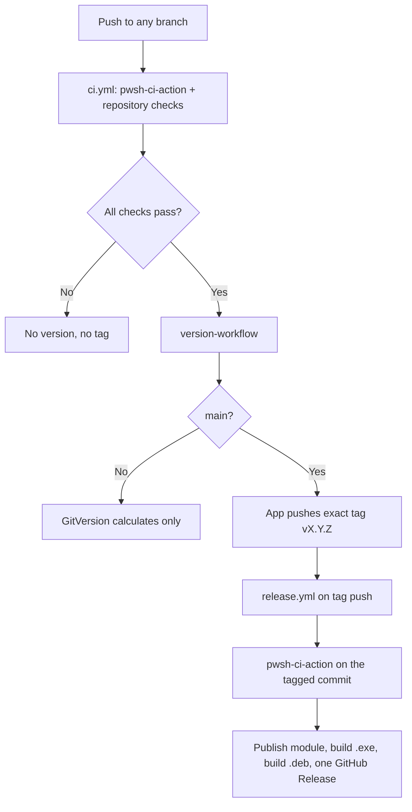

# Plan: PowerShell CI and release workflow

PowerShell has no shared CI component, and its two publishing actions predate the delivery conventions.
This adds `michielvha/pwsh-ci-action`, makes `publish-pwsh-module-action` and
`package-pwsh-script-action` release-only, and moves `michielvha/PDS`, their only consumer, onto the
CI, version and tag-triggered release shape that the Go repositories already use.

## Context

### A pull request runs the release

`michielvha/PDS` publishes its PowerShell module from one job that triggers on `pull_request` as well as
on pushes to `main` (`PDS/.github/workflows/publish-pwsh-module.yaml:15`). The job has no `if:`, and it
calls the action at a moving branch, `michielvha/publish-pwsh-module-action@main`
(`publish-pwsh-module.yaml:27`). The action, read at `753afb5` (its `main`), does every step for every
event:

- **It tags the repository.** `MKTHEPLUGG/gitversion-tag-action@v5` (`action.yml:42`) runs `git tag`
  and `git push origin <semVer>` (`gitversion-tag-action@v5:action.yml:46-47`). A PR run pushes a
  `PullRequest` prerelease tag.
- **It builds the manifest from that version.** `New-ModuleManifest -ModuleVersion <semVer>`
  (`action.yml:63`) accepts only a `System.Version`, so a PR's `0.24.0-PullRequest53.2` fails.
- **It publishes.** `Publish-Module -NuGetApiKey` (`action.yml:93`) runs next. On a PR it is skipped
  only because the manifest step failed first.

```text
$ gh run list -R michielvha/PDS --workflow publish-pwsh-module.yaml --limit 4
2026-11-17 pull_request feat/ssh-server-optional-key failure
2026-11-12 push         main                         success
2026-11-12 pull_request feat/pwsh-enable-ssh-server  failure
2026-06-01 push         main                         success
$ git ls-remote --tags origin | grep -c PullRequest
20
```

The 2026-11-17 failure log ends with `Cannot convert value "0.24.0-PullRequest53.2" to type
"System.Version"` ([run 44117944699](https://github.com/michielvha/PDS/actions/runs/44117944699)), and
that run left the tag `0.24.0-PullRequest53.2` behind. None of the 20 tags had a GitHub Release. With
the owner's approval they were deleted from PDS on 2026-11-17, after their commit SHAs were recorded.

`package-pwsh-script-action@v1` behaves the same for the `.exe` build: PDS calls it on `pull_request`
(`package-ps1-script.yaml:18`, `:32`) and it tags through `gitversion-tag-action@v5`
(`package-pwsh-script-action@v1:action.yaml:38`). It only uploads a workflow artifact, so nothing is
deployed.

### Three jobs decide one version

PDS ships three artifacts from one repository: the `.deb` package with its APT repository, the
PowerShell Gallery module and the packaged `.exe`. Each workflow runs GitVersion on its own. The APT
workflow computes the version with `dry-run: 'true'` (`build-apt-package.yml:44-47`) and creates the tag
through `gh release create` (`:173`). The module action pushes the same tag itself. One push to `main`
that touches both paths makes two writers race for one tag, which
[delivery](../../../conventions/delivery.md#git-and-versioning) forbids: one component decides the
version and one path publishes.

PDS also tags without the `v` prefix (`PDS/gitversion.yml:5`) under a repository-specific GitVersion
file. Eleven old `v0.1.4xx` tags exist beside the current `0.24.0` line.

### No PowerShell checks exist

`PDS/AGENTS.md:31` records it: "PowerShell checks are not yet wired into CI." Measured on `PDS@b1e5857`
with PowerShell 7.5.13, PSScriptAnalyzer 1.25.0 and Pester 5, default rules:

```text
files: 81 (module: 78, scripts: 3)
total findings: 773   Error: 0   Warning: 369   Information: 404
  404 PSAvoidTrailingWhitespace        283 PSAvoidUsingWriteHost
   43 PSUseShouldProcessForStateChangingFunctions
   14 PSUseSingularNouns                 7 PSUseBOMForUnicodeEncodedFile
    5 PSAvoidAssignmentToAutomaticVariable   4 PSAvoidUsingInvokeExpression
    4 PSAvoidUsingWMICmdlet              3 PSAvoidUsingEmptyCatchBlock
    2 PSAvoidUsingCmdletAliases          2 PSReviewUnusedParameter
    1 PSUseApprovedVerbs                 1 PSUseSupportsShouldProcess
pester: passed 0 failed 0 skipped 0
```

The one test file, `pwsh/module/Public/System/Update-Env.Tests.ps1`, is commented out. The module
loader dot-sources every `*.ps1` under `Public/`, test files included, and reports a broken file with a
non-terminating `Write-Error` (`PDS/pwsh/module/PDS.psm1`), so a module with a syntax error still imports.

### The actions fall short of the conventions

| Gap | `publish-pwsh-module-action` | `package-pwsh-script-action` |
| --- | --- | --- |
| Nested actions pinned by SHA | No: `checkout@v5`, `gitversion-tag-action@v5` | No: `checkout@v4`, `gitversion-tag-action@v5`, `upload-artifact@v4` at `v1` |
| Exact semver release tags | No: moving `v1`, `v2` | No: moving `v1` |
| Consumer gets dependency updates | `@main` gets them unreviewed | `@v1` is stuck behind `main` (`checkout@v7`, `gitversion@v6`) |
| Tests, `AGENTS.md`, licence | None | None |
| Owns one intent | No: checkout, version, tag, build and publish | No: checkout, version, tag and build |

The [release rollout handover](../../../reports/2026-10-23-release-rollout-handover.md#open-items) lists
both as missing a licence. `go-ci-action` is the model for the fix: one intent, behaviour tests over a
fixture, a `test.yml` that runs the action on itself and a release through `gh-release-workflow`
(`go-ci-action/.github/workflows/release.yml`).

Code search finds no other consumer of either action:

```text
$ gh search code --owner michielvha --owner vhco-pro publish-pwsh-module-action
michielvha/PDS .github/workflows/publish-pwsh-module.yaml
$ gh search code --owner michielvha --owner vhco-pro package-pwsh-script-action
michielvha/PDS .github/workflows/package-ps1-script.yaml
```

## Scope

In scope:

- A new public action, `michielvha/pwsh-ci-action`, owning blocking PowerShell checks.
- `publish-pwsh-module-action` v3 and `package-pwsh-script-action` v2 as release-only actions, plus
  the repository hygiene each one lacks: SHA pins, Renovate, tests, `AGENTS.md`, Apache-2.0 licence and
  exact releases through `gh-release-workflow`.
- PDS on branch CI, `version-workflow` and one tag-triggered release that publishes all three of its
  artifacts from one exact `v` tag. PDS releases stable versions from `main` only.
- PDS made to pass the new checks: a committed PSScriptAnalyzer settings file, the baseline findings
  fixed or excluded with a reason, and a first Pester suite.
- `knowledge/shared-delivery.md` rows for the new and changed components, and a short knowledge page
  for the PowerShell flow.

Out of scope:

- A reusable `vhco-pro/pwsh-release-workflow`. PDS is the only repository that uses PowerShell, so its
  `release.yml` composes the actions directly. A follow-up issue in `vhco-pro/docs`, filed when this
  document lands, tracks extracting it once a second module repository appears.
- Prerelease publication for PDS. The publish action supports prerelease tags so another repository can
  opt in with the `release:preview` label; PDS does not.
- Changing what the APT build and test steps do. Only their trigger, version source and release owner
  move.
- Windows PowerShell 5.1 checks. The checks run on PowerShell 7 first; a 5.1 pass is a later input of
  `pwsh-ci-action`, tracked by its own follow-up issue.
- Deleting the existing `v1`/`v2` alias tags on the two actions. Releases stop adding aliases; the old
  ones stay so a forgotten pin does not break.
- The private `michielvha/PWSH` repository. It publishes nothing through these actions.

## Design

The shape follows [tag-driven Go releases](../../../knowledge/tag-driven-go-releases.md): each action
owns one intent, workflows only orchestrate, and only an exact tag publishes.

The owner set this shape as the target for every language on 2026-11-17, not only Go and PowerShell:
a language CI action on branch pushes, `version-workflow` tagging `main`, and a tag-triggered release.
The knowledge page this feature adds states that, so later languages start from it.

| Intent | Go component | PowerShell component |
| --- | --- | --- |
| Check source | `go-ci-action` | `pwsh-ci-action` (new) |
| Decide when to tag, then tag | `version-workflow` + `gitversion-tag-action` | the same, unchanged |
| Build and publish an exact tag | `goreleaser-action` v2 via `go-release-workflow` | `publish-pwsh-module-action` v3, `package-pwsh-script-action` v2, composed in the consumer's `release.yml` |



<details>
<summary>Legend</summary>

- **ci.yml** runs on branch pushes, as the Go callers do: a `pull_request` run has the merge ref, so
  GitVersion would compute a `PullRequest` version. A PR shows the push checks on its head commit.
- **release.yml** runs the checks again on the exact tag before publishing, so a tag pushed by hand
  cannot publish unchecked source.
- PDS passes `preview-label: ''` to `version-workflow`, so only `main` tags. The pattern still allows
  label-driven previews for another repository: the publish action turns a prerelease tag into a Gallery
  prerelease, installable only with `-AllowPrerelease`.

</details>

### `pwsh-ci-action`

A composite action. The logic lives in one script, `ci.ps1`, that the action calls and a developer can
run locally with the same arguments, so a local pass predicts the hosted one. It does not check out,
version, tag or publish.

The checks themselves are the official modules, Microsoft's PSScriptAnalyzer and Pester; the script only
installs them at pinned versions and calls them, as `go-ci-action` calls `gofmt` and `golangci-lint`.
No maintained official action wraps them:

- `microsoft/psscriptanalyzer-action` last released `v1.1` on 2022-09-13. It installs whatever
  PSScriptAnalyzer is newest, interpolates its inputs into the script, and exits non-zero only on
  `Error` records through `enableExit`; its purpose is a SARIF file for code scanning.
- `pester/action` has been archived since 2021, and the Pester organization publishes no other action.
- GitHub's runner images preinstall Pester 5.9.0 and an unpinned PSScriptAnalyzer
  (`actions/runner-images` toolsets), but
  [delivery](../../../conventions/delivery.md#pinning-and-updates) forbids silently accepting a
  preinstalled version, so the action installs its own pins.

Inputs: `path` (default `.`), `settings` (PSScriptAnalyzer settings relative to `path`, default
`PSScriptAnalyzerSettings.psd1`), `module-manifest` (optional `.psd1` or `.psm1` to load), `tests`
(Pester path, default `tests`) and `allow-no-tests` (default `false`).

Blocking checks, in order:

1. **Format.** `Invoke-Formatter` with the caller's settings over every `*.ps1`, `*.psm1` and `*.psd1`.
   It reports files whose formatted output differs and changes nothing, like `gofmt -l`.
2. **Analyze.** `Invoke-ScriptAnalyzer -Recurse -Settings <settings>`. Any `Error` or `Warning` fails;
   `Information` is reported only. A missing settings file fails, so the rule set is always explicit.
3. **Load.** When `module-manifest` is set, import it in a fresh process with
   `$ErrorActionPreference = 'Stop'`, so a non-terminating load error such as the PDS loader's fails
   the check. A `.psd1` also goes through `Test-ModuleManifest`.
4. **Test.** `Invoke-Pester` 5 with a configuration object, failing on any failed test, and failing
   when it discovers no tests unless `allow-no-tests` is `true`.

PSScriptAnalyzer and Pester install at exact versions from `nupkg` files whose SHA-256 the action pins
and checks before import, as [delivery](../../../conventions/delivery.md#pinning-and-updates) requires.
A Renovate custom manager on the `nuget` datasource with the Gallery's v2 feed proposes the next
versions. The checksum still has to be refreshed in the same PR, so the README says how. The action runs
on `pwsh` on Linux, macOS and Windows runners; the caller picks the runner.

The repository copies `go-ci-action`'s layout: `tests/` with a passing fixture module and failing
fixtures (a formatting diff, an analyzer warning, a module that fails to load, a failing test, a module
with no tests), a `test.yml` that runs the action on itself, `release.yml` through `gh-release-workflow`,
`AGENTS.md`, `README.md`, `renovate.json5` and an Apache-2.0 `LICENSE`.

### `publish-pwsh-module-action` v3

A release-only major, like `goreleaser-action` v2. It no longer checks out, runs GitVersion, tags or
reads the commit message. Inputs: `module-path`, `tag` (the exact tag, such as `v0.25.0` or
`v0.25.0-feat-ssh.1`), `api-key`, and the manifest fields the current action takes (`root-module`,
`description`, `company-name`, `author`).

It turns the tag into Gallery fields: `ModuleVersion` is the three-part `MAJOR.MINOR.PATCH`, and a
prerelease label becomes `PrivateData.PSData.Prerelease` with every character outside `[0-9A-Za-z]`
removed (`feat-ssh.1` becomes `featssh1`). The Gallery allows only those characters, with a hyphen only
as the first one, and no dot. A tag without a `v` prefix, or a version that is not SemVer, fails before
anything is written.

It writes the manifest, runs `Test-ModuleManifest`, then checks the Gallery for that exact version. An
existing identical version ends the step as already published, so a retried tag is safe. Otherwise it
runs `Publish-Module`. Release notes come from the GitHub Release for the tag, not the last commit
message. It runs on `pwsh`, so it works on any runner.

### `package-pwsh-script-action` v2

Release-only as well: inputs `script-path`, `name` and `tag`; it installs PS2EXE at a pinned version
and checksum, builds `<name>-<version>.exe` without the `v`, and returns the file path for the caller to
attach. It no longer tags or uploads a workflow artifact.

### PDS

PDS keeps its packaging and test steps and changes who decides the version and who publishes:

- **`ci.yml`** on `push` to any branch: ShellCheck and the package build and install tests moved
  unchanged from `build-apt-package.yml`, `pwsh-ci-action` on `windows-latest` with
  `module-manifest: pwsh/module/PDS.psm1`, then `version-workflow` with `preview-label: ''`, so only
  `main` is tagged. No job here holds a publishing secret.
- **`release.yml`** on `push` of `v*.*.*` tags: `pwsh-ci-action` on the tag, then the `.deb` build, the
  `.exe` build and one `gh release create` for the tag with both files attached, then the APT repository
  deploy and the Gallery publish. The three old workflows are removed.
- **Version.** Tags gain the `v` prefix: first tag the `0.24.0` commit as `v0.24.0`, as
  [delivery](../../../conventions/delivery.md#git-and-versioning) describes, then drop
  `PDS/gitversion.yml` for the action's bundled configuration. Before the first release, GitVersion with
  the bundled configuration must compute a version above `0.24.0` on `main`, not a reset. Artifact
  versions stay unprefixed (`pds_0.25.0_all.deb`, module `0.25.0`).
- **Checks pass.** A committed `PSScriptAnalyzerSettings.psd1` that excludes one rule,
  `PSAvoidUsingWriteHost`, and a first Pester suite. The other 486 findings are fixed.
- **Why `Write-Host` stays.** The rule's documentation says `Write-Host` is "designed to produce
  display-only output in the host" and recommends `Write-Output` for objects and `Write-Verbose` for
  logging. PDS functions are interactive installers whose `Write-Host` calls print coloured progress, and
  none of the replacements keep that: `Write-Output` puts the text into the function's return value,
  `Write-Verbose` shows nothing without `-Verbose`, and `Write-Information` shows nothing by default and
  has no colour parameters. Since Windows PowerShell 5.0 `Write-Host` writes to the information stream,
  so a caller can still suppress it with `6>$null` or `-InformationAction Ignore`. The settings file
  carries that reason. A `Write-Host` that emits data a caller needs is a defect and becomes
  `Write-Output` during the fix.
- **Other findings are mostly mechanical.** Trailing whitespace (404) and missing BOMs (7) are fixed by
  tooling. The 43 `ShouldProcess`, 14 singular-noun and 1 approved-verb findings need a reading each; a
  rename keeps the old public name as an alias, because `PDS/AGENTS.md` requires public names to stay.
- **Docs.** `AGENTS.md` lists the PowerShell command beside the existing checks, `pwsh/readme.md`
  describes the checks and the release path, and `changelog.md` records the change.

## Acceptance Criteria

- [ ] AC-01: `michielvha/pwsh-ci-action` exists, public, Apache-2.0, with a released exact `v` tag
  published through `gh-release-workflow`, and every nested action pinned by full SHA with its release as
  a comment.
- [ ] AC-02: Run against its fixtures, the action passes the clean module and fails each failing fixture
  (formatting diff, analyzer warning, module that fails to load, failing test, no tests) with a message
  naming the failed check, and changes no file.
- [ ] AC-03: `pwsh ./ci.ps1` run locally on a fixture gives the same verdict as the action on that
  fixture.
- [ ] AC-04: The action refuses to import PSScriptAnalyzer or Pester when the downloaded package's
  SHA-256 differs from the pinned value.
- [ ] AC-05: `publish-pwsh-module-action` v3 and `package-pwsh-script-action` v2 are released with exact
  tags, take the version from a `tag` input, and contain no checkout, GitVersion or `git tag` step.
- [ ] AC-06: Given `v0.25.0-feat-ssh.1`, the publish action writes `ModuleVersion = '0.25.0'` and
  `Prerelease = 'featssh1'`; given a tag without `v` or not in SemVer, it fails before writing a
  manifest.
- [ ] AC-07: Publishing a version that already exists on the Gallery ends as already published, and the
  run succeeds without publishing again.
- [ ] AC-08: Both actions and `pwsh-ci-action` have `AGENTS.md`, a README listing inputs, outputs and an
  example pinned by SHA, Renovate with `helpers:pinGitHubActionDigests`, and a `test.yml` that runs the
  action on itself.
- [ ] AC-09: A PDS branch push that touches `pwsh/module/` runs `pwsh-ci-action` and creates no tag,
  publishes nothing and receives no publishing secret.
- [ ] AC-10: A PDS merge to `main` creates exactly one new tag, `v<version>`, and that tag's run
  publishes the module to the Gallery, attaches the `.deb` and `.exe` to one GitHub Release and updates
  the APT repository.
- [ ] AC-11: A PDS PR carrying the `release:preview` label creates no tag and publishes nothing; only a
  push to `main` tags PDS.
- [ ] AC-12: PDS passes `pwsh-ci-action` with a committed settings file that excludes only
  `PSAvoidUsingWriteHost`, with its reason, and runs at least one Pester test per public function changed
  in this feature, including `Enable-SshServer` with and without a key.
- [ ] AC-14: Every public PDS function renamed to satisfy the analyzer still runs under its old name.
- [ ] AC-13: `knowledge/shared-delivery.md` lists `pwsh-ci-action` and the two release-only actions, and
  a knowledge page describes the PowerShell flow and links the PDS workflows as the reference consumer.

## Test Plan

| Criterion | Proof |
| --- | --- |
| AC-01 | `gh repo view` and `gh release view` on the new repository; grep the workflow and action files for `uses:` lines without a 40-character SHA |
| AC-02 | The action's behaviour tests over `tests/fixtures`, and `test.yml` running the composite on GitHub |
| AC-03 | A behaviour test that runs `ci.ps1` directly on each fixture and compares the exit code with the composite run |
| AC-04 | A behaviour test that pins a wrong checksum and expects a failure before import |
| AC-05 | Read both `action.yml` files at the released SHA; their tests call them with a `tag` input |
| AC-06 | Unit tests of the tag-to-manifest function in the publish action's suite |
| AC-07 | A publish action test against a stub Gallery lookup, then the PDS retry: rerun the release job for an already published tag |
| AC-08 | File listing of each repository at its released SHA |
| AC-09 | Push a PDS branch touching `pwsh/module/`; `git ls-remote --tags` and the Gallery feed are unchanged, and the run's jobs show no secret use |
| AC-10 | The first PDS merge after adoption: one new tag, one GitHub Release with both files, Gallery feed shows the version, APT `Packages` lists it |
| AC-11 | Label a PDS PR and push to it; `git ls-remote --tags`, the GitHub Releases list and the Gallery feed are unchanged |
| AC-12 | `pwsh-ci-action` result on the PDS head, and the settings file review |
| AC-14 | A Pester test that calls each old name through `Get-Command` and the module's exported aliases |
| AC-13 | Read both pages in the merged docs commit |

## Tasks

None yet; written once the document is planned.

## Open Questions

None.

## Review Log

| Date | Review | Kind | Commit | Model | Isolation | Outcome |
| --- | --- | --- | --- | --- | --- | --- |

## Sources

- [Prerelease module versions](https://learn.microsoft.com/en-us/powershell/gallery/concepts/module-prerelease-support):
  `ModuleVersion` must be three-part when a prerelease is used; the label goes in
  `PrivateData.PSData.Prerelease`, allows only `[0-9A-Za-z]` with a hyphen only as the first character
  and no `.` or `+`; installing a prerelease needs `-AllowPrerelease`. The page was last updated
  2023-04-17.
- [PDS run 44117944699](https://github.com/michielvha/PDS/actions/runs/44117944699): the PR run that
  failed on `System.Version` after computing `0.24.0-PullRequest53.2`.
- [PDS PR 53](https://github.com/michielvha/PDS/pull/53): the module change whose PR run surfaced this.
- [microsoft/psscriptanalyzer-action](https://github.com/microsoft/psscriptanalyzer-action): last
  release `v1.1` (2022-09-13); `action.yml` installs the newest PSScriptAnalyzer and ConvertToSARIF and
  produces a SARIF file. Not used.
- [pester/action](https://github.com/pester/action): archived, last pushed 2021-02-16. Not used.
- [Windows 2025 runner toolset](https://github.com/actions/runner-images/blob/main/images/windows/toolsets/toolset-2025.json)
  and [Ubuntu 24.04 runner toolset](https://github.com/actions/runner-images/blob/main/images/ubuntu/toolsets/toolset-2404.json):
  both preinstall Pester 5.9.0 and PSScriptAnalyzer without a pinned version.
- [AvoidUsingWriteHost](https://learn.microsoft.com/en-us/powershell/utility-modules/psscriptanalyzer/rules/avoidusingwritehost):
  why the rule flags `Write-Host`, its recommended replacements, and the `Show` verb exemption.
- [Write-Host](https://learn.microsoft.com/en-us/powershell/module/microsoft.powershell.utility/write-host):
  a wrapper for `Write-Information` since Windows PowerShell 5.0; suppressible with `6>$null` or
  `-InformationAction Ignore`; `$InformationPreference` does not affect it.
- [Write-Information](https://learn.microsoft.com/en-us/powershell/module/microsoft.powershell.utility/write-information):
  hidden by default because `$InformationPreference` defaults to `SilentlyContinue`; no colour
  parameters.
