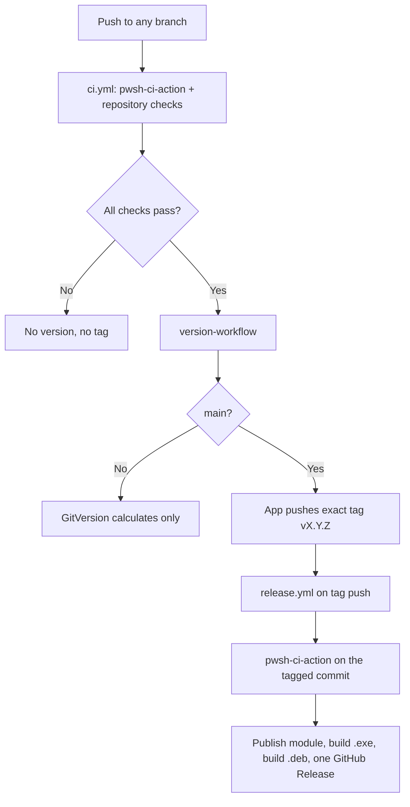

# Plan: PowerShell CI and release workflow

PowerShell has no shared CI component, and its two publishing actions predate the delivery conventions.
This adds `michielvha/pwsh-ci-action`, makes `publish-pwsh-module-action` and
`package-pwsh-script-action` release-only, and moves `michielvha/PDS`, their only consumer, onto the
CI, version and tag-triggered release shape that the Go repositories already use.

## Context

### A pull request runs the release

`michielvha/PDS` publishes its PowerShell module from one job that triggers on `pull_request` as well as
on pushes to `main` (`PDS/.github/workflows/publish-pwsh-module.yaml:15`). The job has no `if:`, and it
calls the action at a moving branch, `michielvha/publish-pwsh-module-action@main`
(`publish-pwsh-module.yaml:27`). The action, read at `753afb5` (its `main`), does every step for every
event:

- **It tags the repository.** `MKTHEPLUGG/gitversion-tag-action@v5` (`action.yml:42`) runs `git tag`
  and `git push origin <semVer>` (`gitversion-tag-action@v5:action.yml:46-47`). A PR run pushes a
  `PullRequest` prerelease tag.
- **It builds the manifest from that version.** `New-ModuleManifest -ModuleVersion <semVer>`
  (`action.yml:63`) accepts only a `System.Version`, so a PR's `0.24.0-PullRequest53.2` fails.
- **It publishes.** `Publish-Module -NuGetApiKey` (`action.yml:93`) runs next. On a PR it is skipped
  only because the manifest step failed first.

```text
$ gh run list -R michielvha/PDS --workflow publish-pwsh-module.yaml --limit 4
2026-11-17 pull_request feat/ssh-server-optional-key failure
2026-11-12 push         main                         success
2026-11-12 pull_request feat/pwsh-enable-ssh-server  failure
2026-06-01 push         main                         success
$ git ls-remote --tags origin | grep -c PullRequest
20
```

The 2026-11-17 failure log ends with `Cannot convert value "0.24.0-PullRequest53.2" to type
"System.Version"` ([run 44117944699](https://github.com/michielvha/PDS/actions/runs/44117944699)), and
that run left the tag `0.24.0-PullRequest53.2` behind. None of the 20 tags had a GitHub Release. With
the owner's approval they were deleted from PDS on 2026-11-17, after their commit SHAs were recorded.

`package-pwsh-script-action@v1` behaves the same for the `.exe` build: PDS calls it on `pull_request`
(`package-ps1-script.yaml:18`, `:32`) and it tags through `gitversion-tag-action@v5`
(`package-pwsh-script-action@v1:action.yaml:38`). It only uploads a workflow artifact, so nothing is
deployed.

### Three jobs decide one version

PDS ships three artifacts from one repository: the `.deb` package with its APT repository, the
PowerShell Gallery module and the packaged `.exe`. Each workflow runs GitVersion on its own. The APT
workflow computes the version with `dry-run: 'true'` (`build-apt-package.yml:44-47`) and creates the tag
through `gh release create` (`:173`). The module action pushes the same tag itself. One push to `main`
that touches both paths makes two writers race for one tag, which
[delivery](../../../conventions/delivery.md#git-and-versioning) forbids: one component decides the
version and one path publishes.

PDS also tags without the `v` prefix (`PDS/gitversion.yml:5`) under a repository-specific GitVersion
file. Eleven old `v0.1.4xx` tags exist beside the current `0.24.0` line.

### No PowerShell checks exist

`PDS/AGENTS.md:31` records it: "PowerShell checks are not yet wired into CI." Measured on `PDS@b1e5857`
with PowerShell 7.5.13, PSScriptAnalyzer 1.25.0 and Pester 5, default rules:

```text
files: 81 (module: 78, scripts: 3)
total findings: 773   Error: 0   Warning: 369   Information: 404
  404 PSAvoidTrailingWhitespace        283 PSAvoidUsingWriteHost
   43 PSUseShouldProcessForStateChangingFunctions
   14 PSUseSingularNouns                 7 PSUseBOMForUnicodeEncodedFile
    5 PSAvoidAssignmentToAutomaticVariable   4 PSAvoidUsingInvokeExpression
    4 PSAvoidUsingWMICmdlet              3 PSAvoidUsingEmptyCatchBlock
    2 PSAvoidUsingCmdletAliases          2 PSReviewUnusedParameter
    1 PSUseApprovedVerbs                 1 PSUseSupportsShouldProcess
pester: passed 0 failed 0 skipped 0
```

The one test file, `pwsh/module/Public/System/Update-Env.Tests.ps1`, is commented out. The module
loader dot-sources every `*.ps1` under `Public/`, test files included, and reports a broken file with a
non-terminating `Write-Error` (`PDS/pwsh/module/PDS.psm1`), so a module with a syntax error still imports.

### The actions fall short of the conventions

| Gap | `publish-pwsh-module-action` | `package-pwsh-script-action` |
| --- | --- | --- |
| Nested actions pinned by SHA | No: `checkout@v5`, `gitversion-tag-action@v5` | No: `checkout@v4`, `gitversion-tag-action@v5`, `upload-artifact@v4` at `v1` |
| Exact semver release tags | No: moving `v1`, `v2` | No: moving `v1` |
| Consumer gets dependency updates | `@main` gets them unreviewed | `@v1` is stuck behind `main` (`checkout@v7`, `gitversion@v6`) |
| Tests, `AGENTS.md`, licence | None | None |
| Owns one intent | No: checkout, version, tag, build and publish | No: checkout, version, tag and build |

The [release rollout handover](../../../reports/2026-10-23-release-rollout-handover.md#open-items) lists
both as missing a licence. `go-ci-action` is the model for the fix: one intent, behaviour tests over a
fixture, a `test.yml` that runs the action on itself and a release through `gh-release-workflow`
(`go-ci-action/.github/workflows/release.yml`).

Code search finds no other consumer of either action:

```text
$ gh search code --owner michielvha --owner vhco-pro publish-pwsh-module-action
michielvha/PDS .github/workflows/publish-pwsh-module.yaml
$ gh search code --owner michielvha --owner vhco-pro package-pwsh-script-action
michielvha/PDS .github/workflows/package-ps1-script.yaml
```

## Scope

In scope:

- A new public action, `michielvha/pwsh-ci-action`, owning blocking PowerShell checks.
- `publish-pwsh-module-action` v3 and `package-pwsh-script-action` v2 as release-only actions, plus
  the repository hygiene each one lacks: SHA pins, Renovate, tests, `AGENTS.md`, Apache-2.0 licence and
  exact releases through `gh-release-workflow`.
- PDS on branch CI, `version-workflow` and one tag-triggered release that publishes all three of its
  artifacts from one exact `v` tag. PDS releases stable versions from `main` only.
- PDS made to pass the new checks: a committed PSScriptAnalyzer settings file, the baseline findings
  fixed or excluded with a reason, and a first Pester suite.
- `knowledge/shared-delivery.md` rows for the new and changed components, and a short knowledge page
  for the PowerShell flow.

Out of scope:

- A reusable `vhco-pro/pwsh-release-workflow`. PDS is the only repository that uses PowerShell, so its
  `release.yml` composes the actions directly.
  [vhco-pro/docs#50](https://github.com/vhco-pro/docs/issues/50) tracks extracting it once a second
  module repository appears.
- Prerelease publication for PDS. The publish action supports prerelease tags so another repository can
  opt in with the `release:preview` label; PDS does not.
- Changing what the APT build and test steps do. Only their trigger, version source and release owner
  move.
- Windows PowerShell 5.1 checks. The checks run on PowerShell 7 first; a 5.1 pass is a later input of
  `pwsh-ci-action`, tracked by [vhco-pro/docs#51](https://github.com/vhco-pro/docs/issues/51).
- Deleting the existing `v1`/`v2` alias tags on the two actions. Releases stop adding aliases; the old
  ones stay so a forgotten pin does not break.
- The private `michielvha/PWSH` repository. It publishes nothing through these actions.

## Design

The shape follows [tag-driven Go releases](../../../knowledge/tag-driven-go-releases.md): each action
owns one intent, workflows only orchestrate, and only an exact tag publishes.

The owner set this shape as the target for every language on 2026-11-17, not only Go and PowerShell:
a language CI action on branch pushes, `version-workflow` tagging `main`, and a tag-triggered release.
The knowledge page this feature adds states that, so later languages start from it.

| Intent | Go component | PowerShell component |
| --- | --- | --- |
| Check source | `go-ci-action` | `pwsh-ci-action` (new) |
| Decide when to tag, then tag | `version-workflow` + `gitversion-tag-action` | the same, unchanged |
| Build and publish an exact tag | `goreleaser-action` v2 via `go-release-workflow` | `publish-pwsh-module-action` v3, `package-pwsh-script-action` v2, composed in the consumer's `release.yml` |



<details>
<summary>Legend</summary>

- **ci.yml** runs on branch pushes, as the Go callers do: a `pull_request` run has the merge ref, so
  GitVersion would compute a `PullRequest` version. A PR shows the push checks on its head commit.
- **release.yml** runs the checks again on the exact tag before publishing, so a tag pushed by hand
  cannot publish unchecked source.
- PDS passes `preview-label: ''` to `version-workflow`, so only `main` tags. The pattern still allows
  label-driven previews for another repository: the publish action turns a prerelease tag into a Gallery
  prerelease, installable only with `-AllowPrerelease`.

</details>

### `pwsh-ci-action`

A composite action. The logic lives in one script, `ci.ps1`, that the action calls and a developer can
run locally with the same arguments, so a local pass predicts the hosted one. It does not check out,
version, tag or publish.

The checks themselves are the official modules, Microsoft's PSScriptAnalyzer and Pester; the script only
installs them at pinned versions and calls them, as `go-ci-action` calls `gofmt` and `golangci-lint`.
No maintained official action wraps them:

- `microsoft/psscriptanalyzer-action` last released `v1.1` on 2022-09-13. It installs whatever
  PSScriptAnalyzer is newest, interpolates its inputs into the script, and exits non-zero only on
  `Error` records through `enableExit`; its purpose is a SARIF file for code scanning.
- `pester/action` has been archived since 2021, and the Pester organization publishes no other action.
- GitHub's runner images preinstall Pester 5.9.0 and an unpinned PSScriptAnalyzer
  (`actions/runner-images` toolsets), but
  [delivery](../../../conventions/delivery.md#pinning-and-updates) forbids silently accepting a
  preinstalled version, so the action installs its own pins.

Inputs: `path` (default `.`), `settings` (PSScriptAnalyzer settings relative to `path`, default
`PSScriptAnalyzerSettings.psd1`), `module-manifest` (optional `.psd1` or `.psm1` to load), `tests`
(Pester path, default `tests`) and `allow-no-tests` (default `false`).

Blocking checks, in order:

1. **Format.** `Invoke-Formatter` with the caller's settings over every `*.ps1`, `*.psm1` and `*.psd1`.
   It reports files whose formatted output differs and changes nothing, like `gofmt -l`.
2. **Analyze.** `Invoke-ScriptAnalyzer -Recurse -Settings <settings>`. Any `Error` or `Warning` fails;
   `Information` is reported only. A missing settings file fails, so the rule set is always explicit.
3. **Load.** When `module-manifest` is set, import it in a fresh process with
   `$ErrorActionPreference = 'Stop'`, so a non-terminating load error such as the PDS loader's fails
   the check. A `.psd1` also goes through `Test-ModuleManifest`.
4. **Test.** `Invoke-Pester` 5 with a configuration object, failing on any failed test, and failing
   when it discovers no tests unless `allow-no-tests` is `true`.

PSScriptAnalyzer and Pester install at exact versions from `nupkg` files whose SHA-256 the action pins
and checks before import, as [delivery](../../../conventions/delivery.md#pinning-and-updates) requires.
A Renovate custom manager on the `nuget` datasource with the Gallery's v2 feed proposes the next
versions. The checksum still has to be refreshed in the same PR, so the README says how. The action runs
on `pwsh` on Linux, macOS and Windows runners; the caller picks the runner.

The repository copies `go-ci-action`'s layout: `tests/` with a passing fixture module and failing
fixtures (a formatting diff, an analyzer warning, a module that fails to load, a failing test, a module
with no tests), a `test.yml` that runs the action on itself, `release.yml` through `gh-release-workflow`,
`AGENTS.md`, `README.md`, `renovate.json5` and an Apache-2.0 `LICENSE`.

### `publish-pwsh-module-action` v3

A release-only major, like `goreleaser-action` v2. It no longer checks out, runs GitVersion, tags or
reads the commit message. Inputs: `module-path`, `tag` (the exact tag, such as `v0.25.0` or
`v0.25.0-feat-ssh.1`), `api-key`, and the manifest fields the current action takes (`root-module`,
`description`, `company-name`, `author`).

It turns the tag into Gallery fields: `ModuleVersion` is the three-part `MAJOR.MINOR.PATCH`, and a
prerelease label becomes `PrivateData.PSData.Prerelease` with every character outside `[0-9A-Za-z]`
removed (`feat-ssh.1` becomes `featssh1`). The Gallery allows only those characters, with a hyphen only
as the first one, and no dot. A tag without a `v` prefix, or a version that is not SemVer, fails before
anything is written.

It writes the manifest, runs `Test-ModuleManifest`, then checks the Gallery for that exact version. An
existing identical version ends the step as already published, so a retried tag is safe. Otherwise it
runs `Publish-Module`. Release notes come from the GitHub Release for the tag, not the last commit
message. It runs on `pwsh`, so it works on any runner.

### `package-pwsh-script-action` v2

Release-only as well: inputs `script-path`, `name` and `tag`; it installs PS2EXE at a pinned version
and checksum, builds `<name>-<version>.exe` without the `v`, and returns the file path for the caller to
attach. It no longer tags or uploads a workflow artifact.

### PDS

PDS keeps its packaging and test steps and changes who decides the version and who publishes:

- **`ci.yml`** on `push` to any branch: ShellCheck and the package build and install tests moved
  unchanged from `build-apt-package.yml`, `pwsh-ci-action` on `windows-latest` with
  `module-manifest: pwsh/module/PDS.psm1`, then `version-workflow` with `preview-label: ''`, so only
  `main` is tagged. No job here holds a publishing secret.
- **`release.yml`** on `push` of `v*.*.*` tags: `pwsh-ci-action` on the tag, then the `.deb` build, the
  `.exe` build and one `gh release create` for the tag with both files attached, then the APT repository
  deploy and the Gallery publish. The three old workflows are removed.
- **Version.** Tags gain the `v` prefix: first tag the `0.24.0` commit as `v0.24.0`, as
  [delivery](../../../conventions/delivery.md#git-and-versioning) describes, then drop
  `PDS/gitversion.yml` for the action's bundled configuration. Before the first release, GitVersion with
  the bundled configuration must compute a version above `0.24.0` on `main`, not a reset. Artifact
  versions stay unprefixed (`pds_0.25.0_all.deb`, module `0.25.0`).
- **Checks pass.** A committed `PSScriptAnalyzerSettings.psd1` that excludes one rule,
  `PSAvoidUsingWriteHost`, and a first Pester suite. The other 486 findings are fixed.
- **Why `Write-Host` stays.** The rule's documentation says `Write-Host` is "designed to produce
  display-only output in the host" and recommends `Write-Output` for objects and `Write-Verbose` for
  logging. PDS functions are interactive installers whose `Write-Host` calls print coloured progress, and
  none of the replacements keep that: `Write-Output` puts the text into the function's return value,
  `Write-Verbose` shows nothing without `-Verbose`, and `Write-Information` shows nothing by default and
  has no colour parameters. Since Windows PowerShell 5.0 `Write-Host` writes to the information stream,
  so a caller can still suppress it with `6>$null` or `-InformationAction Ignore`. The settings file
  carries that reason. A `Write-Host` that emits data a caller needs is a defect and becomes
  `Write-Output` during the fix.
- **Other findings are mostly mechanical.** Trailing whitespace (404) and missing BOMs (7) are fixed by
  tooling. The 43 `ShouldProcess`, 14 singular-noun and 1 approved-verb findings need a reading each; a
  rename keeps the old public name as an alias, because `PDS/AGENTS.md` requires public names to stay.
- **Docs.** `AGENTS.md` lists the PowerShell command beside the existing checks, `pwsh/readme.md`
  describes the checks and the release path, and `changelog.md` records the change.

## Acceptance Criteria

- [ ] AC-01: `michielvha/pwsh-ci-action` exists, public, Apache-2.0, with a released exact `v` tag
  published through `gh-release-workflow`, and every nested action pinned by full SHA with its release as
  a comment.
- [ ] AC-02: Run against its fixtures, the action passes the clean module and fails each failing fixture
  (formatting diff, analyzer warning, module that fails to load, failing test, no tests) with a message
  naming the failed check, and changes no file.
- [ ] AC-03: `pwsh ./ci.ps1` run locally on a fixture gives the same verdict as the action on that
  fixture.
- [ ] AC-04: The action refuses to import PSScriptAnalyzer or Pester when the downloaded package's
  SHA-256 differs from the pinned value.
- [ ] AC-05: `publish-pwsh-module-action` v3 and `package-pwsh-script-action` v2 are released with exact
  tags, take the version from a `tag` input, and contain no checkout, GitVersion or `git tag` step.
- [ ] AC-06: Given `v0.25.0-feat-ssh.1`, the publish action writes `ModuleVersion = '0.25.0'` and
  `Prerelease = 'featssh1'`; given a tag without `v` or not in SemVer, it fails before writing a
  manifest.
- [ ] AC-07: Publishing a version that already exists on the Gallery ends as already published, and the
  run succeeds without publishing again.
- [ ] AC-08: Both actions and `pwsh-ci-action` have `AGENTS.md`, a README listing inputs, outputs and an
  example pinned by SHA, Renovate with `helpers:pinGitHubActionDigests`, and a `test.yml` that runs the
  action on itself.
- [ ] AC-09: A PDS branch push that touches `pwsh/module/` runs `pwsh-ci-action` and creates no tag,
  publishes nothing and receives no publishing secret.
- [ ] AC-10: A PDS merge to `main` creates exactly one new tag, `v<version>`, and that tag's run
  publishes the module to the Gallery, attaches the `.deb` and `.exe` to one GitHub Release and updates
  the APT repository.
- [ ] AC-11: A PDS PR carrying the `release:preview` label creates no tag and publishes nothing; only a
  push to `main` tags PDS.
- [ ] AC-12: PDS passes `pwsh-ci-action` with a committed settings file that excludes only
  `PSAvoidUsingWriteHost`, with its reason, and runs at least one Pester test per public function changed
  in this feature, including `Enable-SshServer` with and without a key.
- [ ] AC-14: Every public PDS function renamed to satisfy the analyzer still runs under its old name.
- [ ] AC-13: `knowledge/shared-delivery.md` lists `pwsh-ci-action` and the two release-only actions, and
  a knowledge page describes the PowerShell flow and links the PDS workflows as the reference consumer.

## Test Plan

| Criterion | Proof |
| --- | --- |
| AC-01 | `gh repo view` and `gh release view` on the new repository; grep the workflow and action files for `uses:` lines without a 40-character SHA |
| AC-02 | The action's behaviour tests over `tests/fixtures`, and `test.yml` running the composite on GitHub |
| AC-03 | A behaviour test that runs `ci.ps1` directly on each fixture and compares the exit code with the composite run |
| AC-04 | A behaviour test that pins a wrong checksum and expects a failure before import |
| AC-05 | Read both `action.yml` files at the released SHA; their tests call them with a `tag` input |
| AC-06 | Unit tests of the tag-to-manifest function in the publish action's suite |
| AC-07 | A publish action test against a stub Gallery lookup, then the PDS retry: rerun the release job for an already published tag |
| AC-08 | File listing of each repository at its released SHA |
| AC-09 | Push a PDS branch touching `pwsh/module/`; `git ls-remote --tags` and the Gallery feed are unchanged, and the run's jobs show no secret use |
| AC-10 | The first PDS merge after adoption: one new tag, one GitHub Release with both files, Gallery feed shows the version, APT `Packages` lists it |
| AC-11 | Label a PDS PR and push to it; `git ls-remote --tags`, the GitHub Releases list and the Gallery feed are unchanged |
| AC-12 | `pwsh-ci-action` result on the PDS head, and the settings file review |
| AC-14 | A Pester test that calls each old name through `Get-Command` and the module's exported aliases |
| AC-13 | Read both pages in the merged docs commit |

## Tasks

None yet; written once the document is planned.

## Open Questions

None.

## Review Log

| Date | Review | Kind | Commit | Model | Isolation | Outcome |
| --- | --- | --- | --- | --- | --- | --- |
| 2026-11-17 | R-1 | spec | `bae0bb0` | claude-opus-5-5 | procedural | Blocking: 1 blocking, 16 should-fix and 4 nits |

### R-1

FINDING: F-01
KIND: factual
SEVERITY: blocking
WHERE: Test Plan, row AC-01; Acceptance Criteria, AC-01; Design, `pwsh-ci-action` (repository layout copied from `go-ci-action`)
EVIDENCE: The AC-01 proof says to "grep the workflow and action files for `uses:` lines without a 40-character SHA". The layout the Design copies from `go-ci-action` has local references with no SHA: `git -C /home/m/code/go-ci-action show origin/main:.github/workflows/test.yml` has `uses: ./` and `release.yml:25` has `uses: ./.github/workflows/test.yml`. The grep as written matches those lines, so the proof fails a correct implementation. conventions/delivery.md (Pinning and updates) pins external actions and reusable workflows only.
PROPOSAL: Limit the AC-01 proof (and criterion wording) to external `uses:` references, for example lines not starting with `./`, each requiring a 40-character SHA and a release comment.

FINDING: F-02
KIND: factual
SEVERITY: should-fix
WHERE: Context, Owner summary (absent; Context opens with "### A pull request runs the release")
EVIDENCE: conventions/feature-documents.md at 1ccf8f3, "Owner summary in Context": "New documents and documents undergoing a normative revision start Context with `### Owner summary`" and it must be refreshed "before asking for acceptance". This document was created in 3659198 on 2026-11-17 and waits on spec review for acceptance.
PROPOSAL: Add a `### Owner summary` at the top of Context covering problem, scope, approach, defaults (PDS stable only, one `Write-Host` exclusion), permissions (App key, Gallery key, GPG key, Pages), migration (v0.24.0 baseline, old workflows removed), and planned versus observed proof.

FINDING: F-03
KIND: factual
SEVERITY: should-fix
WHERE: Design, `pwsh-ci-action` check 1 (Format); Design, PDS "Checks pass"; Acceptance Criteria, AC-02 (formatting diff fixture) and AC-12; Context, "No PowerShell checks exist" baseline
EVIDENCE: PSScriptAnalyzer `Engine/Formatter.cs` (`gh api repos/PowerShell/PSScriptAnalyzer/contents/Engine/Formatter.cs`): `Format` loops over formatting rules and does `if (!settings.RuleArguments.ContainsKey(rule)) continue;`, so `Invoke-Formatter` applies only rules configured under the settings file's `Rules` key. AC-12 and the Design say the PDS settings file "excludes only `PSAvoidUsingWriteHost`", which configures no formatting rule. That makes the Format check a no-op on PDS. The Context baseline measures analyzer findings only, not formatter diffs, so if the settings enable formatting rules, the PDS work is unmeasured.
PROPOSAL: State which formatting rules (for example the `CodeFormatting` preset values) the PDS settings file configures under `Rules`, measure the formatter diff on PDS for the baseline, and have AC-12 require that configuration. Also say that the action fails or warns when the settings configure no formatting rule.

FINDING: F-04
KIND: judgement
SEVERITY: should-fix
WHERE: Scope ("the baseline findings fixed or excluded with a reason"); Design, PDS "Checks pass" ("The other 486 findings are fixed") and "Other findings are mostly mechanical"; Acceptance Criteria, AC-12; Context baseline table
EVIDENCE: Scope allows findings to be "fixed or excluded with a reason". Design and AC-12 allow exactly one settings exclusion and say every other finding is fixed. Neither says whether in-source `[Diagnostics.CodeAnalysis.SuppressMessageAttribute]` suppressions are allowed, for example for the 43 `PSUseShouldProcessForStateChangingFunctions` findings, so one implementer adds ShouldProcess to 43 installers and another suppresses them. The count is also wrong: the Context table sums to 773 and 773 - 283 = 490, not 486. Only the 86 non-`Write-Host` warnings (369 - 283) block under the Analyze rule "Information is reported only", because the 404 `PSAvoidTrailingWhitespace` findings are exactly the 404 Information records.
PROPOSAL: State whether per-function suppressions with a reason are allowed and for which rules, make Scope, Design and AC-12 say the same thing, and correct the count to 490 (86 blocking).

FINDING: F-05
KIND: judgement
SEVERITY: should-fix
WHERE: Acceptance Criteria, AC-12; Test Plan, row AC-12; Design, PDS "Checks pass" and "Other findings are mostly mechanical"
EVIDENCE: AC-12 requires "at least one Pester test per public function changed in this feature, including `Enable-SshServer` with and without a key". The planned fixes (trailing whitespace in 404 places, BOMs, ShouldProcess, WMI to CIM, `Invoke-Expression`) touch most of the 78 module files, so "changed in this feature" could mean nearly every function or only the behaviourally changed ones. `Enable-SshServer` was changed by PDS PR 53 (`9385732`), not by this feature. PDS `AGENTS.md:16` says "Syntax checks or stubs alone do not prove installation or authentication works", and no row says whether these tests run the installer on the hosted Windows runner or mock it. The AC-12 proof ("`pwsh-ci-action` result on the PDS head, and the settings file review") does not check the per-function coverage.
PROPOSAL: Name the functions that need tests, or define "changed" as a behavioural change rather than a whitespace or encoding edit, and say whether `Enable-SshServer` tests run for real on `windows-latest` or mock the system calls. Make the AC-12 proof list the functions and their tests.

FINDING: F-06
KIND: factual
SEVERITY: should-fix
WHERE: Design, `pwsh-ci-action` Inputs (`tests` default); Design, PDS `ci.yml` bullet and "Checks pass"; Context, "No PowerShell checks exist"
EVIDENCE: The `tests` input defaults to `tests` relative to `path` `.`, but PDS already has a root `tests/` holding Python and Dockerfile tests (`git -C /home/m/code/PDS ls-tree origin/main tests/`). The only Pester file is `pwsh/module/Public/System/Update-Env.Tests.ps1`. `PDS.psm1:9` collects every `*.ps1` under `Public` recursively, `:17` dot-sources each one at import, and `:26-29` exports a function per file BaseName. A suite placed beside the functions, as the existing file is, runs its `Describe` blocks at module import and is missed by the default `tests` path. The Context names this loader behaviour, but the Design never decides where the suite lives or whether the loader skips `*.Tests.ps1`.
PROPOSAL: Name the Pester suite location and the `tests` input PDS passes, and state whether the loader excludes `*.Tests.ps1` and what happens to the commented-out `Update-Env.Tests.ps1`.

FINDING: F-07
KIND: factual
SEVERITY: should-fix
WHERE: Design, mermaid ("App pushes exact tag vX.Y.Z") and PDS `ci.yml` bullet ("No job here holds a publishing secret"); Scope (PDS on `version-workflow`); Acceptance Criteria, AC-09; Test Plan, row AC-09
EVIDENCE: `gh secret list -R michielvha/PDS` shows API_KEY, DOCKER_*, GPG_PASSPHRASE and GPG_PRIVATE_KEY, and `gh variable list` is empty, so PDS has no `RELEASE_APP_CLIENT_ID` or `RELEASE_APP_PRIVATE_KEY`. The separate-workflows arrangement needs them (`go-release-workflow/examples/separate-workflows/ci.yml`: "Needs: RELEASE_APP_CLIENT_ID (variable), RELEASE_APP_PRIVATE_KEY (secret)"). Without them, `version.yml` pushes with `GITHUB_TOKEN`, which starts no tag workflow (knowledge/tag-driven-go-releases.md, Same workflow or separate workflows). The document never lists this owner setup step and never records the arrangement choice. The version-workflow example passes `release-app-private-key` to the version job on every branch push, which the knowledge page calls an owner-wide credential. AC-09 ("receives no publishing secret") does not say whether that key counts, and "the run's jobs show no secret use" is not an observable check.
PROPOSAL: Add the App variable and secret setup to Scope as an owner action and record the separate-workflows choice. Name the secrets AC-09 covers (API_KEY, GPG_PRIVATE_KEY, GPG_PASSPHRASE), and prove AC-09 by showing those names appear only in `release.yml`.

FINDING: F-08
KIND: factual
SEVERITY: should-fix
WHERE: Design, PDS `release.yml` bullet ("then the APT repository deploy"); Scope, out of scope ("Only their trigger, version source and release owner move"); Acceptance Criteria, AC-10; Test Plan, row AC-10
EVIDENCE: `gh api repos/michielvha/PDS/environments` shows `github-pages` with a `branch_policy` protection rule and custom branch policies, and `.../environments/github-pages/deployment-branch-policies` lists only `main` (type branch). Pages uses `build_type: workflow`. The actions/deploy-pages README says the OIDC token carries the run's ref and "the pages deployment API ... verif[ies] if that workflow is allowed to deploy to pages", and that environment protection rules take precedence. Moving `deploy-apt-repo` (build-apt-package.yml:179-325) to a `v*.*.*` tag run is likely to be refused, so AC-10's APT update cannot happen. The document does not plan the policy change.
PROPOSAL: Add a `v*.*.*` tag policy to the `github-pages` environment as a named owner step in Scope (or move the Pages deploy elsewhere), and make the AC-10 proof include a successful Pages deployment from the tag run.

FINDING: F-09
KIND: judgement
SEVERITY: should-fix
WHERE: Design, PDS `release.yml` bullet; Design, `publish-pwsh-module-action` v3 ("An existing identical version ends the step as already published, so a retried tag is safe"); Acceptance Criteria, AC-07 and AC-10; Test Plan, rows AC-07 and AC-10
EVIDENCE: `release.yml` runs `gh release create`, then the APT deploy, then the Gallery publish. Today's step (build-apt-package.yml:173) is a plain `gh release create`, which fails when the release already exists. The AC-07 PDS proof ("rerun the release job for an already published tag") therefore stops at the release step before the Gallery idempotency is reached. A Gallery failure after the public Release leaves a Release with no module, and the document defines no recovery. There is no concurrency rule for `release.yml`, so two quick merges give two tag runs that both restore the same aptly cache and deploy Pages. `gh cache list` shows one fixed key `aptly-repo-Linux-michielvha/PDS`, and the live `Packages` index lists only 0.20.0 and 0.23.0, missing 0.21.0, so overlapping deploys can drop versions. go-release-workflow serializes per exact tag only. conventions/delivery.md (Workflows and permissions) says "Serialize publication where competing runs could conflict ... preserve exact tags on retries".
PROPOSAL: Define the release step as idempotent for the exact tag (create when absent, verify or upload missing assets when present, or draft until all publishes succeed), and give `release.yml` a repository-wide concurrency group without cancellation. Make the AC-07 and AC-10 proofs include a full rerun of the tag workflow.

FINDING: F-10
KIND: factual
SEVERITY: should-fix
WHERE: Design, PDS `release.yml` bullet (one `gh release create`) and "Version" bullet; Design, `publish-pwsh-module-action` v3 ("Release notes come from the GitHub Release for the tag"); Scope, out of scope
EVIDENCE: The design does not say what the PDS GitHub Release notes contain, and the publish action copies them to the Gallery. The current notes come from `.github/templates/release-notes.md`, whose line 23 builds `wget https://github.com/{{REPOSITORY}}/releases/download/{{VERSION}}/{{PACKAGE_NAME}}_{{VERSION}}_all.deb` from the unprefixed version. After the tags gain `v`, that URL points at a missing release. conventions/delivery.md (Git and versioning): "Update anything that builds a download URL from the version". knowledge/shared-delivery.md (Release contract) says shared releases render Conventional Commit notes with `git-cliff`.
PROPOSAL: Name the notes source for the PDS Release (the template with a `v{{VERSION}}` tag URL, or rendered notes), and add the template fix to the PDS changes.

FINDING: F-11
KIND: factual
SEVERITY: should-fix
WHERE: Design, PDS "Version" bullet; Acceptance Criteria, AC-10; Test Plan, row AC-10
EVIDENCE: AC-10 says "A PDS merge to `main` creates exactly one new tag". The bundled config (`gitversion-tag-action@v7.0.4:gitversion.yml:13-21`) sets main `increment: None` with commit-message incrementing, and `docs`, `style`, `test` and `ci` do not bump (conventions/delivery.md). A no-bump merge computes the existing version, and `scripts/tag.sh:23-26` skips with `tag-exists`, so the universal wording contradicts the design. The Design's preconditions ("tag the `0.24.0` commit as `v0.24.0`", "must compute a version above `0.24.0`") have no criterion or proof. AC-10 would pass on a reset version, because the Gallery accepts a lower new version. "The `0.24.0` commit" is hardcoded although `main` may move first (0.24.0 is at 68b1601, the Gallery's latest; the latest GitHub Release is 0.23.0).
PROPOSAL: Reword AC-10 to a merge carrying a bumping commit. Add a criterion and proof that `v<latest release>` exists on the latest release commit before the migration merge and that the first tag is above it. Phrase the baseline as "the latest released version" rather than 0.24.0.

FINDING: F-12
KIND: factual
SEVERITY: should-fix
WHERE: Scope ("`publish-pwsh-module-action` v3 and `package-pwsh-script-action` v2 ... exact releases through `gh-release-workflow`"); Design, intent table, `publish-pwsh-module-action` v3 and `package-pwsh-script-action` v2; Acceptance Criteria, AC-05; Test Plan, row AC-05
EVIDENCE: `git tag -l` shows only `v1` and `v2` in publish-pwsh-module-action and only `v1` in package-pwsh-script-action, with no exact SemVer tag. gh-release-workflow computes the version with `gitversion-tag-action@v7.0.4` and the bundled config, and GitVersion's default Strict format does not parse `v1` or `v2`. The first release therefore comes from the fallback base (0.x or 1.0.0), not v3.0.0 or v2.0.0. The Go precedent had an exact `v1.0.0` before `v2.0.0` (`gh api repos/michielvha/goreleaser-action/tags`).
PROPOSAL: Specify the baseline exact tags first (for example `v2.0.0` on the `v2` commit and `v1.0.0` on the `v1` commit, each checked for tag triggers) and a breaking-change commit, so gh-release-workflow computes v3.0.0 and v2.0.0. Make AC-05 name those versions.

FINDING: F-13
KIND: judgement
SEVERITY: should-fix
WHERE: Design, `publish-pwsh-module-action` v3; Design, PDS bullets; Scope, out of scope (alias tags "stay so a forgotten pin does not break")
EVIDENCE: PDS calls `michielvha/publish-pwsh-module-action@main` (`publish-pwsh-module.yaml:27`) on every module push to `main`. When v3 reaches the action's `main` before PDS migrates, the next PDS module push runs the release-only v3 with the old inputs (`psd1Path`, `psm1Path`, `apiKey`), and v3 has no checkout. Keeping alias tags does not protect a branch ref. knowledge/tag-driven-go-releases.md records the precedent: "Before the release-only change reached its default branch, all ten inventoried consumers of its floating main ref were frozen to their original commits".
PROPOSAL: State the rollout order: freeze PDS to `753afb5` by SHA (or migrate PDS) before v3 merges to the action's `main`, and say how PDS rolls back if the new release path fails.

FINDING: F-14
KIND: judgement
SEVERITY: should-fix
WHERE: Design, `publish-pwsh-module-action` v3 (prerelease mapping and "existing identical version"); Design, Legend (Gallery prerelease); Acceptance Criteria, AC-06 and AC-07; Scope, out of scope (prerelease publication)
EVIDENCE: The Gallery page in Sources says "If the Prerelease string is specified for two modules, the sort order is based on the string portion following the hyphen", which is a string comparison. Stripping the dot makes `feat-ssh.10` become `featssh10`, which sorts below `featssh9`, so `Install-Module -AllowPrerelease` installs an older preview after the ninth. Distinct tags such as `v0.25.0-feat-ssh.1` and `v0.25.0-featssh.1` map to the same `0.25.0`/`featssh1`, and the "already published" path then skips the second tag silently. "Identical" is not defined: the design does not say whether it is version-only or content-compared.
PROPOSAL: Define the mapping to keep the order (for example a zero-padded counter) and fail on a collision with an existing prerelease that came from a different tag. Define "identical" in the already-published check and cover both cases in AC-06 and AC-07.

FINDING: F-15
KIND: factual
SEVERITY: should-fix
WHERE: Design, `package-pwsh-script-action` v2 ("installs PS2EXE at a pinned version and checksum"); Acceptance Criteria, AC-08
EVIDENCE: conventions/delivery.md (Pinning and updates): "A version and checksum hardcoded in a script are invisible to Dependabot and Renovate ... use a Renovate custom manager that matches the pin ... Adding a dependency includes confirming the updater will propose its next version." The Design gives `pwsh-ci-action` a Renovate custom manager for its module pins, but gives the PS2EXE pin no updater path. AC-08 only requires `helpers:pinGitHubActionDigests`.
PROPOSAL: Give the PS2EXE pin the same Renovate custom manager and checksum-refresh note as `pwsh-ci-action`, and have AC-08 require each action's tool pins to be matched by a custom manager.

FINDING: F-16
KIND: factual
SEVERITY: should-fix
WHERE: Test Plan, rows AC-03, AC-05, AC-08 and AC-14
EVIDENCE: AC-03: "A behaviour test that runs `ci.ps1` directly on each fixture and compares the exit code with the composite run". A composite action runs only inside Actions, so a single behaviour test cannot run both unless the comparison happens in `test.yml`, and the row does not say so. AC-05 says to read "both `action.yml` files", but the package action's file is `action.yaml` (`git ls-files` in package-pwsh-script-action). AC-08: a "File listing" cannot show that a README lists inputs, outputs and a SHA-pinned example, or that Renovate uses `helpers:pinGitHubActionDigests`. AC-14: calling each old name "through `Get-Command`" resolves the name but does not run it, while the criterion says it "still runs under its old name".
PROPOSAL: Make AC-03 compare the two runs inside `test.yml` per fixture. Read both action metadata files whatever their extension. Make AC-08 inspect the README and Renovate contents. Make AC-14 invoke each old alias, with mocks where it installs software, and check that it reaches the new function.

FINDING: F-17
KIND: factual
SEVERITY: should-fix
WHERE: Design, intro ("The knowledge page this feature adds states that, so later languages start from it"); Scope (knowledge page); Acceptance Criteria, AC-13; Test Plan, row AC-13; frontmatter `covers`
EVIDENCE: The Design promises the new page states the owner's every-language target, but AC-13 only requires a page that "describes the PowerShell flow and links the PDS workflows", so the proof "Read both pages" passes without it. The new page's path is never named and is absent from `covers` (only `knowledge/shared-delivery.md` and `knowledge/tag-driven-go-releases.md`). Scope does not say whether `knowledge/tag-driven-go-releases.md` changes.
PROPOSAL: Name the new knowledge page path, add it to `covers`, say whether `tag-driven-go-releases.md` changes, and make AC-13 require the cross-language statement.

FINDING: F-18
KIND: factual
SEVERITY: nit
WHERE: Acceptance Criteria (AC-14 listed before AC-13); Test Plan (same order)
EVIDENCE: The criteria list runs AC-12, AC-14, AC-13, and the Test Plan rows follow the same order.
PROPOSAL: List AC-13 before AC-14 in both places.

FINDING: F-19
KIND: factual
SEVERITY: nit
WHERE: Scope, out of scope ("PDS is the only repository that uses PowerShell")
EVIDENCE: `gh repo list michielvha --json name,primaryLanguage` lists `PWSH` (private) and `func-app` (public, with `.github/workflows/deploy.yml`) as PowerShell repositories. The supported claim is that PDS is the only module-publishing consumer, which the code search in Context shows.
PROPOSAL: Say "PDS is the only repository that publishes a PowerShell module".

FINDING: F-20
KIND: factual
SEVERITY: nit
WHERE: Design, `publish-pwsh-module-action` v3 ("the manifest fields the current action takes (`root-module`, `description`, `company-name`, `author`)")
EVIDENCE: The current action's inputs are `psd1Path`, `psm1Path`, `companyName`, `apiKey`, `rootModule` and `description` (`action.yml:9-28` at 753afb5). Author is hardcoded as `-Author "itmvha"` (`action.yml:63`), not an input.
PROPOSAL: Say `author` is a new input that replaces the hardcoded value.

FINDING: F-21
KIND: factual
SEVERITY: nit
WHERE: Context, "A pull request runs the release" (run list) and "The actions fall short of the conventions" (code search output)
EVIDENCE: `gh run list -R michielvha/PDS` shows a `push main success` run of Publish PowerShell Module at 2026-11-17T15:46:31Z, which published 0.24.0 at 68b1601. It came before the document's commit (3659198, 16:16 UTC) but is missing from the quoted `--limit 4` output. The second code search also returns `michielvha/package-pwsh-script-action readme.md`, which the quoted output leaves out.
PROPOSAL: Refresh both command outputs so they match what the commands return.

## Sources

- [Prerelease module versions](https://learn.microsoft.com/en-us/powershell/gallery/concepts/module-prerelease-support):
  `ModuleVersion` must be three-part when a prerelease is used; the label goes in
  `PrivateData.PSData.Prerelease`, allows only `[0-9A-Za-z]` with a hyphen only as the first character
  and no `.` or `+`; installing a prerelease needs `-AllowPrerelease`. The page was last updated
  2023-04-17.
- [PDS run 44117944699](https://github.com/michielvha/PDS/actions/runs/44117944699): the PR run that
  failed on `System.Version` after computing `0.24.0-PullRequest53.2`.
- [PDS PR 53](https://github.com/michielvha/PDS/pull/53): the module change whose PR run surfaced this.
- [microsoft/psscriptanalyzer-action](https://github.com/microsoft/psscriptanalyzer-action): last
  release `v1.1` (2022-09-13); `action.yml` installs the newest PSScriptAnalyzer and ConvertToSARIF and
  produces a SARIF file. Not used.
- [pester/action](https://github.com/pester/action): archived, last pushed 2021-02-16. Not used.
- [Windows 2025 runner toolset](https://github.com/actions/runner-images/blob/main/images/windows/toolsets/toolset-2025.json)
  and [Ubuntu 24.04 runner toolset](https://github.com/actions/runner-images/blob/main/images/ubuntu/toolsets/toolset-2404.json):
  both preinstall Pester 5.9.0 and PSScriptAnalyzer without a pinned version.
- [AvoidUsingWriteHost](https://learn.microsoft.com/en-us/powershell/utility-modules/psscriptanalyzer/rules/avoidusingwritehost):
  why the rule flags `Write-Host`, its recommended replacements, and the `Show` verb exemption.
- [Write-Host](https://learn.microsoft.com/en-us/powershell/module/microsoft.powershell.utility/write-host):
  a wrapper for `Write-Information` since Windows PowerShell 5.0; suppressible with `6>$null` or
  `-InformationAction Ignore`; `$InformationPreference` does not affect it.
- [Write-Information](https://learn.microsoft.com/en-us/powershell/module/microsoft.powershell.utility/write-information):
  hidden by default because `$InformationPreference` defaults to `SilentlyContinue`; no colour
  parameters.
