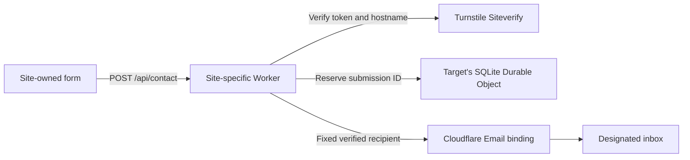
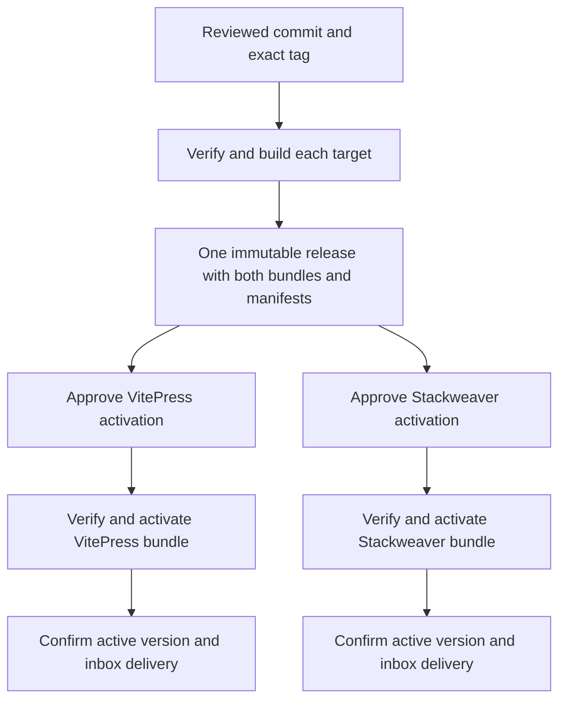

# Contact email with Cloudflare Workers

A public site can accept contact enquiries without adding an email endpoint to
its application backend. Each site owns its form and submits to a same-origin
edge route. The pilot, `vhco-contact`, shares one Worker codebase across
VH & Co's VitePress site and Stackweaver. Both targets have been exercised in
staging. [Pilot staging runbook](https://github.com/vhco-pro/vhco-contact/blob/main/docs/staging.md)

## Request path

The Worker checks the request origin, method and input. The browser's Turnstile
widget supplies a token and the Worker validates it before reserving a new
submission. The reservation prevents another send for the same ID and payload
within the retention window. The pilot stores keyed hashes for quota and
deduplication, along with submission state. [Turnstile server validation](https://developers.cloudflare.com/turnstile/get-started/server-side-validation/)

The Email binding restricts the destination. The Worker uses a verified sender
and puts the visitor's address in Reply-To. Add the sending service's SPF and
DKIM records while preserving any existing inbound MX records. A successful
send call confirms acceptance by the provider. Confirm inbox placement
separately. [Cloudflare Email bindings](https://developers.cloudflare.com/email-service/configuration/send-bindings/)

## Delivery path

Build the two target artifacts once per published version. A target's manifest
binds its Worker module to its source revision and build configuration. Each
activation selects an exact tag and one target, checks the artifact and records
the active and previous Worker versions. Keep deployment credentials in the
target's protected GitHub environment. Confirm that the other target's version
stays put. [GitHub deployment environments](https://docs.github.com/en/actions/reference/workflows-and-actions/deployments-and-environments)

Provision the Worker, route, secrets and Durable Object namespace separately
from activation. Rehearse activation and rollback for each target. A version
rollback restores code and configuration for that Worker. The Durable Object
state persists, so migrations need their own compatibility and recovery plan.
[Cloudflare Worker versions and deployments](https://developers.cloudflare.com/workers/versions-and-deployments/)

## Ownership

| Layer | Owns | Source |
| --- | --- | --- |
| Site | Form, validation feedback, Turnstile widget and submission handling | Each site repository |
| Contact Worker | Request contract, duplicate handling, email and per-target settings | [vhco-contact](https://github.com/vhco-pro/vhco-contact) |
| CI action | Tests, bundle smoke checks and target artifact manifest | [worker-ci-action](https://github.com/vhco-pro/worker-ci-action) |
| Release workflow | Verification, immutable publication and target selection | [worker-release-workflow](https://github.com/vhco-pro/worker-release-workflow) |
| Deploy action | Artifact verification, upload and activation readback | [worker-deploy-action](https://github.com/vhco-pro/worker-deploy-action) |
