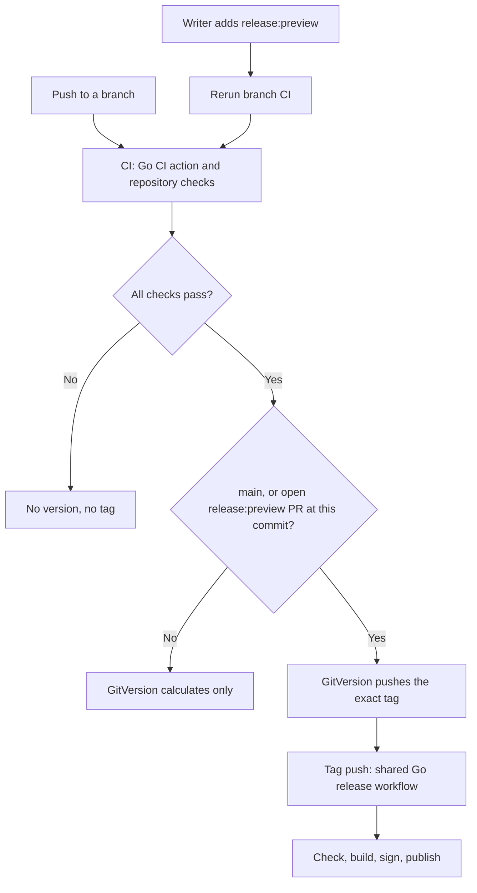
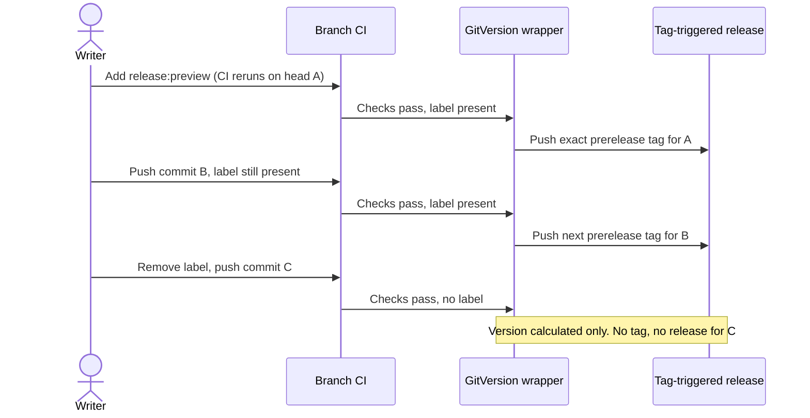

# Tag-driven Go releases

The pilot consumer is `michielvha/vh-adlc`. Shared workflows compose separate
actions, each owning one intent.

| Intent | Component |
| --- | --- |
| Check Go source | [go-ci-action](https://github.com/michielvha/go-ci-action) |
| Calculate a version and create its exact tag | [gitversion-tag-action](https://github.com/michielvha/gitversion-tag-action) |
| Build, sign, and publish Go artifacts | [goreleaser-action](https://github.com/michielvha/goreleaser-action), release-only next major |
| Checkout, authenticate, and order those actions | [Shared workflows](https://github.com/vhco-pro/.github) |

This design has passed the binary pilot, not an estate-wide rollout. Each
consumer still needs its own migration review and live verification.

The binary-only `michielvha/vh-adlc` pilot uses the merged shared components.
Its Version workflow automatically creates a new stable tag on main when
GitVersion selects a new version. Artifact publication remains a separate
tag-triggered run.

The [PR preview policy below](#proposed-pr-preview-policy) is the next rollout
change. Its diagrams describe the proposed behavior, not an already deployed
label trigger. The [live pilot](#current-live-pilot-flow) still uses manual
feature-branch dispatch until its workflows adopt this policy.

Container migration is a later round. `michielvha/chart-fetcher` first produces Go
binaries, then packages those `dist/` binaries into a multi-platform image through
the existing `michielvha/docker-release-action`. A later shared container workflow
can compose the primitives and define the artifact handoff; it is not part of the
binary canary.

Call the GitVersion action directly through `uses:`. Do not check out or invoke
its internal scripts. Shared workflows contain orchestration, not copies of CI
commands or another tagging or publication implementation.

## Proposed PR preview policy

Every consumer uses the same shape. Its own checks stay in its own CI.

| Intent | How the caller does it |
| --- | --- |
| CI only | Call `michielvha/go-ci-action` directly, plus repository-specific checks |
| Version and tag | After the checks, `needs:` a call to the shared GitVersion wrapper |
| Build, sign and publish | Exact tag push calls the shared Go release workflow |

The GitVersion wrapper authenticates, checks out the branch and calls
`michielvha/gitversion-tag-action`. GitVersion and its configuration decide the
version and push the tag. No workflow adds tagging scripts, version parsing or
a PR-derived counter.

### Run CI on the branch, not the PR

GitVersion reads the branch from the run's ref. A `pull_request` run has GitHub's
merge ref (`refs/pull/N/merge`) instead of the branch, so a version calculated
there is a `PullRequest` version rather than the feature branch's. Callers
therefore run CI on `push`. A PR shows those push checks on its head commit, so
no separate PR run is needed.

After all checks pass, a small release gate decides whether this run tags:

| Branch | Wrapper call |
| --- | --- |
| `main` | Tags the stable version when it is new |
| Feature branch with an open `release:preview` PR at this commit | Tags the prerelease version |
| Any other feature branch | `dry-run`: calculates the version only |

The gate is one `gh pr list --head <branch> --state open --label release:preview`
query. A writer adds the label once and every later push to that PR gets a
prerelease until the label is removed or the PR closes. Adding the label does
not push a commit, so a small `pull_request: labeled` workflow reruns CI on the
branch with `gh workflow run`. That run tags the current head.

Fork PRs do not run the push workflow and never receive tagging or signing
credentials. Removing the label stops future prereleases; it does not delete
existing tags or releases.

### PR-only CI for private repositories

Private repositories pay for runner minutes, so a caller can skip feature-push
CI. It runs CI on `pull_request` and on pushes to `main` only. Checks on a PR run
use the merge ref, so they never tag. For previews, the same small workflow
listens to `pull_request: [labeled, synchronize]` and, while the label is present,
reruns CI on the branch. Only labelled PRs pay for that second run.

### Packaging is tested by the tag workflow

CI does not run GoReleaser. The shared release workflow runs Go CI and the owned
GoReleaser action on every exact tag, and a labelled prerelease exercises the
whole path with the production signing identity. Keep failed-tag retries and
existing-asset protection as defined under [failure and retry](#failure-and-retry).

## Current live pilot flow

1. PR checks validate the code and calculate the feature branch's GitVersion
   version without publishing or creating a tag.
2. A push to `main` runs GitVersion to select the next stable version.
   An authorized manual run on a trusted feature branch can instead request
   its computed prerelease version.
3. Tag creation pushes only the exact semantic version for that source commit.
   No new tag means no new publication request. Floating major and minor aliases
   are not release inputs.
4. The exact tag push starts a thin caller of the shared Go release workflow.
   The publisher checks out the event's commit, validates the tag-to-commit
   mapping, and passes the exact event tag to GoReleaser. It must not rediscover
   a different tag from that commit. It does not run GitVersion.
5. `go-ci-action` runs formatting, module tidiness, vet, tests, build, and lint
   as blocking checks. PR CI calls the same action.
6. The release-only GoReleaser action provisions the release toolchain, imports
   the signing key with native GnuPG into a private temporary keyring, and calls
   the upstream GoReleaser action directly. Setup-go manages Go module/build
   caching; there is no separate GoReleaser binary cache or custom CLI launcher.
   In the shared job, Go CI owns cache restore/save; the release step reuses
   those populated caches without restoring them a second time.
   The tool pin is independent of GitVersion's application version. GoReleaser
   itself creates the draft, uploads artifacts, and publishes after successful
   upload. Its configuration marks prerelease tags as prereleases.

A branch event requests versioning. The exact tag authorizes artifact
publication. These are separate responsibilities even when both are automatic.
Checks on the tagged source may repeat PR checks; they verify the source actually
being released.

The Go CI action and shared Go release workflow are additive. The release-only
GoReleaser implementation is now on its default branch. Before that merge, all
ten inventoried consumers of its floating main ref were frozen to their original
commits, including the legacy v1 release action. That freeze was not a migration
to the new interface. Existing immutable refs and the v1 tag remain unchanged.
The notes-only shared release workflow remains a separate publisher.

A binary repository has one publisher; it must not run the notes-only publisher
alongside GoReleaser for the same release.

## Identity and source

Automated tag pushes use an approved, narrowly scoped GitHub App installation
token. A tag pushed with the ordinary `GITHUB_TOKEN` does not start another
tag-push workflow. Checkout or Git's credential helper must use the App identity
for the push; merely generating an App token is insufficient.

The personal account reuses one owner-wide App, `michielvha-repo-write`, rather
than registering an App for each consumer. It has Contents: write and Metadata:
read, no webhook events, and an all-repositories installation. Each trusted
tagging job narrows its short-lived token to `github.event.repository.name`
under `github.repository_owner`, and explicitly requests Contents: write.

Installation coverage is not the same as workflow access to the key. Configure
`RELEASE_APP_CLIENT_ID` and `RELEASE_APP_PRIVATE_KEY` only in repositories as
they adopt the flow. A user account has no account-wide Actions secret store;
the pilot uses repository-level configuration. Do not put the key in source or
pass it to PR preview jobs. The App key can mint tokens throughout its
installation even though each normal job requests a single-repository token.
Treat that key as an owner-wide credential.

PR version calculation uses the GitVersion action with `dry-run: true` and gets
no tagging or signing credentials. A published PR preview is requested through
an authorized manual run on its trusted feature branch with dry-run disabled,
not through a privileged `pull_request` job. A manual run on `main` selects a
stable version instead. Fork PRs receive validation only. Feature names do not
supply a second version counter: use GitVersion's actual prerelease output.

Pin actions and reusable workflows to full commit SHAs. The Go workflow needs no
helper checkout or second `workflow-ref` pin. The application tag identifies
source; the workflow and action pins identify the build implementation.

## Failure and retry

An exact tag can exist before its artifact is ready. GitHub Releases, rather
than the existence of a source tag, indicate completed binary publication in
this pilot.

| State | Recovery |
| --- | --- |
| Checks or build fail before a release exists | Re-run the original tag workflow at the same source commit |
| A partial draft exists | Inspect it before retrying; preserve uploaded artifacts and do not delete or replace the draft automatically |
| A public release exists | Do not overwrite its assets; collisions must fail |
| The source needs a fix | Commit the fix and release a new exact version |

The shared workflow serializes runs per exact tag. GoReleaser owns release API
operations and upload failure handling. Configure `replace_existing_artifacts`
and `replace_existing_draft` as false, and `use_existing_draft` as true. An
existing asset collision fails rather than replacing its content. These are
native GoReleaser controls, not custom recovery scripts.

A tag event is not automatically repeated by a later branch push. Re-running a
failed workflow preserves its original source ref and commit.

Do not require a new tag to be created on every retry: the original exact tag is
the release identity. Recovery must still protect any content already published.
The pilot does not automate deletion, asset replacement, or partial-release
recovery.

## Prerelease retention

No automatic deletion is part of the pilot. Agree retention separately before
enabling cleanup. Distinguish source tags, GitHub Releases, stored artifacts, and
deployed references. Cleanup must preserve anything still consumed and must not
remove stable releases or move tags.

## Component types

For a binary or image, a source tag may precede artifact readiness. For a
GitHub action or reusable workflow, the tag itself is already consumable through
`uses:`. Essential component tests must pass before creating that tag; post-tag
checks do not prevent consumers from using it.

## Pilot verification (2026-10-20)

The [consumer activation](https://github.com/michielvha/vh-adlc/pull/6) passed
Go CI and the existing Linux/macOS plugin checks. The
[main-branch Version run](https://github.com/michielvha/vh-adlc/actions/runs/39445345539)
used the App identity to create GitVersion's exact `v0.2.0` tag at commit
`2f77c2d4f393e5a3bec52b872dd18c672299f138`.

That push started a separate
[tag-only release run](https://github.com/michielvha/vh-adlc/actions/runs/39445397839).
Blocking Go CI, native GPG signing, and GoReleaser publication all succeeded.
The [published stable release](https://github.com/michielvha/vh-adlc/releases/tag/v0.2.0)
contains four Linux/macOS amd64/arm64 archives, the checksum manifest, and its
detached signature. All four downloaded archives passed checksum verification;
the signature verified against the consumer's committed release public key.
The downloaded macOS arm64 binary reported `vh-adlc 0.2.0`.

The first run also exposed a duplicate setup-go cache restore: the release
action tried to overwrite read-only modules already restored by CI. Publication
succeeded, but the tar extraction errors warranted a composition fix rather
than being treated as a clean run. The release action retains caching by default
for standalone callers; the shared workflow disables only its duplicate
restore/save through `go-cache: 'false'`.

The [release-action fix](https://github.com/michielvha/goreleaser-action/pull/13)
and [shared composition](https://github.com/vhco-pro/.github/pull/20) passed their
checks and were merged. Before merging the
[pilot pin update](https://github.com/michielvha/vh-adlc/pull/14), a trusted manual
branch run used GitVersion to create `v0.2.0-ci-single-go-cache.1` at
`67cc38bce7628e90266171478e064ceb3a1d64e0`. Its
[tag-triggered publication](https://github.com/michielvha/vh-adlc/actions/runs/39446871759)
succeeded with no cache extraction failures, and GitHub correctly marked the
[release as a prerelease](https://github.com/michielvha/vh-adlc/releases/tag/v0.2.0-ci-single-go-cache.1).
The downloaded signature, all four archive checksums, and the macOS arm64
binary's exact prerelease version also verified. Stable latest remained `v0.2.0`.
The verified pin update was then merged.

Both tag-triggered runs identify `michielvha-repo-write[bot]` as their actor.
A separate
[main-branch versioning retry](https://github.com/michielvha/vh-adlc/actions/runs/39446313064)
found `v0.2.0` already on the remote and skipped tagging. It did not request a
second publication or overwrite the release.

## Container migration boundary

The current
[chart-fetcher Dockerfile](https://github.com/michielvha/chart-fetcher/blob/e884bbe879c2d4dcd211b8be170a6e53f5625c85/Dockerfile)
copies Linux binaries from GoReleaser's architecture-specific `dist/`
directories into its image. Its existing workflow builds binaries and images in
one job, so those files are local. Calling the Go reusable workflow from one job
does not make its `dist/` tree available to a later Docker job: a split-job design
needs an explicit, verified artifact handoff.

Before migrating that consumer, review the selected
[owned Docker action](https://github.com/michielvha/docker-release-action/blob/c499e52a1a05e5bdd8cf03ba19a423d4c7ec25e3/action.yaml).
Its default mode publishes the requested version, `latest`, and the commit tag;
it does not distinguish stable from prerelease versions for that promotion.
It also has tagged rather than SHA-pinned nested action references. The caller
freeze did not rewrite this pinned action's implementation.

The container round therefore needs reviewed nested pins, a stable/prerelease
promotion policy, and a decision about keeping the build in one job or passing
verified binaries between jobs. Preserve the existing native matrix and
digest-based signing/attestation options when changing shared interfaces. Keep
container publication separate from GitVersion's version decision, and do not
add another GitHub Release owner alongside GoReleaser. No container consumer
was migrated by the binary pilot.

## Related

- [Dated migration dependency report](../reports/2026-10-19-go-delivery-dependencies.md)
- [Delivery conventions](../conventions/delivery.md)
- [Shared delivery components](shared-delivery.md)
