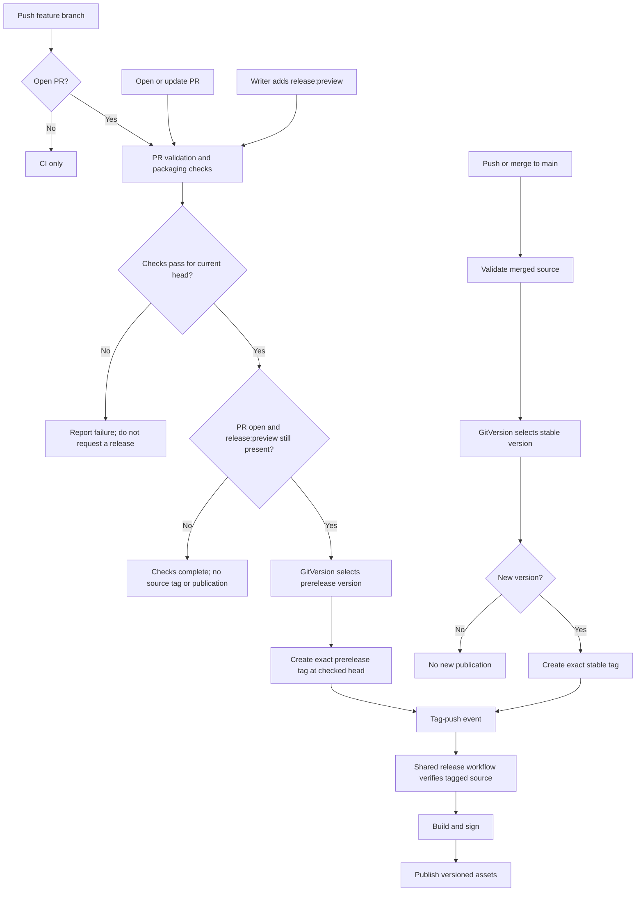
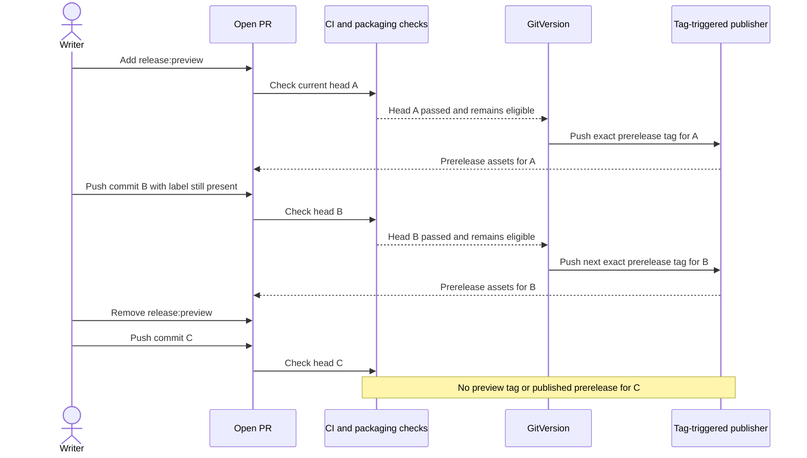

# Tag-driven Go releases

The pilot consumer is `michielvha/vh-adlc`. Shared workflows compose separate
actions, each owning one intent.

| Intent | Component |
| --- | --- |
| Check Go source | [go-ci-action](https://github.com/michielvha/go-ci-action) |
| Calculate a version and create its exact tag | [gitversion-tag-action](https://github.com/michielvha/gitversion-tag-action) |
| Build, sign, and publish Go artifacts | [goreleaser-action](https://github.com/michielvha/goreleaser-action), release-only next major |
| Checkout, authenticate, and order those actions | [Shared workflows](https://github.com/vhco-pro/.github) |

This design has passed the binary pilot, not an estate-wide rollout. Each
consumer still needs its own migration review and live verification.

The binary-only `michielvha/vh-adlc` pilot uses the merged shared components.
Its Version workflow automatically creates a new stable tag on main when
GitVersion selects a new version. Artifact publication remains a separate
tag-triggered run.

The [PR preview policy below](#proposed-pr-preview-policy) is the next rollout
change. Its diagrams describe the proposed behavior, not an already deployed
label trigger. The [live pilot](#current-live-pilot-flow) still uses manual
feature-branch dispatch until its workflows adopt this policy.

Container migration is a later round. `michielvha/chart-fetcher` first produces Go
binaries, then packages those `dist/` binaries into a multi-platform image through
the existing `michielvha/docker-release-action`. A later shared container workflow
can compose the primitives and define the artifact handoff; it is not part of the
binary canary.

Call the GitVersion action directly through `uses:`. Do not check out or invoke
its internal scripts. Shared workflows contain orchestration, not copies of CI
commands or another tagging or publication implementation.

## Proposed PR preview policy

Use the same event policy in each consuming repository. Keep its additional
checks and packaging requirements: a shared Go check does not replace a
provider's acceptance tests or an application's no-network tests.

The native GitHub label `release:preview` enables automatic prereleases for an
open PR. A repository writer adds it once. It stays on the PR until someone
removes it; each subsequent eligible head revision requests a new prerelease.
Opening a PR or pushing a feature branch without that label never requests a
published preview.

No new App, service, custom action, command bot, or per-commit approval is needed.
Use the existing GitVersion action, CI action, release action and shared
workflows. Caller workflows supply GitHub events and repository-specific checks;
shared workflows compose the common behavior.

### Events and outputs

| Event or state | Validation and packaging | Published output |
| --- | --- | --- |
| Feature push with no open PR | CI for the pushed commit | None |
| PR opened or updated without `release:preview` | PR checks and non-publishing packaging checks | None |
| Writer adds `release:preview` to an open PR | Validate the current head and test packaging | Request its exact prerelease tag after checks pass |
| New commit on an open PR with `release:preview` | Validate the new head and test packaging | Automatically request its next GitVersion prerelease tag after checks pass |
| Label removed or PR closed | Stop future preview requests | No new prerelease; keep existing tags and artifacts |
| Main updated | Validate the merged source, then calculate its stable version | Request an exact stable tag only when GitVersion selects a new version |
| Exact stable or prerelease tag pushed | Validate the tagged source, build and sign | Publish through the shared tag-triggered release workflow |

Adding the label to an existing PR requests a preview of its current head;
another push is not required. Removing it does not undo a tag already created
or stop a publication that has already been authorized by that tag.

### Delivery diagram

Branch/PR event routing should avoid running equivalent validation twice for
the same source. A PR merge-result check, a main integration check and a check
of the exact tagged commit can have different purposes. Preserve required
checks rather than suppressing them solely because their commands look alike.

### The label stays enabled across pushes

The publisher remains tag-driven in every case. The label and main-branch
policy decide whether to request a source tag; neither publishes directly.
GitVersion supplies the actual versions. Do not add a separate label, PR, or
run counter to invent version numbers.

### Writer access and source identity

Repository roles `write`, `maintain` and `admin` may enable previews. Triage
access alone is insufficient, even though GitHub can allow triagers to apply
labels. A label is an opt-in signal; the workflow must also establish that a
writer enabled it before using the release identity.

The opt-in covers subsequent commits on that same open PR until removed.
There is no requirement to copy a SHA, request another approval, or remove and
re-add the label on each push. The implementation records the source SHA
internally for checks and tagging.

Initially, published previews are limited to branches in the same repository.
Fork PRs receive unprivileged validation and packaging checks. Do not use a
privileged PR event to execute untrusted source with tagging or signing keys.

Each request targets the captured PR head commit, not a later branch tip or
GitHub's temporary PR merge commit. Before tagging, confirm the PR remains open,
label-enabled and at that head. If a newer push arrives, discard the stale
request and let the new revision's checks produce the next preview. Serialize
requests per PR so competing events cannot tag different revisions under one
version.

PR merge-result tests may complement source checks, but they do not prove that
the exact feature commit passed. Main and publication checks retain their own
source identities. A failed check does not create a preview request.

### Packaging tests do not require source tags

Exercise GoReleaser configuration and snapshot packaging without creating a
remote tag or GitHub Release. These checks must not receive the production App
key or artifact-signing key. An isolated signing fixture can test signing where
needed.

Temporary workflow artifacts may make a successful build downloadable without
publishing a version. They are CI outputs, not prereleases. Published previews
use the normal exact-tag path and production signing identity.

Snapshot checks cannot establish real tag-event delivery, production permissions
or publication behavior. A controlled, label-enabled prerelease verifies those
boundaries. Keep failed-tag retries and existing-asset protection as defined
under [failure and retry](#failure-and-retry).

### Adoption boundary

This policy is a change to the existing manual-branch pilot. Once a consumer
adopts it, a manual feature request must obey the same open-PR and label rules;
it must not provide an unlabeled branch-publication bypass.

Roll out the shared behavior and pilot caller through review-only PRs before
migrating other consumers one at a time. The docs alone do not enable labels,
modify repository permissions, create tags or publish artifacts. Container
promotion and prerelease retention remain separate follow-ups.

## Current live pilot flow

1. PR checks validate the code and calculate the feature branch's GitVersion
   version without publishing or creating a tag.
2. A push to `main` runs GitVersion to select the next stable version.
   An authorized manual run on a trusted feature branch can instead request
   its computed prerelease version.
3. Tag creation pushes only the exact semantic version for that source commit.
   No new tag means no new publication request. Floating major and minor aliases
   are not release inputs.
4. The exact tag push starts a thin caller of the shared Go release workflow.
   The publisher checks out the event's commit, validates the tag-to-commit
   mapping, and passes the exact event tag to GoReleaser. It must not rediscover
   a different tag from that commit. It does not run GitVersion.
5. `go-ci-action` runs formatting, module tidiness, vet, tests, build, and lint
   as blocking checks. PR CI calls the same action.
6. The release-only GoReleaser action provisions the release toolchain, imports
   the signing key with native GnuPG into a private temporary keyring, and calls
   the upstream GoReleaser action directly. Setup-go manages Go module/build
   caching; there is no separate GoReleaser binary cache or custom CLI launcher.
   In the shared job, Go CI owns cache restore/save; the release step reuses
   those populated caches without restoring them a second time.
   The tool pin is independent of GitVersion's application version. GoReleaser
   itself creates the draft, uploads artifacts, and publishes after successful
   upload. Its configuration marks prerelease tags as prereleases.

A branch event requests versioning. The exact tag authorizes artifact
publication. These are separate responsibilities even when both are automatic.
Checks on the tagged source may repeat PR checks; they verify the source actually
being released.

The Go CI action and shared Go release workflow are additive. The release-only
GoReleaser implementation is now on its default branch. Before that merge, all
ten inventoried consumers of its floating main ref were frozen to their original
commits, including the legacy v1 release action. That freeze was not a migration
to the new interface. Existing immutable refs and the v1 tag remain unchanged.
The notes-only shared release workflow remains a separate publisher.

A binary repository has one publisher; it must not run the notes-only publisher
alongside GoReleaser for the same release.

## Identity and source

Automated tag pushes use an approved, narrowly scoped GitHub App installation
token. A tag pushed with the ordinary `GITHUB_TOKEN` does not start another
tag-push workflow. Checkout or Git's credential helper must use the App identity
for the push; merely generating an App token is insufficient.

The personal account reuses one owner-wide App, `michielvha-repo-write`, rather
than registering an App for each consumer. It has Contents: write and Metadata:
read, no webhook events, and an all-repositories installation. Each trusted
tagging job narrows its short-lived token to `github.event.repository.name`
under `github.repository_owner`, and explicitly requests Contents: write.

Installation coverage is not the same as workflow access to the key. Configure
`RELEASE_APP_CLIENT_ID` and `RELEASE_APP_PRIVATE_KEY` only in repositories as
they adopt the flow. A user account has no account-wide Actions secret store;
the pilot uses repository-level configuration. Do not put the key in source or
pass it to PR preview jobs. The App key can mint tokens throughout its
installation even though each normal job requests a single-repository token.
Treat that key as an owner-wide credential.

PR version calculation uses the GitVersion action with `dry-run: true` and gets
no tagging or signing credentials. A published PR preview is requested through
an authorized manual run on its trusted feature branch with dry-run disabled,
not through a privileged `pull_request` job. A manual run on `main` selects a
stable version instead. Fork PRs receive validation only. Feature names do not
supply a second version counter: use GitVersion's actual prerelease output.

Pin actions and reusable workflows to full commit SHAs. The Go workflow needs no
helper checkout or second `workflow-ref` pin. The application tag identifies
source; the workflow and action pins identify the build implementation.

## Failure and retry

An exact tag can exist before its artifact is ready. GitHub Releases, rather
than the existence of a source tag, indicate completed binary publication in
this pilot.

| State | Recovery |
| --- | --- |
| Checks or build fail before a release exists | Re-run the original tag workflow at the same source commit |
| A partial draft exists | Inspect it before retrying; preserve uploaded artifacts and do not delete or replace the draft automatically |
| A public release exists | Do not overwrite its assets; collisions must fail |
| The source needs a fix | Commit the fix and release a new exact version |

The shared workflow serializes runs per exact tag. GoReleaser owns release API
operations and upload failure handling. Configure `replace_existing_artifacts`
and `replace_existing_draft` as false, and `use_existing_draft` as true. An
existing asset collision fails rather than replacing its content. These are
native GoReleaser controls, not custom recovery scripts.

A tag event is not automatically repeated by a later branch push. Re-running a
failed workflow preserves its original source ref and commit.

Do not require a new tag to be created on every retry: the original exact tag is
the release identity. Recovery must still protect any content already published.
The pilot does not automate deletion, asset replacement, or partial-release
recovery.

## Prerelease retention

No automatic deletion is part of the pilot. Agree retention separately before
enabling cleanup. Distinguish source tags, GitHub Releases, stored artifacts, and
deployed references. Cleanup must preserve anything still consumed and must not
remove stable releases or move tags.

## Component types

For a binary or image, a source tag may precede artifact readiness. For a
GitHub action or reusable workflow, the tag itself is already consumable through
`uses:`. Essential component tests must pass before creating that tag; post-tag
checks do not prevent consumers from using it.

## Pilot verification (2026-10-20)

The [consumer activation](https://github.com/michielvha/vh-adlc/pull/6) passed
Go CI and the existing Linux/macOS plugin checks. The
[main-branch Version run](https://github.com/michielvha/vh-adlc/actions/runs/39445345539)
used the App identity to create GitVersion's exact `v0.2.0` tag at commit
`2f77c2d4f393e5a3bec52b872dd18c672299f138`.

That push started a separate
[tag-only release run](https://github.com/michielvha/vh-adlc/actions/runs/39445397839).
Blocking Go CI, native GPG signing, and GoReleaser publication all succeeded.
The [published stable release](https://github.com/michielvha/vh-adlc/releases/tag/v0.2.0)
contains four Linux/macOS amd64/arm64 archives, the checksum manifest, and its
detached signature. All four downloaded archives passed checksum verification;
the signature verified against the consumer's committed release public key.
The downloaded macOS arm64 binary reported `vh-adlc 0.2.0`.

The first run also exposed a duplicate setup-go cache restore: the release
action tried to overwrite read-only modules already restored by CI. Publication
succeeded, but the tar extraction errors warranted a composition fix rather
than being treated as a clean run. The release action retains caching by default
for standalone callers; the shared workflow disables only its duplicate
restore/save through `go-cache: 'false'`.

The [release-action fix](https://github.com/michielvha/goreleaser-action/pull/13)
and [shared composition](https://github.com/vhco-pro/.github/pull/20) passed their
checks and were merged. Before merging the
[pilot pin update](https://github.com/michielvha/vh-adlc/pull/14), a trusted manual
branch run used GitVersion to create `v0.2.0-ci-single-go-cache.1` at
`67cc38bce7628e90266171478e064ceb3a1d64e0`. Its
[tag-triggered publication](https://github.com/michielvha/vh-adlc/actions/runs/39446871759)
succeeded with no cache extraction failures, and GitHub correctly marked the
[release as a prerelease](https://github.com/michielvha/vh-adlc/releases/tag/v0.2.0-ci-single-go-cache.1).
The downloaded signature, all four archive checksums, and the macOS arm64
binary's exact prerelease version also verified. Stable latest remained `v0.2.0`.
The verified pin update was then merged.

Both tag-triggered runs identify `michielvha-repo-write[bot]` as their actor.
A separate
[main-branch versioning retry](https://github.com/michielvha/vh-adlc/actions/runs/39446313064)
found `v0.2.0` already on the remote and skipped tagging. It did not request a
second publication or overwrite the release.

## Container migration boundary

The current
[chart-fetcher Dockerfile](https://github.com/michielvha/chart-fetcher/blob/e884bbe879c2d4dcd211b8be170a6e53f5625c85/Dockerfile)
copies Linux binaries from GoReleaser's architecture-specific `dist/`
directories into its image. Its existing workflow builds binaries and images in
one job, so those files are local. Calling the Go reusable workflow from one job
does not make its `dist/` tree available to a later Docker job: a split-job design
needs an explicit, verified artifact handoff.

Before migrating that consumer, review the selected
[owned Docker action](https://github.com/michielvha/docker-release-action/blob/c499e52a1a05e5bdd8cf03ba19a423d4c7ec25e3/action.yaml).
Its default mode publishes the requested version, `latest`, and the commit tag;
it does not distinguish stable from prerelease versions for that promotion.
It also has tagged rather than SHA-pinned nested action references. The caller
freeze did not rewrite this pinned action's implementation.

The container round therefore needs reviewed nested pins, a stable/prerelease
promotion policy, and a decision about keeping the build in one job or passing
verified binaries between jobs. Preserve the existing native matrix and
digest-based signing/attestation options when changing shared interfaces. Keep
container publication separate from GitVersion's version decision, and do not
add another GitHub Release owner alongside GoReleaser. No container consumer
was migrated by the binary pilot.

## Related

- [Dated migration dependency report](../reports/2026-10-19-go-delivery-dependencies.md)
- [Delivery conventions](../conventions/delivery.md)
- [Shared delivery components](shared-delivery.md)
