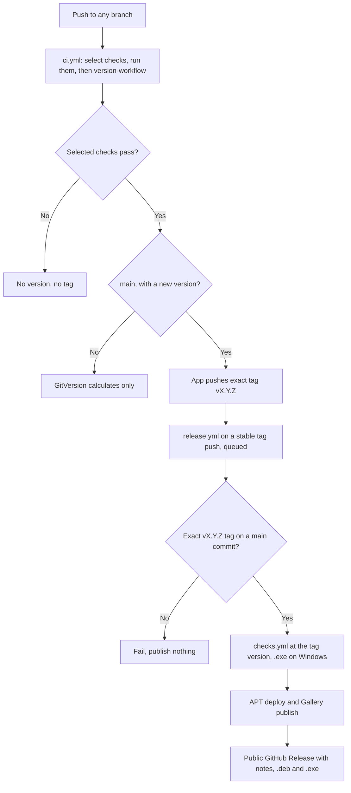

# Tag-driven PowerShell releases

PowerShell repositories release the way [Go repositories](tag-driven-go-releases.md) do, in the
separate-workflows arrangement: every branch push runs the checks its changes need, `version-workflow`
tags `main` after they pass, and the App's tag push starts a release workflow that runs every check and
publishes only that exact tag. The
consumer is [michielvha/PDS](https://github.com/michielvha/PDS).

## One shape for every language

Every repository that publishes artifacts from a tag follows this shape, whatever its language: a
language CI action on branch pushes, `version-workflow` to tag `main`, and a tag-triggered release
workflow that publishes. Actions and reusable workflows, whose tag is itself the release, release
through [gh-release-workflow](https://github.com/vhco-pro/gh-release-workflow) instead. A new language
starts from these two statements and its own CI action.

| Intent | Component |
| --- | --- |
| Install a pinned PowerShell | [setup-pwsh-action](https://github.com/vhco-pro/setup-pwsh-action) |
| Check PowerShell source: formatting, PSScriptAnalyzer, module load, Pester | [pwsh-ci-action](https://github.com/vhco-pro/pwsh-ci-action) |
| Decide when to tag, then tag | [version-workflow](https://github.com/vhco-pro/version-workflow) with [gitversion-tag-action](https://github.com/michielvha/gitversion-tag-action) |
| Publish a module to the PowerShell Gallery for an exact tag | [publish-pwsh-module-action](https://github.com/michielvha/publish-pwsh-module-action), release-only since v3 |
| Package a script as `<name>-<version>.exe` for an exact tag | [package-pwsh-script-action](https://github.com/michielvha/package-pwsh-script-action), release-only since v2 |
| Create the GitHub Release with notes and files | [gh-release-action](https://github.com/vhco-pro/gh-release-action), `files` input since v0.2.0 |

There is no reusable PowerShell release workflow yet: PDS is the only repository that publishes a
module, so its `release.yml` composes the actions.
[vhco-pro/docs#50](https://github.com/vhco-pro/docs/issues/50) tracks extracting one when a second
module repository appears.

## Flow

PDS's workflows are the reference:

- [`checks.yml`](https://github.com/michielvha/PDS/blob/main/.github/workflows/checks.yml) holds every
  check once: actionlint, ShellCheck, the package build and install tests, and `pwsh-ci-action` on
  Windows. It takes a `version` input and three group inputs (`package`, `powershell`, `workflows`, each
  `'true'` by default), receives no secrets and computes no version.
- [`ci.yml`](https://github.com/michielvha/PDS/blob/main/.github/workflows/ci.yml) runs on every branch
  push. A selection job runs [`scripts/detect-changes.sh`](https://github.com/michielvha/PDS/blob/main/scripts/detect-changes.sh),
  which judges a branch on its whole diff from `main` and `main` on everything since the latest stable
  tag with a published Release, counting both sides of every rename. Each changed file takes the first
  rule that matches, with directories counted from the repository root:
  1. Markdown anywhere selects nothing.
  2. A file under `.github/` selects every check, actionlint included.
  3. A file under `scripts/` selects ShellCheck, the package jobs and `pwsh-ci-action`.
  4. A PowerShell file anywhere else, or another file under `pwsh/`, selects `pwsh-ci-action`.
  5. A file under `packaging/`, `bash/` or `tests/` selects ShellCheck and the package jobs.
  6. Any other path selects nothing.

  A dispatch, `main` without a released stable tag, or a base it cannot resolve runs every check. Then
  `ci.yml` calls `checks.yml` with that selection and `version-workflow` with `preview-label: ''`, so
  only `main` is tagged. This follows the [GitHub Actions](../conventions/github-actions.md) rule to run
  only the checks a change needs.
- [`release.yml`](https://github.com/michielvha/PDS/blob/main/.github/workflows/release.yml) runs on
  stable tags (`v[0-9]+.[0-9]+.[0-9]+`) and on dispatch. Its first job refuses anything but an exact
  stable tag on a `main` commit, because a dispatch ignores the tag filter. Then `checks.yml` runs again
  at the tag's version, the publishing jobs need it, and the Release job attaches the files those checks
  built. Runs share one group with `queue: max`, so no waiting tag is cancelled.

Only the publishing jobs receive secrets: the Gallery key goes to the Gallery job, the signing key to
the APT job, and no workflow uses `secrets: inherit`.

## Prereleases

The release-only actions refuse prerelease tags, so a PowerShell repository releases stable versions
only and calls `version-workflow` with `preview-label: ''`.
[michielvha/publish-pwsh-module-action#7](https://github.com/michielvha/publish-pwsh-module-action/issues/7)
tracks prerelease support, with the Gallery's version ordering and collision rules.

## Failure and retry

Every publishing step is safe to repeat. The Gallery job skips a version that is already published,
the APT job rebuilds its index from the published Releases (adding the run's `.deb` only while the tag
has no Release), and `gh-release-action` leaves a Release that already holds the same file names alone.
Rerun a failed job with `gh run rerun <run-id> --failed` within GitHub's 30-day limit; once the
Release exists, rerun the APT job too, so its index includes the new Release. After 30 days, dispatch
`release.yml` with `--ref v<version>`. A defect in the tag's own workflows is fixed forward on `main`
with a version-bumping commit.

## Related

- [Shared delivery components](shared-delivery.md)
- [GitHub Actions](../conventions/github-actions.md), including the actionlint ignore for `queue`
- [Delivery](../conventions/delivery.md)
